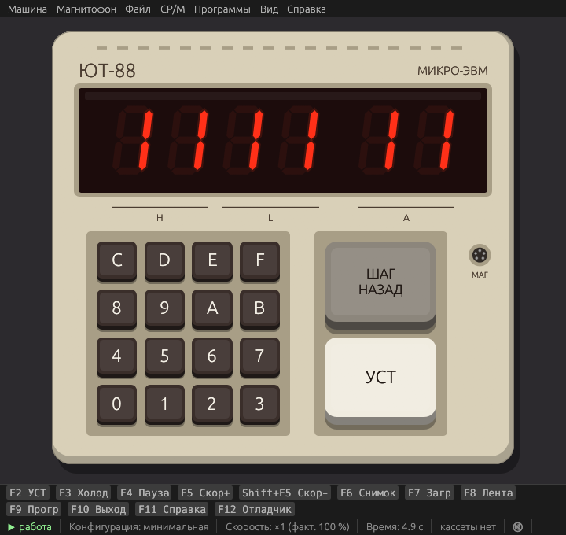
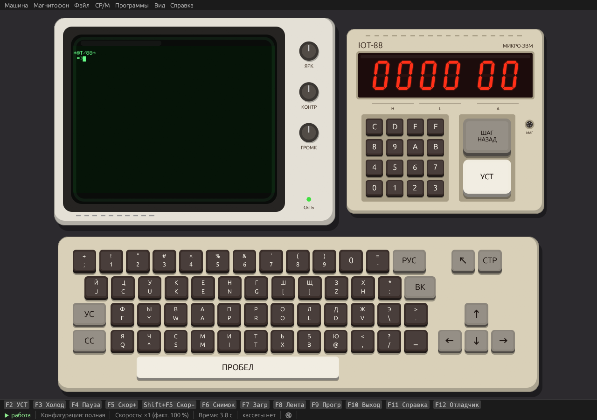

# UT-88 emulator

[](https://github.com/pompei-kz/ut-88/actions/workflows/ci.yml)
[](#license)

An emulator of the **UT-88** («ЮТ-88»), a Soviet do-it-yourself home computer published
part by part in 1989–1990 by the magazine «ЮТ для умелых рук» (a supplement to
«Юный техник», *Young Technician*). The computer is built around the **КР580ВМ80А**
CPU, the Soviet clone of the **Intel 8080**, and is modular: a processor module with a
six-digit LED display and a 16-key hex keypad, a display module (64×28 text screen and a
full keyboard), 64 KB RAM, a RAM disk (the "quasi-disk", «квазидиск») and CP/M.

The emulator runs the original ROMs and programs typed in from the magazine pages, in a
window (egui) or in a terminal (ratatui).

| Processor module (`make base`)                  | Full configuration (`make full`)         |
|-------------------------------------------------|------------------------------------------|
|  |    |
| **Tetris** (`make tetris`)                      | **CP/M 2.2** (`make cpm`)                |
|                   |  |

## Requirements

- **Rust toolchain with `cargo`** (Rust 1.89 or newer). Install it with
  [rustup](https://rustup.rs) — see also the official guide
  <https://www.rust-lang.org/tools/install>:

  ```sh
  curl --proto '=https' --tlsv1.2 -sSf https://sh.rustup.rs | sh
  ```

- **GNU make** (the commands below are `make` targets; each one is a thin wrapper around
  `cargo` and `target/release/ut88`).
- **Linux system libraries** for the window and sound: a C toolchain, `pkg-config` and
  the ALSA development package are needed to build; X11 or Wayland, OpenGL and
  xkbcommon are loaded at run time (any desktop has them). File dialogs use
  `xdg-desktop-portal`. On Debian / Ubuntu:

  ```sh
  sudo apt install build-essential pkg-config libasound2-dev \
      libx11-6 libxcursor1 libxrandr2 libxi6 libxkbcommon-x11-0 libgl1 libwayland-client0
  ```

The terminal interface (`-t` targets) needs no graphics at all, only a terminal of at
least 80×32 characters.

## Quick start — make commands

Clone the repository and run any command from its root. The first run builds the
emulator (`cargo build --release`), which takes a few minutes.

```sh
git clone https://github.com/pompei-kz/ut-88.git
cd ut-88
make base
```

| Command                   | What it does                                                                               |
|---------------------------|--------------------------------------------------------------------------------------------|
| `make` / `make compile`   | build the binaries (`target/release/ut88`)                                                 |
| `make help`               | list all commands                                                                          |
| `make base`               | basic computer: processor module (module 1) with LED display and keypad                    |
| `make full`               | full computer: display module, MONITOR-F, 64 KB RAM                                        |
| `make tetris`             | the Tetris game from the magazine (full configuration)                                     |
| `make cpm`                | CP/M 2.2 on a 256 KB RAM disk; the disk is saved to `ut88-disk.img`                        |
| `make os`                 | the "UT-88 OS" (monitor, editor, assembler, debugger) from the magazine                    |
| `make prog P=NAME`        | a program from `programs/`, e.g. `make prog P=gamma`                                       |
| `make programs`           | list the programs in `programs/`                                                           |
| `make asm F=FILE.asm`     | assemble a program (КР580ВМ80А assembly) into `FILE.hex`; `O=` sets the output             |
| `make asm-run F=FILE.asm` | assemble and run it in the emulator (`C=minimal\|full` sets the configuration)             |
| `make link O=OUT.hex M=…` | link object modules, e.g. `M="a.link b.link"` (`B=` sets the load address)                 |
| `make asm-examples`       | build all examples from `examples/asm/`                                                    |
| `make …-t`                | the same in the terminal: `base-t`, `full-t`, `tetris-t`, `cpm-t`, `os-t`, `prog-t P=NAME` |
| `make test`               | run the tests                                                                              |
| `make test-all`           | all tests, including the long ones (8080 exerciser, Tetris)                                |
| `make lint`               | `cargo clippy` and `cargo fmt --check`                                                     |
| `make fmt`                | format the code                                                                            |
| `make clean`              | remove build results                                                                       |

What happens after each command and what to do next is described below. In every
window the hot keys are the same: **F2** is the RESET button («УСТ»), **F11** shows the
key help, **F10** quits (see [Hot keys](#hot-keys-and-the-button-bar)).

### `make base` — the processor module and its MONITOR

A window with the processor module opens: six red seven-segment LEDs and a 4×4 keypad
with two big buttons, **STEP BACK** («ШАГ НАЗАД») and **RESET** («УСТ»). The four left
digits (labelled H and L) show the register pair **HL** — usually an address; the two
right digits (A) show the accumulator **A** — usually a data byte.

The rightmost LEDs show **«11»**: the MONITOR ROM is waiting for a directive. A
directive is a single key; its parameters are then typed as hex digits — four for an
address, two for a byte. PC keys:

| PC key           | UT-88 button            |
|------------------|-------------------------|
| `0`–`9`, `A`–`F` | `0`–`F`                 |
| Backspace        | STEP BACK («ШАГ НАЗАД») |
| F2               | RESET («УСТ»)           |

You can also click the drawn buttons with the mouse.

The simple MONITOR directives:

|    Key    | Parameters | What it does                                                                        |
|:---------:|------------|-------------------------------------------------------------------------------------|
|     1     | —          | write bytes to RAM starting at C000H                                                |
|     0     | ADDR       | write bytes to RAM starting at ADDR                                                 |
|     2     | —          | view RAM from C000H: every key press shows the next cell (address on HL, byte on A) |
|     5     | ADDR       | view RAM from ADDR, the same way                                                    |
|     6     | —          | run the program at C000H                                                            |
|     7     | ADDR       | run the program at ADDR                                                             |
| STEP BACK | —          | while writing or viewing: go back one cell and type its byte again                  |
|   RESET   | —          | leave any directive or program; «11» appears again                                  |

When writing (directives 1 and 0) you type the two digits of a byte; about a second
later the MONITOR moves to the next cell by itself (HL increments, A shows 00). The
other directives (checksum, tape, clock, RAM test, helper routines) are listed in the
[manual](docs/MANUAL.md) (section 5).

**Example: light «11» on all six LEDs.** This is the first program from the magazine
(doc/05): `MVI A,11H; STA 9000H; LXI H,9001H; MOV M,A; LXI D,9002H; STAX D` plus
`RST 0` (`C7`) to return to the MONITOR. The LEDs are memory cells 9000H–9002H.

1. Press **1** — HL shows `C000`, A shows `00`.
2. Type the bytes, two digits each, waiting until the address on HL changes after each
   byte: `3E 11 32 00 90 21 01 90 77 11 02 90 12 C7`. A typo — press Backspace
   (STEP BACK) and type the byte again.
3. Press **F2** (RESET) — «11» again.
4. Check: press **2**, then any key repeatedly — HL shows `C000`, `C001`, … and A shows
   `3E`, `11`, `32`, … Press **F2** to stop.
5. Run: press **6**. All six LEDs show **`11 11 11`** (the screenshot above).

#### Programs from the magazine

The programs in [`programs/`](programs/README.md) were typed in from the magazine pages
(the list: `make programs`). `make prog P=NAME` loads one and starts it immediately, so
you do not need to type it in.

**«Гамма» (the musical scale)** — `make prog P=gamma`. The program waits for four hex
digits on the keypad: two for the note length and two for the pause between notes
(01–FF), for example `4010`. Right after the fourth digit a scale of eight notes plays
in a loop through the PC speaker (the computer's tape output). Stop it with **F2**.
Sound works in the window only.

**«Крестики-нолики» (tic-tac-toe)** — `make prog P=tic-tac-toe`. The cells are numbered

```
01  02  03
08  09  04
07  06  05
```

The computer always moves first, into the centre: the right LEDs show `09`. Make your
move by typing the cell number as **two digits** (`0` `1` … `0` `8`; after one digit
nothing happens). The computer's reply appears on the right LEDs. If you lose, the code
**73** appears (the program halts; press F2); a draw shows **11** (back to the MONITOR).

Others: `fill-const`, `reaction`, `labyrinth` — see the [manual](docs/MANUAL.md)
(section 10).

### `make full` — the display module and MONITOR-F

A window with a TV screen, the processor module and the full keyboard opens. The screen
shows

```
*ЮТ/88*
 =>
```

— the prompt of **MONITOR-F**, the display module ROM. A directive is a Latin letter
followed by hex parameters separated by commas (no `H`, leading zeros not needed) and
**Enter** (the UT-88 key ВК). An error shows `?`. Letters are typed as upper case.

| PC key    | UT-88 key                                       |
|-----------|-------------------------------------------------|
| Enter     | ВК (carriage return)                            |
| Shift     | СС (shift: upper symbol of digit and sign keys) |
| Ctrl      | УС (control: Ctrl+C sends code 03H)             |
| Alt       | РУС (Russian letters)                           |
| Backspace | ← (cursor left)                                 |

Keys are taken by physical position, so the PC keyboard layout does not matter.

A few directives:

| Directive          | What it does                                                        |
|--------------------|---------------------------------------------------------------------|
| `D ADDR1,ADDR2`    | hex dump of memory                                                  |
| `M ADDR`           | view and change memory: new value + Enter, or just Enter; `.` exits |
| `G ADDR`           | run the program at ADDR                                             |
| `F ADDR1,ADDR2,BB` | fill memory with byte BB                                            |
| `K ADDR1,ADDR2`    | checksum                                                            |

**Example: a program printing the letter A.**

1. Type `MC000` Enter, then `0E` Enter, `41` Enter, `CD` Enter, `09` Enter, `F8` Enter,
   `C3` Enter, `6C` Enter, `F8` Enter and `.` to finish. This is
   `MVI C,41H; CALL F809H; JMP F86CH` — print the character in C and return to the
   prompt.
2. `DC000,C007` Enter — the dump shows `C000 0E 41 CD 09 F8 C3 6C F8`.
3. `GC000` Enter — the letter `A` appears after the command and a new prompt follows.

All directives are listed in the [manual](docs/MANUAL.md) (section 6).

#### `make tetris` — Tetris

The game from the 1989 No. 9 issue (start address 3000H). The full configuration opens
and the game starts at once (see the screenshot above). Inside `make full` you can
start it from the **F9** program list or load it there and type `G3000` Enter.

1. «ВАШ УРОВЕНЬ (0-7) ?» (*your level*) — press a digit 0–7: the higher, the faster.
2. «НАЖМИТЕ ЛЮБУЮ КЛАВИШУ !» (*press any key*) — press any key; the moment of the
   press seeds the random sequence of pieces.
3. Play. Use the digit keys of the main keyboard row:

   |      Key      | Action                                                   |
   |:-------------:|----------------------------------------------------------|
   |       7       | move the piece left                                      |
   |       9       | move the piece right                                     |
   |       8       | rotate the piece                                         |
   |     Space     | drop the piece                                           |
   |       6       | speed up (level + 1)                                     |
   |       S       | pause («ВОДИТЕЛЬ, УСТАЛ - ОТДОХНИ !»); any key continues |
   | Ctrl+C (УС+C) | end the game                                             |

4. Full rows disappear; the counter «ЧИСЛО ПОЛНЫХ СТРОК» (*number of full rows*) grows
   and the level rises by itself.
5. When there is no room for the next piece (or after Ctrl+C): «ИГРА ЗАКОНЧЕНА,
   ЖЕЛАЕТЕ ПОВТОРИТЬ? (Y/N)» (*game over, play again?*) — `Y` starts a new game, `N`
   returns to MONITOR-F.

**Hold each key for about half a second**: the game polls the keyboard rarely and a
short tap may be lost. Pieces are drawn as `[[` and walls as `##` — this is how the
original program prints them, not a bug of the dump.

#### `make cpm` — CP/M 2.2

The magazine published CP/M 2.2 for the UT-88 with a RAM disk, the "quasi-disk" (extra RAM banks seen
only by stack instructions). `make cpm` boots CP/M-64 with a 256 KB RAM disk:

```
 CPM V - 2.2  DISK RAM - 256K.

A>
```

Type commands and press Enter: `DIR` (on a fresh disk — `NO FILE`), `TYPE NAME.EXT`,
`ERA NAME.EXT`, `REN NEW.EXT=OLD.EXT`, `SAVE N NAME.COM` (save N 256-byte pages from
100H), `NAME` (run `NAME.COM`). Ctrl+C is a warm start (re-reads the directory),
Ctrl+X erases the line.

The RAM disk is saved to `ut88-disk.img` on exit and loaded on the next `make cpm`, so
files survive restarts. To put PC files onto the CP/M disk, use the CP/M menu of the
window («CP/M → Записать файл на диск CP/M…») or the command line, for example the
CHANGER utility from the magazine:

```sh
target/release/ut88 --boot cpm64 --kvazidisk ut88-disk.img --cpm-put roms/cpm-ch-com.bin=CH.COM
```

Then `DIR` shows `CH.COM`. The CP/M-35 variant without a RAM disk is started with
`ut88 --boot cpm35`.

### `make os` — UT-88 OS

The starter prints «ВЫКЛЮЧИТЕ ПЗУ МОНИТОРА И НАЖМИТЕ ЛЮБУЮ КЛАВИШУ» (*switch off the
monitor ROM and press any key*). The emulator flips those switches itself — just press
any key, and the OS prompt `ЮT*88>` appears. The OS commands are described in
[doc/30-os-ut88.md](doc/30-os-ut88.md) (Russian).

### Terminal variants (`-t`)

`make base-t`, `make full-t`, `make tetris-t`, `make cpm-t`, `make os-t` and
`make prog-t P=NAME` run the same machine in the terminal (`ut88 --tui`). The six LEDs
are drawn with big digits, the 64×28 screen in a frame. There is no sound. Many
terminals grab **F11**: then click the «11Справка» button in the bottom bar for the menu
and help. Terminals do not report key releases, so the emulator holds every key press
itself for a moment; keys can be typed quickly.

### Assembler

The repository also has a cross-assembler for the КР580ВМ80А, `asm-k580vm80a` (Intel
mnemonics, macros, conditional assembly, listings; output as a flat binary, the
magazine hex dump, Intel HEX or relocatable `.link` modules), and the linker
`link-k580vm80a`. Write a program on the PC and run it in one step:

```sh
make asm-run F=examples/asm/hello.asm   # prints «HELLO, WORLD!» via MONITOR-F
```

The examples in [`examples/asm/`](examples/asm/) include the magazine programs
(«11» on the LEDs, memory fill, «Гамма» — byte-for-byte identical to `programs/`), a
MONITOR-F «Hello», macros and a two-module program. See
[docs/ASSEMBLER.md](docs/ASSEMBLER.md) (Russian: [doc/43-assembler.md](doc/43-assembler.md))
and `asm-k580vm80a -he` for the full reference.

### Hot keys and the button bar

The same scheme in the window and in the terminal. Every key is also a button in the bar
at the bottom — a click equals the key press.

| Key           | Action                                                           |
|---------------|------------------------------------------------------------------|
| F2            | RESET («УСТ») — reset the CPU; memory is kept                    |
| F3            | cold start (power off and on)                                    |
| F4            | pause / continue                                                 |
| F5 / Shift+F5 | speed up / down: ×0.25 … ×16, maximum                            |
| F6 / F7       | quick snapshot to `./ut88-quick.snap` / load it back             |
| F8            | tape recorder: insert a WAV cassette, record, fast load and save |
| F9            | programs from the magazine: load / load and run                  |
| F10           | quit (without asking — press F6 first if you need the state)     |
| F11           | help: all keys (in the terminal — the menu of all actions)       |
| F12           | debugger: registers, disassembly, memory, breakpoints            |

## Documentation

- [docs/MANUAL.md](docs/MANUAL.md) — the full user manual in English: command-line
  options, menus, keyboards, both MONITORs, tape, snapshots, debugger, every program,
  RAM disk, CP/M and the UT-88 OS, troubleshooting;
- [manual.md](manual.md) — the same manual in Russian;
- [docs/ASSEMBLER.md](docs/ASSEMBLER.md) — the КР580ВМ80А assembler and linker
  (Russian: [doc/43-assembler.md](doc/43-assembler.md));
- [doc/README.md](doc/README.md) — the magazine articles converted to Markdown, with
  notes and annotated listings (Russian);
- [programs/README.md](programs/README.md) — the programs, their addresses and checksums
  (Russian).

Command-line options: `target/release/ut88 --help`. For example:

```sh
target/release/ut88 --config minimal --load my.bin@C000   # your program, run it with directive 6
target/release/ut88 --load programs/tetris.bin --run 3000 # Tetris
target/release/ut88 --snapshot ut88-quick.snap            # continue from a snapshot
```

## Project layout

| Path                   | Contents                                                                       |
|------------------------|--------------------------------------------------------------------------------|
| `crates/i8080`         | КР580ВМ80А / Intel 8080 CPU emulator (passes the classic 8080 test suites)     |
| `crates/ut88-core`     | the machine: memory map, devices, display, keyboard, tape, RAM disk, snapshots |
| `crates/ut88-audio`    | sound output (cpal)                                                            |
| `crates/ut88-gui`      | the window (egui / eframe)                                                     |
| `crates/ut88-tui`      | the terminal interface (ratatui)                                               |
| `crates/ut88`          | the `ut88` binary and its command line                                         |
| `crates/asm-k580vm80a` | the assembler `asm-k580vm80a` and the linker `link-k580vm80a`                  |
| `examples/asm/`        | example programs in assembly language                                          |
| `roms/`                | ROM images and system dumps from the magazine (MONITOR-F, CP/M, OS, …)         |
| `monitor/`             | the module 1 MONITOR ROM: dump, fixed image, annotated disassembly             |
| `programs/`            | programs from the magazine, `.bin` and `.hex`                                  |
| `doc/`                 | the magazine articles in Markdown (Russian) and their illustrations            |
| `docs/`                | the English manuals and screenshots                                            |
| `scripts/`             | helper scripts used by the Makefile                                            |
| `plans/`               | task statements, plans and deviation logs of the development (Russian)         |

## Development

```sh
make test       # cargo test
make test-all   # also the long #[ignore] tests (8080 exerciser, Tetris), in release mode
make lint       # cargo clippy --all-targets -- -D warnings; cargo fmt --check
make fmt        # cargo fmt
```

See [CONTRIBUTING.md](CONTRIBUTING.md) for the conventions and
[CHANGELOG.md](CHANGELOG.md) for the history.

## License

The source code is licensed under either of

- Apache License, Version 2.0 ([LICENSE-APACHE](LICENSE-APACHE)), or
- MIT license ([LICENSE-MIT](LICENSE-MIT))

at your option. Unless you explicitly state otherwise, any contribution intentionally
submitted for inclusion in the work by you, as defined in the Apache-2.0 license, shall
be dual licensed as above, without any additional terms or conditions.

**The license does not cover the magazine materials** — the scanned issue, the article
texts and illustrations in `doc/`, the ROM and program dumps in `roms/`, `monitor/` and
`programs/` — nor the third-party 8080 test programs. See [NOTICE.md](NOTICE.md).

## Acknowledgements

- The magazine «ЮТ для умелых рук», a supplement to «Юный техник», which published the
  UT-88 in 1989–1990, and its designer **V. Bartenev** with the radio electronics club
  of the Ramenskoye House of Pioneers.
- The authors of the 8080 test programs used by the CPU tests: Microcosm Associates
  (Kelly Smith), Frank D. Cringle, Ian Bartholomew, SuperSoft Associates; and
  Nicolas Allemand's [superzazu/8080](https://github.com/superzazu/8080) repository they
  were taken from.
- The [egui](https://github.com/emilk/egui), [ratatui](https://ratatui.rs) and
  [cpal](https://github.com/RustAudio/cpal) projects.
