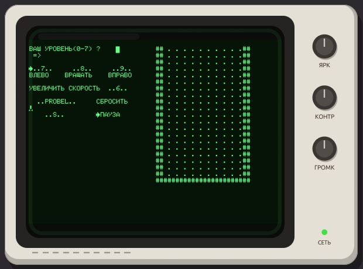
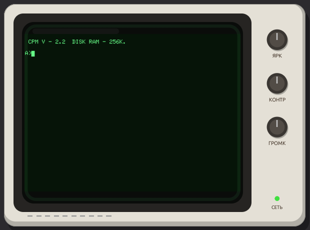

# Эмулятор «ЮТ-88»

[](https://github.com/pompei-kz/ut-88/actions/workflows/ci.yml)
[](#лицензия)

Эмулятор **«ЮТ-88»** — советского самодельного домашнего компьютера, который в 1989–1990
годах по частям публиковал журнал «ЮТ для умелых рук» (приложение к «Юному технику»).
Компьютер построен на процессоре **КР580ВМ80А** — советском аналоге **Intel 8080** — и
собирается из модулей: процессорный модуль с шестиразрядным светодиодным индикатором и
16-кнопочной шестнадцатеричной клавиатурой, дисплейный модуль (текстовый экран 64×28 и
полная клавиатура), ОЗУ 64 Кбайт, электронный квазидиск и CP/M.

Эмулятор выполняет оригинальные ПЗУ и программы, набранные со страниц журнала, — в окне
(egui) или в терминале (ratatui).

| Процессорный модуль (`make base`)                       | Полная конфигурация (`make full`)                  |
|---------------------------------------------------------|----------------------------------------------------|
|  |        |
| **«Тетрис»** (`make tetris`)                            | **CP/M 2.2** (`make cpm`)                          |
|                         |  |

## Возможности

**Компьютер**

- **Процессор КР580ВМ80А (Intel 8080)** — все 256 кодов команд, включая
  недокументированные, точные флаги и число тактов; проходит классические тесты 8080
  (TST8080, 8080PRE, CPUTEST и 8080EXM — «экзерсайзер» команд 8080).
- **Три конфигурации** настоящего компьютера:
  - **минимальная** — процессорный модуль: ОЗУ 1 Кбайт, шесть семисегментных
    индикаторов, 16 кнопок и кнопки «ШАГ НАЗАД» и «УСТ», оригинальное ПЗУ МОНИТОРА
    1 Кбайт;
  - **полная** — плюс дисплейный модуль (экран 64×28, полная клавиатура с РУС/УС/СС,
    ПЗУ МОНИТОРА-F, знакогенератор) и модуль ОЗУ 64 Кбайт;
  - **CP/M** — плюс квазидиск 64–256 Кбайт на порту 40H.
- **Оригинальная частота:** процессор на 16 МГц / 9 ≈ 1,78 МГц, прерывание `RST 7` раз
  в секунду от датчика часов на микросхеме К176ИЕ5.
- **Магнитофон:** запись и чтение WAV-файлов с настоящим двухфазным сигналом обоих
  МОНИТОРОВ (совместимы с записями «Микро-80» / «Радио-86РК»), а также мгновенная
  загрузка и сохранение блоков памяти.
- **Звук** выхода на магнитофон через звуковую карту (щелчки клавиш, «Гамма»,
  «Лабиринт»), правильно растянутый на низких скоростях.
- **Программы из журнала, готовые к запуску:** оба МОНИТОРА, «Тетрис», «Гамма»,
  «Крестики-нолики», «Лабиринт», «Реакция», программатор ПЗУ, ПЗУ калькулятора с
  плавающей точкой, **CP/M 2.2** (версии CP/M-64 и CP/M-35) и **ОС ЮТ-88** (редактор,
  ассемблер, отладчик) — всё набрано со страниц журнала и сверено с напечатанными
  контрольными суммами.

**Эмулятор**

- **Два интерфейса на одном ядре:** окно, похожее на настоящий компьютер (бежевый
  корпус, красные индикаторы, телевизор, клавиатура как на рисунке журнала), и полный
  терминальный интерфейс.
- **Скорость:** ×0,25 … ×16 и «максимум», пауза, «УСТ» (F2) и холодный старт.
- **Отладчик:** регистры и флаги, дизассемблер, дамп и правка памяти, точки останова по
  адресам и портам ввода-вывода, шаг и шаг с обходом.
- **Снимки** всего состояния машины (быстрый снимок и загрузка — F6/F7).
- **Загрузка программ** из `.bin`, Intel HEX и дампов в формате журнала; запись файлов
  ПК на диск CP/M; сохранение образа квазидиска между запусками.
- **Мышь и клавиатура:** любое действие доступно и F-клавишей, и кнопкой панели на
  экране.

**Инструменты**

- **Кросс-ассемблер `asm-k580vm80a`:** мнемоника Intel, выражения, макросы, INCLUDE,
  условная сборка, листинги; на выходе — двоичный образ, дамп в формате журнала, Intel
  HEX или перемещаемые объектные модули `.link`; подробная справка по-русски (`-h`) и
  по-английски (`-he`).
- **Компоновщик `link-k580vm80a`:** собирает модули `.link` в программу с картой
  памяти.
- **Документация:** статьи журнала целиком, переведённые в Markdown, руководство
  пользователя, руководство по ассемблеру, готовые примеры.

## Требования

- **Rust с `cargo`** (Rust 1.89 или новее). Установить его можно через
  [rustup](https://rustup.rs) — см. также официальную инструкцию
  <https://www.rust-lang.org/tools/install>:

  ```sh
  curl --proto '=https' --tlsv1.2 -sSf https://sh.rustup.rs | sh
  ```

- **GNU make** (команды ниже — цели `make`; каждая — тонкая обёртка над `cargo` и
  `target/release/ut88`).
- **Системные библиотеки Linux** для окна и звука: для сборки нужны компилятор C,
  `pkg-config` и пакет разработчика ALSA; X11 или Wayland, OpenGL и xkbcommon
  подгружаются при запуске (они есть в любом рабочем окружении). Файловые диалоги
  используют `xdg-desktop-portal`. В Debian / Ubuntu:

  ```sh
  sudo apt install build-essential pkg-config libasound2-dev \
      libx11-6 libxcursor1 libxrandr2 libxi6 libxkbcommon-x11-0 libgl1 libwayland-client0
  ```

Терминальному интерфейсу (цели `-t`) графика не нужна вовсе — только терминал размером
не меньше 80×32 символов.

Что нужно установить в Windows — см. [Запуск в Windows](#запуск-в-windows).

## Запуск в Windows

### Что нужно установить

- **Git для Windows** — система контроля версий, через неё скачивается проект
  (`git clone`). В неё входит **Git Bash** — командная строка bash с привычными
  утилитами (grep, awk и др.). Команды `make` запускаются именно в Git Bash: рецепты
  `Makefile` вызывают bash-скрипты из `scripts/`.
  Скачать: <https://git-scm.com/download/win>.
- **GNU make** — запускает команды проекта: `make base`, `make full`, `make tetris` и
  другие. Скачать: пакет [make](https://community.chocolatey.org/packages/make) для
  Chocolatey или [GNU make для Windows](https://gnuwin32.sourceforge.net/packages/make.htm).
- **Rust с `cargo`** (1.89 или новее) — компилятор языка Rust, на котором написан
  эмулятор, и `cargo` — его система сборки. Ставится установщиком rustup.
  Скачать: <https://rustup.rs> (`rustup-init.exe` для 64-разрядной Windows).
- **Microsoft C++ Build Tools** — компилятор и компоновщик C++ от Microsoft; без них
  Rust в Windows не может собрать программу. В установщике отметьте рабочую нагрузку
  **«Разработка классических приложений на C++»** (Desktop development with C++). Если
  Visual Studio с этой нагрузкой уже стоит, ничего ставить не нужно.
  Скачать: <https://visualstudio.microsoft.com/visual-cpp-build-tools/>.

Если у вас есть [Chocolatey](https://chocolatey.org), всё это ставится одной командой в
PowerShell, **запущенном от имени администратора**:

```powershell
choco install -y git make rustup.install visualstudio2022-workload-vctools
```

После установки откройте **новое** окно Git Bash (в меню «Пуск» или правым щелчком в
папке → «Open Git Bash here») и проверьте, что всё на месте:

```sh
git --version
make --version
cargo --version
```

### Сборка и запуск

В Git Bash:

```sh
git clone https://github.com/pompei-kz/ut-88.git
cd ut-88
make base
```

Первый запуск собирает эмулятор (`cargo build --release`) — это занимает несколько
минут. Дальше работают все команды из [следующего раздела](#быстрый-старт--команды-make).

## Быстрый старт — команды make

Склонируйте репозиторий и запускайте любую команду из его корня. Первый запуск собирает
эмулятор (`cargo build --release`) — это занимает несколько минут.

```sh
git clone https://github.com/pompei-kz/ut-88.git
cd ut-88
make base
```

| Команда                                 | Что делает                                                                                                                         |
|-----------------------------------------|------------------------------------------------------------------------------------------------------------------------------------|
| `make base`                             | минимальный компьютер: процессорный модуль (модуль 1) с индикаторами и клавиатурой                                                 |
| `make full`                             | полный компьютер: дисплейный модуль, МОНИТОР-F, ОЗУ 64 Кбайт                                                                       |
| `make tetris`                           | игра «Тетрис» из журнала (полная конфигурация)                                                                                     |
| `make cpm`                              | CP/M 2.2 на квазидиске 256 Кбайт; диск сохраняется в `ut88-disk.img`                                                               |
| `make os`                               | «ОС ЮТ-88» из журнала (монитор, редактор, ассемблер, отладчик)                                                                     |
| `make prog P=gamma`                     | программа из `programs/` — здесь «Гамма», музыкальная гамма                                                                        |
| `make programs`                         | список программ в `programs/`                                                                                                      |
| `make asm-run F=examples/asm/draw.asm`  | собрать и запустить пример рисования: рамка, диагонали и инверсный прямоугольник на экране                                         |
| `make asm-load F=examples/asm/draw.asm` | загрузить пример рисования без запуска: `G3000` + Enter запускает его, `GF800` + Enter очищает экран (программа остаётся в памяти) |
| `make asm-run F=examples/asm/hello.asm` | собрать и запустить «HELLO, WORLD!» / «ПРИВЕТ, ЮТ-88!» с выводом через МОНИТОР-F                                                   |
| `make asm-run F=examples/asm/ones.asm`  | собрать и запустить первую программу журнала: «11» на всех индикаторах                                                             |
| `make asm-run F=ФАЙЛ.asm`               | собрать и запустить свою программу (`C=minimal\|full` задаёт конфигурацию)                                                         |
| `make asm-load F=ФАЙЛ.asm`              | собрать и загрузить без запуска (по умолчанию `C=full`); затем наберите `G3000` + Enter                                            |
| `make …-t`                              | то же в терминале: `base-t`, `full-t`, `tetris-t`, `cpm-t`, `os-t`, `prog-t P=ИМЯ`                                                 |
| `make help`                             | список всех команд                                                                                                                 |

Что происходит после каждой команды и что делать дальше — ниже. Горячие клавиши везде
одни и те же: **F2** — кнопка «УСТ», **F11** — справка по клавишам, **F10** — выход (см.
[Горячие клавиши и панель кнопок](#горячие-клавиши-и-панель-кнопок)).

### `make base` — процессорный модуль и его МОНИТОР

Открывается окно с процессорным модулем: шесть красных семисегментных индикаторов и
клавиатура 4×4 с двумя большими кнопками — **«ШАГ НАЗАД»** и **«УСТ»**. Четыре левых
разряда (подписи H и L) показывают пару регистров **HL** — обычно адрес; два правых
разряда (A) — аккумулятор **A**, обычно байт данных.

На правых индикаторах — **«11»**: МОНИТОР ждёт директиву. Директива — одна кнопка, затем
её параметры набираются шестнадцатеричными цифрами: адрес — четыре цифры, байт — две.
Клавиши ПК:

| Клавиша ПК       | Кнопка «ЮТ-88» |
|------------------|----------------|
| `0`–`9`, `A`–`F` | `0`–`F`        |
| Backspace        | «ШАГ НАЗАД»    |
| F2               | «УСТ»          |

По нарисованным кнопкам можно щёлкать мышью.

Простые директивы МОНИТОРА:

|  Кнопка   | Параметры | Что делает                                                                                |
|:---------:|-----------|-------------------------------------------------------------------------------------------|
|     1     | —         | запись в ОЗУ с адреса C000H                                                               |
|     0     | АДР       | запись в ОЗУ с адреса АДР                                                                 |
|     2     | —         | просмотр ОЗУ с C000H: каждое нажатие показывает следующую ячейку (адрес на HL, байт на A) |
|     5     | АДР       | просмотр ОЗУ с адреса АДР, так же                                                         |
|     6     | —         | пуск программы с адреса C000H                                                             |
|     7     | АДР       | пуск программы с адреса АДР                                                               |
| ШАГ НАЗАД | —         | при записи/просмотре — вернуться на ячейку назад и ввести её заново                       |
|    УСТ    | —         | выйти из любой директивы или программы; снова появится «11»                               |

При записи (директивы 1 и 0) набирают две цифры байта; примерно через секунду МОНИТОР
сам переходит к следующей ячейке (HL увеличивается, на A — 00). Остальные директивы
(контрольная сумма, магнитофон, часы, тест ОЗУ, вспомогательные программы) — в
[руководстве](manual.md#5-работа-с-монитором-модуля-1) (раздел 5).

**Пример: «11» на всех шести индикаторах.** Это первая программа из журнала (doc/05):
`MVI A,11H; STA 9000H; LXI H,9001H; MOV M,A; LXI D,9002H; STAX D` плюс `RST 0` (`C7`)
для возврата в МОНИТОР. Индикаторы — это ячейки памяти 9000H–9002H.

1. Нажмите **1** — на HL «C000», на A «00».
2. Наберите байты по две цифры, после каждого байта дожидаясь, пока сменится адрес на
   HL: `3E 11 32 00 90 21 01 90 77 11 02 90 12 C7`. Ошиблись — нажмите Backspace
   («ШАГ НАЗАД») и наберите байт заново.
3. Нажмите **F2** («УСТ») — снова «11».
4. Проверьте: нажмите **2**, затем несколько раз любую кнопку — на HL «C000», «C001», …,
   на A «3E», «11», «32», … Остановиться — **F2**.
5. Запустите: нажмите **6**. На всех шести индикаторах — **`11 11 11`** (скриншот
   выше).

#### Программы из журнала

Программы в [`programs/`](programs/README.md) набраны со страниц журнала (список —
`make programs`). `make prog P=ИМЯ` загружает программу и сразу запускает её, так что
набирать её вручную не нужно.

**«Гамма» (музыкальная гамма)** — `make prog P=gamma`. Программа ждёт четыре
шестнадцатеричные цифры с клавиатуры: две — длительность ноты, две — пауза между нотами
(01–FF), например `4010`. Сразу после четвёртой цифры через динамик ПК (выход
компьютера на магнитофон) по кругу играет гамма из восьми нот. Остановить — **F2**. Звук
есть только в окне.

**«Крестики-нолики»** — `make prog P=tic-tac-toe`. Клетки пронумерованы так:

```
01  02  03
08  09  04
07  06  05
```

Компьютер всегда ходит первым, в центр: на правых индикаторах `09`. Свой ход делайте,
набирая номер клетки **двумя цифрами** (`0` `1` … `0` `8`; после одной цифры ничего не
происходит). Ответный ход компьютера появляется на правых индикаторах. При проигрыше
появляется код **73** (программа останавливается; нажмите F2); ничья — **11** (возврат в
МОНИТОР).

Остальные: `fill-const`, `reaction`, `labyrinth` — см.
[руководство](manual.md#10-программы-из-журналов) (раздел 10).

### `make full` — дисплейный модуль и МОНИТОР-F

Открывается окно с экраном телевизора, процессорным модулем и полной клавиатурой. На
экране

```
*ЮТ/88*
 =>
```

— приглашение **МОНИТОРА-F**, ПЗУ дисплейного модуля. Директива — латинская буква,
затем шестнадцатеричные параметры через запятую (`H` и ведущие нули не нужны) и
**Enter** (клавиша ВК «ЮТ-88»). Ошибка — «?». Буквы набираются прописными.

| Клавиша ПК | Клавиша «ЮТ-88»                            |
|------------|--------------------------------------------|
| Enter      | ВК (возврат каретки)                       |
| Shift      | СС (верхний символ клавиш цифр и знаков)   |
| Ctrl       | УС (управляющие коды: Ctrl+C даёт код 03H) |
| Alt        | РУС (русские буквы)                        |
| Backspace  | ← (курсор влево)                           |

Клавиши берутся по физическому положению, так что раскладка клавиатуры ПК не важна.

Некоторые директивы:

| Директива          | Что делает                                                                       |
|--------------------|----------------------------------------------------------------------------------|
| `D АДР1,АДР2`      | дамп памяти в шестнадцатеричном виде                                             |
| `M АДР`            | просмотр и изменение ячеек: новое значение + Enter или просто Enter; `.` — выход |
| `G АДР`            | запуск программы с адреса АДР                                                    |
| `F АДР1,АДР2,БАЙТ` | заполнить область байтом                                                         |
| `K АДР1,АДР2`      | контрольная сумма области                                                        |

**Пример: программа, печатающая букву A.**

1. Наберите `MC000` Enter, затем `0E` Enter, `41` Enter, `CD` Enter, `09` Enter, `F8`
   Enter, `C3` Enter, `6C` Enter, `F8` Enter и `.` для выхода. Это
   `MVI C,41H; CALL F809H; JMP F86CH` — вывести символ из C и вернуться к приглашению.
2. `DC000,C007` Enter — в дампе `C000 0E 41 CD 09 F8 C3 6C F8`.
3. `GC000` Enter — после команды появится буква `A` и новое приглашение.

Все директивы — в [руководстве](manual.md#6-работа-с-монитором-f) (раздел 6).

#### `make tetris` — «Тетрис»

Игра из № 9 за 1989 год (адрес пуска 3000H). Открывается полная конфигурация, и игра
сразу запускается (см. скриншот выше). Из `make full` её можно запустить из списка
программ по **F9** или загрузить и набрать `G3000` Enter.

1. «ВАШ УРОВЕНЬ (0-7) ?» — нажмите цифру 0–7: чем больше, тем быстрее.
2. «НАЖМИТЕ ЛЮБУЮ КЛАВИШУ !» — нажмите любую клавишу; момент нажатия задаёт случайную
   последовательность фигур.
3. Играйте. Цифры — в основном ряду клавиатуры:

   |    Клавиша    | Действие                                                           |
   |:-------------:|--------------------------------------------------------------------|
   |       7       | сдвинуть фигуру влево                                              |
   |       9       | сдвинуть фигуру вправо                                             |
   |       8       | повернуть фигуру                                                   |
   |    пробел     | сбросить фигуру вниз                                               |
   |       6       | ускорить: уровень +1                                               |
   |       S       | пауза («ВОДИТЕЛЬ, УСТАЛ - ОТДОХНИ !»), продолжение — любая клавиша |
   | УС+C (Ctrl+C) | закончить игру                                                     |

4. Заполненные ряды исчезают; счётчик «ЧИСЛО ПОЛНЫХ СТРОК» растёт, а уровень
   повышается сам.
5. Когда для новой фигуры нет места (или после Ctrl+C) — «ИГРА ЗАКОНЧЕНА, ЖЕЛАЕТЕ
   ПОВТОРИТЬ? (Y/N)»: `Y` — новая игра, `N` — выход в МОНИТОР-F.

**Держите каждую клавишу около полсекунды**: игра опрашивает клавиатуру редко, и
короткое нажатие может потеряться. Фигуры рисуются символами `[[`, стенки — `##`: так
выводит сама программа, это не ошибка дампа.

#### `make cpm` — CP/M 2.2

Журнал опубликовал CP/M 2.2 для «ЮТ-88» с электронным квазидиском (дополнительные блоки
ОЗУ, видимые только стековым командам). `make cpm` загружает CP/M-64 с квазидиском
256 Кбайт:

```
 CPM V - 2.2  DISK RAM - 256K.

A>
```

Набирайте команды и нажимайте Enter: `DIR` (на чистом диске — `NO FILE`),
`TYPE ИМЯ.РАС`, `ERA ИМЯ.РАС`, `REN НОВОЕ.РАС=СТАРОЕ.РАС`, `SAVE N ИМЯ.COM` (сохранить
N страниц по 256 байт с адреса 100H), `ИМЯ` (запустить `ИМЯ.COM`). Ctrl+C — тёплый старт
(перечитывает каталог), Ctrl+X стирает строку.

Квазидиск сохраняется в `ut88-disk.img` при выходе и загружается при следующем
`make cpm`, так что файлы переживают перезапуск. Положить файлы ПК на диск CP/M можно
через меню окна «CP/M → Записать файл на диск CP/M…» или из командной строки — например,
утилиту CHANGER из журнала:

```sh
target/release/ut88 --boot cpm64 --kvazidisk ut88-disk.img --cpm-put roms/cpm-ch-com.bin=CH.COM
```

После этого `DIR` покажет `CH.COM`. Вариант CP/M-35 без квазидиска запускается командой
`ut88 --boot cpm35`.

### `make os` — ОС ЮТ-88

Стартер выводит «ВЫКЛЮЧИТЕ ПЗУ МОНИТОРА И НАЖМИТЕ ЛЮБУЮ КЛАВИШУ». Эти «тумблеры»
эмулятор переключает сам — просто нажмите любую клавишу, и появится приглашение ОС
`ЮT*88>`. Команды ОС описаны в [doc/30-os-ut88.md](doc/30-os-ut88.md).

### Терминальные варианты (`-t`)

`make base-t`, `make full-t`, `make tetris-t`, `make cpm-t`, `make os-t` и
`make prog-t P=ИМЯ` запускают ту же машину в терминале (`ut88 --tui`). Шесть индикаторов
рисуются крупными цифрами, экран 64×28 — в рамке. Звука нет. Многие терминалы
перехватывают **F11** — тогда меню и справка открываются щелчком по кнопке «11Справка»
нижней панели. Терминалы не сообщают об отпускании клавиш, поэтому эмулятор сам держит
каждое нажатие некоторое время; набирать можно быстро.

### Ассемблер

В репозитории есть кросс-ассемблер для КР580ВМ80А `asm-k580vm80a` (мнемоника Intel,
макросы, условная сборка, листинги; на выходе — двоичный образ, дамп в формате журнала,
Intel HEX или перемещаемые модули `.link`) и компоновщик `link-k580vm80a`. Программу
можно написать на ПК и запустить одной командой:

```sh
make asm-run F=examples/asm/hello.asm   # выводит «HELLO, WORLD!» через МОНИТОР-F
make asm-run F=examples/asm/draw.asm    # рисует на экране рамку, диагонали и инверсный прямоугольник
make asm-load F=examples/asm/draw.asm   # загружает, но не запускает: наберите G3000 + Enter в МОНИТОРЕ-F
                                        # GF800 + Enter очищает экран, программа остаётся в памяти
```

Другие команды ассемблера:

```sh
make asm F=ФАЙЛ.asm [O=ФАЙЛ.hex]           # только собрать (.hex, .bin, .ihx или .link — по расширению)
make link O=OUT.hex M="a.link b.link"      # скомпоновать объектные модули (B= задаёт адрес загрузки)
make asm-examples                          # собрать все примеры из examples/asm/
```

Ассемблер и компоновщик можно запускать напрямую (после `make` исполняемые файлы лежат в
`target/release/`):

```sh
# справка: -h по-русски, -he по-английски
target/release/asm-k580vm80a -h

# формат результата определяется расширением файла -o
target/release/asm-k580vm80a -f examples/asm/draw.asm -o draw.hex    # дамп в формате журнала
target/release/asm-k580vm80a -f examples/asm/draw.asm -o draw.bin    # двоичный образ
target/release/asm-k580vm80a -f examples/asm/draw.asm -o draw.ihx    # Intel HEX

# -t задаёт формат явно, расширение тогда не важно
target/release/asm-k580vm80a -f examples/asm/draw.asm -o draw.txt -t hex

# листинг с адресами, кодами и таблицей символов
target/release/asm-k580vm80a -f examples/asm/draw.asm -o draw.hex -l draw.lst

# определить символ для условной сборки (IFDEF TWICE в macro.asm)
target/release/asm-k580vm80a -f examples/asm/macro.asm -o macro.bin -D TWICE

# два модуля → объектные файлы .link → одна программа с адреса 3000H и карта памяти
target/release/asm-k580vm80a -f examples/asm/hello-link/main.asm  -o main.link
target/release/asm-k580vm80a -f examples/asm/hello-link/print.asm -o print.link
target/release/link-k580vm80a main.link print.link -o hello.hex --base 3000 -m hello.map

# запустить результат в эмуляторе
target/release/ut88 --config full --load draw.hex --run 3000
```

Примеры в [`examples/asm/`](examples/asm/) — это программы из журнала («11» на
индикаторах, заполнение памяти, «Гамма» — байт в байт совпадают с `programs/`),
«Hello» для МОНИТОРА-F, макросы и программа из двух модулей. Полный справочник —
[doc/43-assembler.md](doc/43-assembler.md) и `asm-k580vm80a -h`.

### Горячие клавиши и панель кнопок

Схема одна для окна и терминала. Каждая клавиша есть и кнопкой на панели внизу — щелчок
по кнопке равен нажатию клавиши.

| Клавиша       | Действие                                                                  |
|---------------|---------------------------------------------------------------------------|
| F2            | кнопка «УСТ» — сброс процессора; память сохраняется                       |
| F3            | холодный старт (выключить и включить питание)                             |
| F4            | пауза / продолжить                                                        |
| F5 / Shift+F5 | скорость выше / ниже: ×0,25 … ×16, максимум                               |
| F6 / F7       | быстрый снимок в `./ut88-quick.snap` / загрузить быстрый снимок           |
| F8            | магнитофон: вставить кассету (WAV), запись, быстрая загрузка и сохранение |
| F9            | программы из журналов: загрузить / загрузить и запустить                  |
| F10           | выход (без вопроса — если состояние нужно, сначала нажмите F6)            |
| F11           | справка: все клавиши (в терминале — меню всех действий)                   |
| F12           | отладчик: регистры, дизассемблер, память, точки останова                  |

## Документация

- [manual.md](manual.md) — полное руководство пользователя: ключи командной строки,
  меню, клавиатуры, оба МОНИТОРА, магнитофон, снимки, отладчик, все программы, квазидиск,
  CP/M и ОС ЮТ-88, частые проблемы;
- [doc/43-assembler.md](doc/43-assembler.md) — ассемблер и компоновщик КР580ВМ80А;
- [doc/README.md](doc/README.md) — статьи журнала в Markdown с примечаниями и
  разобранными листингами;
- [programs/README.md](programs/README.md) — программы, их адреса и контрольные суммы.

Ключи командной строки: `target/release/ut88 --help`. Например:

```sh
target/release/ut88 --config minimal --load my.bin@C000   # своя программа, запуск директивой 6
target/release/ut88 --load programs/tetris.bin --run 3000 # «Тетрис»
target/release/ut88 --snapshot ut88-quick.snap            # продолжить со снимка
```

## Структура проекта

| Путь                   | Содержимое                                                                           |
|------------------------|--------------------------------------------------------------------------------------|
| `crates/i8080`         | эмулятор процессора КР580ВМ80А / Intel 8080 (проходит классические тесты 8080)       |
| `crates/ut88-core`     | машина: карта памяти, устройства, дисплей, клавиатура, магнитофон, квазидиск, снимки |
| `crates/ut88-audio`    | вывод звука (cpal)                                                                   |
| `crates/ut88-gui`      | окно (egui / eframe)                                                                 |
| `crates/ut88-tui`      | терминальный интерфейс (ratatui)                                                     |
| `crates/ut88`          | исполняемый файл `ut88` и его командная строка                                       |
| `crates/asm-k580vm80a` | ассемблер `asm-k580vm80a` и компоновщик `link-k580vm80a`                             |
| `examples/asm/`        | примеры программ на языке ассемблера                                                 |
| `roms/`                | образы ПЗУ и дампы систем из журнала (МОНИТОР-F, CP/M, ОС, …)                        |
| `monitor/`             | ПЗУ МОНИТОРА модуля 1: дамп, исправленный образ, разобранный дизассемблер            |
| `programs/`            | программы из журнала, `.bin` и `.hex`                                                |
| `doc/`                 | статьи журнала в Markdown и иллюстрации к ним, руководство по ассемблеру             |
| `docs/img/`            | скриншоты для README                                                                 |
| `manual.md`            | руководство пользователя                                                             |
| `scripts/`             | вспомогательные скрипты для Makefile                                                 |
| `plans/`               | задания, планы и журналы отклонений, по которым шла разработка                       |

## Разработка

```sh
make            # cargo build --release (make compile)
make test       # cargo test
make test-all   # ещё и долгие тесты #[ignore] (экзерсайзер 8080, «Тетрис») в режиме release
make lint       # cargo clippy --all-targets -- -D warnings; cargo fmt --check
make fmt        # cargo fmt
make clean      # cargo clean
```

Правила работы — в [CONTRIBUTING.md](CONTRIBUTING.md), история изменений — в
[CHANGELOG.md](CHANGELOG.md).

## Лицензия

Исходный код распространяется на условиях одной из лицензий на ваш выбор:

- Apache License, Version 2.0 ([LICENSE-APACHE](LICENSE-APACHE)) или
- лицензия MIT ([LICENSE-MIT](LICENSE-MIT)).

Если вы явно не заявите иное, любой вклад, намеренно предложенный вами для включения в
проект (в смысле лицензии Apache-2.0), распространяется под этими двумя лицензиями без
каких-либо дополнительных условий.

**Лицензия не распространяется на материалы журнала** — скан выпуска, тексты статей и
иллюстрации в `doc/`, дампы ПЗУ и программ в `roms/`, `monitor/` и `programs/`, — а также
на сторонние тестовые программы 8080. Подробнее — в [NOTICE.md](NOTICE.md).

## Благодарности

- Журналу «ЮТ для умелых рук», приложению к «Юному технику», опубликовавшему «ЮТ-88» в
  1989–1990 годах, и его автору **В. Бартеневу** с радиокружком Раменского Дома
  пионеров.
- Авторам тестовых программ 8080, на которых проверяется процессор: Microcosm Associates
  (Kelly Smith), Frank D. Cringle, Ian Bartholomew, SuperSoft Associates; и репозиторию
  Nicolas Allemand [superzazu/8080](https://github.com/superzazu/8080), откуда они взяты.
- Проектам [egui](https://github.com/emilk/egui), [ratatui](https://ratatui.rs) и
  [cpal](https://github.com/RustAudio/cpal).
