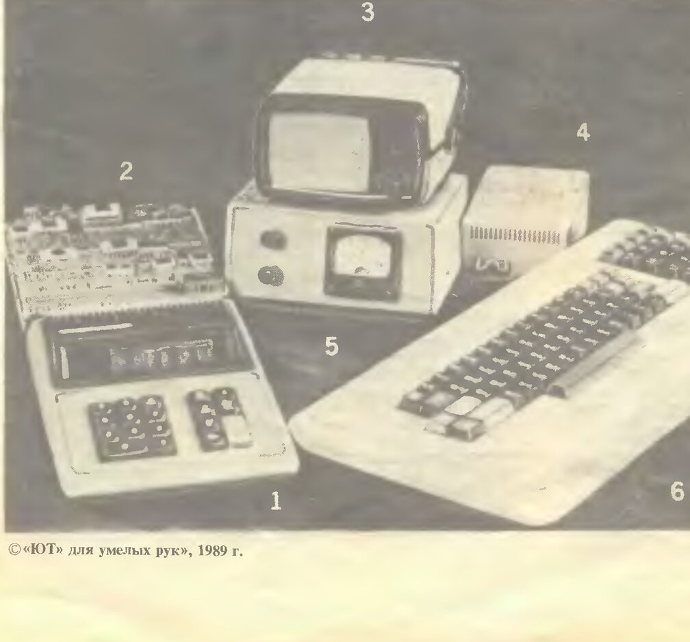

# 1. Введение

## Персональный компьютер «ЮТ-88»

«Хорошо бы собрать компьютер»: об этом наверняка мечтают многие из наших читателей.
Но мечты оставались мечтами. Повторить конструкции, которые предлагали журналы «Радио»
или «Моделист-конструктор», начинающим радиолюбителям не по плечу: сложные схемы,
детали, которых не достать, трудности с налаживанием…

Редакция решила прийти мечтателям (конечно, деятельным) на помощь. По её заказу в
кружке радиоэлектроники при Раменском Доме пионеров под руководством кандидата
технических наук, автора ряда изобретений **В. Бартенева**, был разработан персональный
компьютер, который вы при желании сможете повторить. Дефицитных деталей в нём минимум.

Для удобства вся электронная схема разбита на **модули**. Каждый модуль может работать
«сам по себе» в качестве устройства программного управления, мощного программируемого
микрокалькулятора или банка данных. В полном варианте микроЭВМ «ЮТ-88» по своим
возможностям превосходит большинство популярных среди радиолюбителей компьютеров.

Собирать его вы будете постепенно, модуль за модулем. Это не только упростит сборку, но
и позволит освоить программирование, познакомиться с устройством и принципами работы
вычислительной техники. Собрав «ЮТ-88», вы научитесь не только полноценно им
пользоваться, но и самостоятельно разрабатывать любые собственные конструкции на
микропроцессорах. Работа послужит вам хорошей школой в электронике и информатике.

Идеи, которые нашли отражение в публикации, формировались у автора в процессе
обсуждений со специалистами А. Блохиным, С. Аксеновым, И. Грищенко, А. Мышко, за что им
благодарны и автор, и редакция. Огромное спасибо и кружковцам Г. Бартеневу, А. Егорову,
Р. Тайцлину, И. Басову, А. Чемелю, А. Дорошкевичу за помощь в макетировании компьютера
и отладке программ.

*1 — процессорный модуль; 2 — дисплейный модуль; 3 — дисплей; 4, 5 — блоки питания
процессорного и дисплейного модулей; 6 — клавиатура.*

## Детали о деталях

Персональный компьютер — самоделка серьёзная, и не только из-за сложности схемы. Собрать
её как раз не так уж и трудно. Главная проблема в том, где купить детали. Несмотря на
многочисленные выступления журнала «Радио», купить многие микросхемы, особенно серий
КР580 и КР541, сегодня проблема. В обычных магазинах радиотоваров они бывают редко.

Поэтому тем, кто живёт в крупных городах, советуем в первую очередь обратиться в
фирменные магазины «Электроника» Министерства электронной промышленности. Многие детали
можно найти в магазинах «Юный техник» и «Сделай сам», которые торгуют «неликвидами».

А как быть сельским радиолюбителям? В редакцию обратились несколько кооперативов с
предложением организовать посылочную торговлю наборами деталей для сборки «ЮТ-88», и
скоро их адреса будут опубликованы. Кроме того, некоторые детали можно приобрести через
Роспосылторг и Главкооппосылторг. Каталоги радиодеталей можно взять на почте.

## Внимание!

> Архитектура, основные схемные решения модулей персонального компьютера «ЮТ-88»,
> программное обеспечение, товарный знак, его текст и шрифтовое оформление являются
> исключительной собственностью редакции журнала «Юный техник», представляющей
> интересы автора. Промышленное и мелкосерийное производство компьютера и его
> полуфабрикатов, тиражирование программного обеспечения в любой форме без согласия
> редакции запрещено как государственным, так и кооперативным предприятиям. Но это не
> исключает сотрудничества.
>
> Приглашаем государственные и кооперативные организации, заинтересовавшиеся
> персональным компьютером «ЮТ-88», направлять свои предложения на адрес редакции.

## Первый шаг: микроЭВМ минимальной конфигурации

Компьютер имеет **изменяемую конфигурацию**. В минимальном исполнении используется только
процессорный модуль: простая в изготовлении, дешёвая одноплатная микроЭВМ на доступных
микросхемах. Несмотря на минимальный объём ОЗУ и ПЗУ и простейшие клавиатуру и дисплей,
первый модуль поможет не только разобраться в работе микроЭВМ, но и научиться писать
программы.

Это лишь первый этап освоения компьютерной техники. Изготовив модуль и освоив его
программирование, можно сделать следующий шаг: расширить конфигурацию, добавив
**дисплейный модуль с полной клавиатурой** и **квазидиск** произвольного объёма.

Так, шаг за шагом, от простого к сложному, мы пройдём путь от простейшей микроЭВМ к
настоящему персональному компьютеру с мощным программным обеспечением на основе
операционной системы **CP/M**.

Далее: [02-arhitektura.md](02-arhitektura.md)
