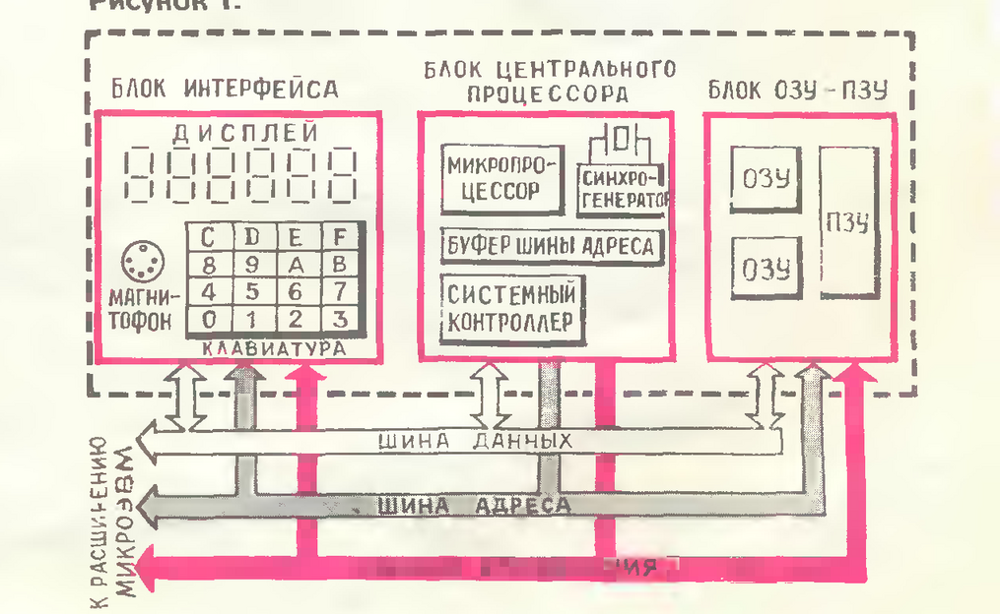

# 2. Архитектура микроЭВМ

## Три основных элемента

Любой компьютер состоит из трёх основных блоков: **центрального процессора**, **памяти** и
**устройств ввода/вывода**.

**Центральный процессор** — самый сложный элемент. Это программно-управляемое устройство,
которое обрабатывает информацию и обменивается ею с остальными компонентами ЭВМ. В
качестве процессора используется БИС микропроцессора **КР580ВМ80А**. Выбор не случаен:
этот микропроцессор ещё долго будет популярен среди радиолюбителей из-за большого объёма
программного обеспечения, написанного под его систему команд. Фиксированная и простая
система команд облегчает составление программ даже в машинных кодах. И, что очень
важно, этот микропроцессор уже появился в продаже.

**Память** состоит из:

- **ПЗУ** (постоянного запоминающего устройства), которое допускает только считывание;
- **ОЗУ** (оперативного запоминающего устройства), из которого можно читать и в которое
  можно записывать.

Память — это совокупность однотипных ячеек с закодированной информацией. Единица
измерения объёма — бит (0 или 1). Разрядность ячейки определяется разрядностью шины
данных микропроцессора: для КР580ВМ80А это 8 бит, или 1 байт. Каждая ячейка имеет
номер — **адрес**. Процессор формирует 16-разрядный адрес, поэтому можно непосредственно
адресовать чуть больше 65 тысяч ячеек (65 536).

**Устройства ввода/вывода**: клавиатура, дисплей, принтер и т. п. Обмен с ними идёт через
**порты ввода/вывода**. К КР580ВМ80А можно подключить в общей сложности 256 таких
устройств.

Объём памяти и число устройств ввода/вывода определяют конфигурацию компьютера, его
возможности и стоимость.

## Блок-схема

*Рисунок 1. Блок-схема микроЭВМ: блок интерфейса (дисплей, клавиатура, магнитофон),
блок центрального процессора, блок ОЗУ–ПЗУ; шины данных, адреса и управления выведены
для расширения микроЭВМ.*

**Шины** — это совокупности проводов, объединённых по функциональному признаку:

| Шина | Число линий | Обозначение | Направление |
|------|:-----------:|-------------|-------------|
| Данных (ШД) | 8 | D0–D7 | двунаправленная; в каждый момент передача идёт только в одну сторону |
| Адреса (ША) | 16 | A0–A15 | только выход процессора |
| Управления (ШУ) | 5 | см. ниже | только выход процессора |

Такая архитектура позволяет легко наращивать периферийные устройства, подключая их к ЭВМ.

Блок-схема первого модуля условно разбита на три блока. Разбивка сделана для удобства
объяснения, но каждый блок функционально закончен и может использоваться в других
радиолюбительских конструкциях.

1. **Блок центрального процессора**: микропроцессор, генератор тактовых импульсов,
   формирователь сигналов шины данных и шины управления (системный контроллер), буфер
   шины адреса.
2. **Блок памяти**: ПЗУ и ОЗУ.
3. **Блок интерфейса**: простейшая клавиатура из 17 кнопок, дисплей на семисегментных
   индикаторах и схема сопряжения с кассетным магнитофоном.

### Сигналы шины управления

Сигналы представлены двумя уровнями напряжения: логическими «0» и «1». Сигнал, который
вызывает выполнение некоторого действия, называется **активным**. На шине управления все
сигналы активны при уровне логического «0» (на схемах они помечены чертой сверху).

| Сигнал | Назначение |
|--------|-----------|
| ЧТЗУ | чтение памяти (MEMR) |
| ЗПЗУ | запись в память (MEMW) |
| ЧТВВ | чтение порта ввода/вывода (I/OR) |
| ЗПВВ | запись в порт ввода/вывода (I/OW) |
| ППР | подтверждение прерывания (INTA) |

Активный низкий уровень выбран потому, что такие сигналы просто объединять по ИЛИ. Кроме
того, выходной каскад большую часть времени выключен и меньше потребляет от источника
питания.

## Шестнадцатеричная система счисления

Информация по шинам передаётся в двоичном коде, но двоичная запись громоздка, поэтому
дальше используется шестнадцатеричная (основание 16, цифры 0–9, A–F).

**Таблица 1.**

| Шестнадцатеричное | Двоичное | Десятичное |
|:-:|:-:|:-:|
| 0 | 0 | 0 |
| 1 | 1 | 1 |
| 2 | 10 | 2 |
| 3 | 11 | 3 |
| 4 | 100 | 4 |
| 5 | 101 | 5 |
| 6 | 110 | 6 |
| 7 | 111 | 7 |
| 8 | 1000 | 8 |
| 9 | 1001 | 9 |
| A | 1010 | 10 |
| B | 1011 | 11 |
| C | 1100 | 12 |
| D | 1101 | 13 |
| E | 1110 | 14 |
| F | 1111 | 15 |
| 10 | 10000 | 16 |
| 11 | 10001 | 17 |

Перевод из двоичной системы прост: разряды, начиная с младшего, разбиваются на группы по
четыре, и каждой группе ставится в соответствие шестнадцатеричная цифра. Диапазон адресов
компьютера — 0000₁₆–FFFF₁₆. Дальше основание обозначается буквой **H** после числа
(адресное пространство: 0000H–FFFFH).

На дисплее после преобразования дешифратором отображаются шестнадцатеричные цифры. Ввод с
клавиатуры тоже идёт шестнадцатеричными цифрами; код нажатой клавиши дешифратор
превращает в двоичный код на шине данных.

## Выборка устройств и способы ввода/вывода

На блок-схеме не показан ещё один блок — **формирователь сигналов выборки кода адреса
(ВК)**. Внешнее устройство работает с процессором при двух условиях: на него подан
управляющий сигнал с шины управления, и оно выбрано соответствующим адресом. Сигналы
выборки формируются дешифрацией сигналов шины адреса.

В первом модуле применяются оба способа ввода/вывода.

**Изолированный ввод/вывод.** Порты имеют собственное адресное пространство (до 256
портов), не пересекающееся с памятью. Обмен идёт командами `IN` (данные из порта в
процессор) и `OUT` (из процессора в порт).

**Ввод/вывод, отображённый на память.** Процессор обращается к портам как к ячейкам
памяти, и все команды обращения к памяти, содержащие адреса портов, превращаются в
команды ввода/вывода.

## Карта адресов модуля 1

### Память

Дешифратор К155ИД3 (DD7) делит адресное пространство на сегменты по 4 Кбайта.

| Адреса | Назначение |
|--------|-----------|
| 0000H–01FFH | ПЗУ DD10: основная часть МОНИТОРА |
| 0200H–03FFH | ПЗУ DD11: вспомогательная часть МОНИТОРА |
| 0000H–0FFFH | сегмент ПЗУ (сигнал выборки выведен на разъём расширения) |
| 9000H | индикатор: младший байт (два правых разряда, «индикатор A») |
| 9001H | индикатор: средние два разряда (L) |
| 9002H | индикатор: левые два разряда (H) |
| C000H–C3FFH | ОЗУ 1 Кбайт (DD13, DD14) |
| E000H–EFFFH, F000H–FFFFH | свободные сегменты для расширения (сигналы выборки выведены на разъём) |

*Прим.: индикаторы выбираются всем сегментом 9000H–9FFFH; внутри сегмента различаются только
по A0 и A1.*

### Порты ввода/вывода

| Порт | Назначение |
|------|-----------|
| A0H | клавиатура (чтение) |
| A1H | магнитофон: бит 0 (запись — выход на магнитофон, чтение — вход с магнитофона) |

Далее: [03-istochnik-pitaniya.md](03-istochnik-pitaniya.md)
