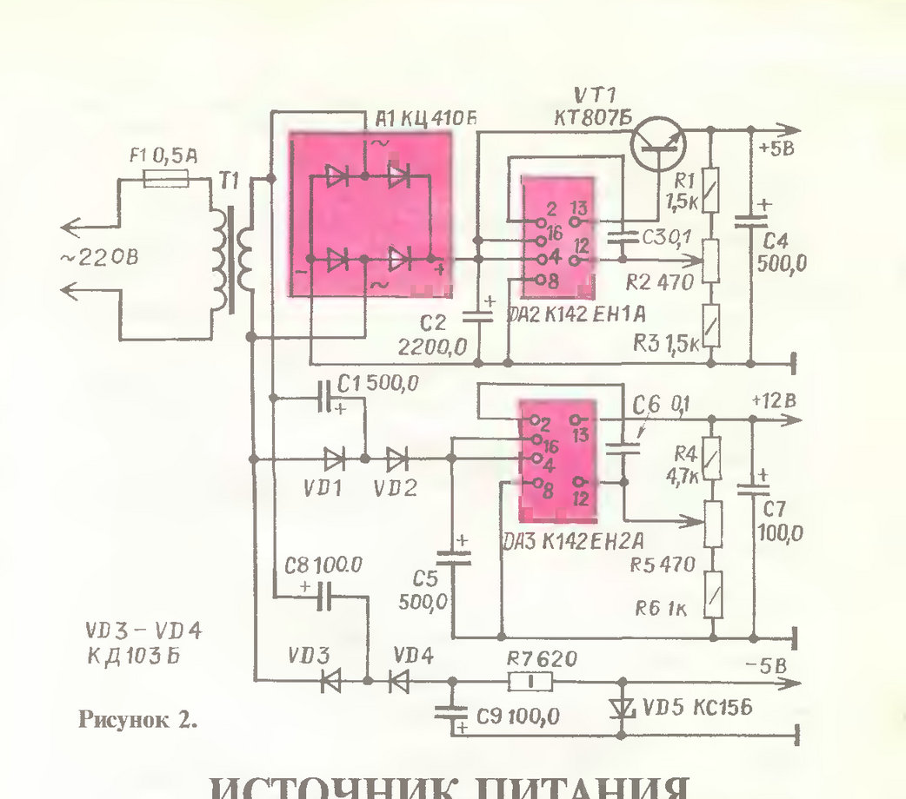

# 3. Источник питания

МикроЭВМ нужны три источника постоянного напряжения:

| Напряжение |            Ток | Потребитель                               |
|-----------:|---------------:|-------------------------------------------|
|       +5 В |         до 1 А | все микросхемы (наиболее мощный источник) |
|      +12 В | не более 50 мА | микропроцессор                            |
|       −5 В |  не более 5 мА | микропроцессор                            |

**Сборку микроЭВМ необходимо начинать с изготовления модуля питания.**

*Рисунок 2. Принципиальная схема источника питания.*

## Описание работы

Переменное напряжение вторичной обмотки T1 (порядка 8–10 В) поступает на мостовой
выпрямитель A1 и на два удвоителя напряжения на диодах VD1–VD4.

**Канал +5 В.** Выпрямленное мостом напряжение сглаживается конденсатором C2 и
стабилизируется микросхемой DA2 (К142ЕН1А). Нагрузочную способность стабилизатора
увеличивает внешний транзистор VT1 (КТ807Б), установленный на радиаторе. Выходное
напряжение устанавливается потенциометром R2.

**Канал +12 В.** Удвоенное напряжение положительной полярности (C1, VD1, VD2) сглаживается
конденсатором C5 и стабилизируется микросхемой DA3 (К142ЕН2А). Выходное напряжение +12 В
регулируется потенциометром R5.

**Канал −5 В.** Удвоенное напряжение отрицательной полярности (C8, VD3, VD4) сглаживается
конденсатором C9. Напряжение −5 В снимается с параметрического стабилизатора на
стабилитроне VD5 (КС156) с балластным резистором R7.

## Перечень элементов (по схеме)

| Обозначение | Тип / номинал                          |
|-------------|----------------------------------------|
| F1          | предохранитель 0,5 А                   |
| T1          | сетевой трансформатор (см. ниже)       |
| A1          | диодная сборка КЦ410Б                  |
| VD1–VD4     | КД103Б                                 |
| VD5         | стабилитрон КС156                      |
| VT1         | КТ807Б (на радиаторе)                  |
| DA2         | К142ЕН1А                               |
| DA3         | К142ЕН2А                               |
| R1          | 1,5 кОм                                |
| R2          | 470 Ом (подстроечный, установка +5 В)  |
| R3          | 1,5 кОм                                |
| R4          | 4,7 кОм                                |
| R5          | 470 Ом (подстроечный, установка +12 В) |
| R6          | 1 кОм                                  |
| R7          | 620 Ом                                 |
| C1          | 500,0 мкФ                              |
| C2          | 2200,0 мкФ                             |
| C3          | 0,1 мкФ                                |
| C4          | 500,0 мкФ                              |
| C5          | 500,0 мкФ                              |
| C6          | 0,1 мкФ                                |
| C7          | 100,0 мкФ                              |
| C8          | 100,0 мкФ                              |
| C9          | 100,0 мкФ                              |

Выводы стабилизаторов К142ЕН1А/ЕН2А, задействованные на схеме: 2, 4, 8, 12, 13, 16.

## Трансформатор

Подойдёт любой понижающий трансформатор со вторичной обмоткой на 8–10 В при токе до 2 А.
Его можно изготовить самостоятельно на сердечнике **ШЛ16×32**:

| Обмотка          | Витков | Провод          |
|------------------|-------:|-----------------|
| Сетевая (~220 В) |   1350 | ПЭВ-2 ⌀ 0,31 мм |
| Вторичная        |     50 | ПЭВ-2 ⌀ 1,5 мм  |

## Замены деталей («Консультационный пункт», 1989-12)

- Диоды VD1–VD4 можно заменить на Д226.
- Диодную сборку КЦ410Б — четырьмя диодами Д202 или Д203 с любым буквенным индексом.
- Транзистор VT1 может быть КТ803, КТ808 или КТ805. Его обязательно ставят на радиатор с
  площадью рассеивания не менее 150 см².

Далее: [04-elektricheskaya-shema.md](04-elektricheskaya-shema.md)
