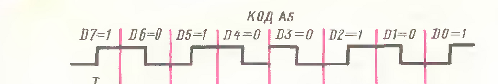

# 4. Электрическая схема модуля 1

Принципиальная схема первого модуля была напечатана в журнале на вкладке:

- [img/schematic-part1.jpg](img/schematic-part1.jpg): левая половина;
- [img/schematic-part2.jpg](img/schematic-part2.jpg): правая половина.

Ниже схема описана по блокам, по тексту статьи.

## Перечень микросхем

| Позиция    | Тип        | Функция                                               |
|------------|------------|-------------------------------------------------------|
| DD1        | КР580ВМ80А | микропроцессор                                        |
| DD2        | КР580ГФ24  | генератор тактовых импульсов (кварц ZQ1 16 МГц)       |
| DD3        | К176ИЕ5    | датчик секундных импульсов для часов (32768 Гц / 2¹⁵) |
| DD4        | К155ТМ2    | D-триггер: DD4.2 — выход на магнитофон                |
| DD5, DD6   | КР580ИР82  | буферные регистры шины адреса                         |
| DD7        | К155ИД3    | дешифратор адреса (сегменты по 4 Кбайта)              |
| DD8        | КР580ВК38  | системный контроллер (на схеме подписан «КР580ИК38»)  |
| DD9, DD21  | К155ЛН1    | инверторы                                             |
| DD10, DD11 | КР556РТ5   | ПЗУ МОНИТОРА (2 × 512 байт)                           |
| DD12, DD17 | К155ЛА8    | 2И-НЕ с открытым коллектором                          |
| DD13, DD14 | КР541РУ2   | ОЗУ (2 × 1К × 4)                                      |
| DD15, DD16 | КР556РТ4   | ПЗУ-дешифратор клавиатуры                             |
| DD18, DD19 | К155РП1    | регистровая память индикатора (8 × 4 бит)             |
| DD20       | К155ИД4    | дешифратор разрядов индикатора                        |
| DD22       | К155ЛЕ4    | 3ИЛИ-НЕ                                               |
| DD23       | К155РЕ3    | ПЗУ-знакогенератор семисегментного кода               |
| DD24       | К155ИЕ5    | двоичный счётчик динамической индикации               |
| DA1        | К140УД6    | операционный усилитель (вход с магнитофона)           |

## Блок центрального процессора

Блок выполнен на микросхемах DD1, DD2, DD5, DD6 и DD8.

- **DD1, КР580ВМ80А**: микропроцессор.
- **DD2, КР580ГФ24**: формирует две последовательности тактовых импульсов Ф1 и Ф2 с нужными
  временными и амплитудными параметрами. Содержит задающий генератор, стабилизированный
  внешним кварцевым резонатором **ZQ1 на 16 МГц**, триггеры синхронизации сигналов
  начальной установки (RES) и готовности (RDY), а также схему формирования строба
  состояния **STB**. Этот строб записывает байт состояния процессора при формировании
  сигналов шины управления.
- **DD5, DD6, КР580ИР82**: буферы шины адреса. Выходы КР580ВМ80А выдерживают нагрузку лишь
  одного входа ТТЛ, а шина адреса подключается ко многим устройствам. КР580ИР82 — это
  8-разрядный регистр с управляемыми выходными формирователями. Запись идёт при
  логической единице на выводе 11 (STB), выдача — при логическом нуле на выводе 9 (OE).
- **DD8, КР580ВК38**: системный контроллер. Повышает нагрузочную способность
  двунаправленной шины данных и формирует сигналы шины управления. Содержит
  двунаправленный магистральный формирователь, регистр состояния и схему формирования
  управляющих сигналов.

## Блок памяти

### ПЗУ

ПЗУ — микросхемы **КР556РТ5** (DD10, DD11, по 512 байт). В них хранится управляющая
программа МОНИТОР.

Чтение ПЗУ после нажатия кнопки «УСТ» происходит так:

1. На шине адреса устанавливается адрес 0000H, на шине управления — сигнал ЧТЗУ.
2. ЧТЗУ инвертируется элементом DD21.5 и подаётся на вход V3 обеих ПЗУ.
3. Дешифратор DD7 вырабатывает сигнал выборки сегмента 0000H–0FFFH на выводе 1. Он
   инвертируется элементом DD9.1 и подаётся на входы V4 обеих ПЗУ.
4. На входы выборки V1, V2 микросхемы DD10 подаются A11 и A9, поэтому DD10 отвечает в
   области **0000H–01FFH**.
5. У DD11 сигнал A9 подаётся на вход V2 через инвертор DD9.2, поэтому DD11 отвечает в
   области **0200H–03FFH**.

Сигналы выборки сегментов 0000H–0FFFH, E000H–EFFFH и F000H–FFFFH нужны для расширения
конфигурации, поэтому вместе с сигналами управления они выведены на внешний разъём.

### ОЗУ

ОЗУ собрано на двух микросхемах **КР541РУ2** (DD13, DD14) с совмещёнными входом и выходом.
Объём — **1 Кбайт**, адреса **C000H–C3FFH**.

- **Запись.** Общие выводы 11–14 работают как входы. Чтобы не было конфликта на внутренних
  выходных линиях, при ЗПЗУ = 0 внутренние выходы переводятся в высокоимпедансное
  состояние. При записи в состоянии логического 0 должны быть и вывод 10 (WE, разрешение
  записи), и вывод 8 (CS, выбор микросхемы).
- **Чтение.** Вывод 8 (CS) в логическом 0, вывод 10 (WE) в логической 1.

Управляющие сигналы ОЗУ формируются на элементах DD9.4, DD12.1 и DD12.2.

## Блок интерфейса

Ввод выполняется с клавиатуры или с кассетного магнитофона, вывод — на индикаторы дисплея
или на магнитофон для долговременного хранения.

### Дисплей

Содержимое ячеек памяти **9000H, 9001H, 9002H** отображается на индикаторах шестью
шестнадцатеричными цифрами.

| Адрес | Разряды индикатора | Название в МОНИТОРЕ       |
|-------|--------------------|---------------------------|
| 9002H | два левых          | H (часть «индикатора HL») |
| 9001H | два средних        | L (часть «индикатора HL») |
| 9000H | два правых         | «индикатор A»             |

**Ячейки памяти индикатора** выполнены на регистрах DD18 и DD19 типа **К155РП1**. Каждая
микросхема содержит восемь четырёхразрядных ячеек, которые адресуются независимо при
записи и при чтении.

- Входы адреса записи WA, WB подключены к A0 и A1 шины адреса.
- Запись идёт подачей логического 0 на вход C1. Этот сигнал получается на элементах
  DD9.3, DD9.5 и DD12.3 объединением сигнала выборки области 9000H–9FFFH от дешифратора
  DD7 и сигнала ЗПЗУ.
- Входы адреса чтения RA, RB подключены к старшим разрядам двоичного счётчика DD24
  (К155ИЕ5). Чтение идёт при логическом 0 на входе C2.
- Выходы DD18 и DD19 выполнены с открытым коллектором и объединены.

**Схема динамической индикации**:

- генератор синхроимпульсов на элементах DD21.3, DD21.4;
- двоичный счётчик DD24;
- дешифратор управляющих импульсов разрядов DD20 (К155ИД4), подключённый к катодам
  индикаторов;
- преобразователь двоичного кода в семисегментный на ПЗУ DD23 (К155РЕ3).

Выходы DD23 подключены к сегментам и через резисторы 1 кОм к шине +5 В. Индикаторы с
общим катодом, например АЛС324А или АЛС318; на катоде светящегося разряда должен быть
логический ноль.

**Таблица 2. Содержимое дешифратора К155РЕ3 (DD23)**

| Цифра индикатора | Адрес на входе ПЗУ | Код |
|:----------------:|:------------------:|:---:|
|        0         |         00         | 3F  |
|        1         |         01         | 06  |
|        2         |         02         | 5B  |
|        3         |         03         | 4F  |
|        4         |         04         | 66  |
|        5         |         05         | 6D  |
|        6         |         06         | 7D  |
|        7         |         07         | 07  |
|        8         |         08         | 7F  |
|        9         |         09         | 6F  |
|        A         |         0A         | 77  |
|        B         |         0B         | 7C  |
|        C         |         0C         | 39  |
|        D         |         0D         | 5E  |
|        E         |         0E         | 79  |
|        F         |         0F         | 71  |

Код — это стандартный семисегментный код: бит 0 = сегмент a, …, бит 6 = сегмент g.

### Клавиатура

Клавиатура состоит из **17 кнопок**: 16 шестнадцатеричных цифр и «ШАГ НАЗАД». Отдельно
есть кнопка «УСТ» (сброс). Кнопки соединены с дешифратором, который формирует двоичный
код нажатой клавиши. Дешифратор выполнен на ПЗУ **DD15 и DD16 типа КР556РТ4**.

Когда не нажата ни одна клавиша, при поступлении сигнала выборки клавиатуры (логический
0) обе ПЗУ открываются, и на шину данных считываются нули: по адресу FF в ПЗУ записаны
нули.

**Таблица 3. Содержимое ПЗУ клавиатуры**

| Адрес на входе ПЗУ | DD15 | DD16 |
|:------------------:|:----:|:----:|
|         FF         |  0   |  7   |
|         FE         |  0   |  8   |
|         FD         |  1   |  9   |
|         FB         |  2   |  A   |
|         F7         |  3   |  B   |
|         EF         |  4   |  C   |
|         DF         |  5   |  D   |
|         BF         |  6   |  E   |
|         7F         |  7   |  F   |
|   все остальные    |  0   |  0   |

- **Код клавиши «0»** — 10H. Его формирует вспомогательный элемент 2И-НЕ с открытым
  коллектором микросхемы DD17. Так же формируется код клавиши «ШАГ НАЗАД» (по МОНИТОРУ —
  80H).
- **Коды остальных 15 клавиш** формируют DD15 или DD16. При кодах от «8» до «F»
  логическая единица в разряде D3 шины данных запрещает выборку DD15.
- **Две дополнительные клавиши** можно подключить к выводу 4 микросхемы DD17 (код 20H)
  или к выводу 10 DD17 (код 40H).

Клавиатура читается из порта **A0H**.

*Прим.: МОНИТОР (`GETKEY` в [monitor.asm](../monitor/monitor.asm)) считает 0 «нет
нажатия», код 80H — «шаг назад», а у остальных кодов берёт младшие 4 бита. Поэтому код
10H превращается в цифру 0.*

### Интерфейс магнитофона

**Запись.** Используется D-триггер **DD4.2**. Его информационный вход подключён к нулевому
разряду шины данных, а выход через фильтр соединяется со входом магнитофона в режиме
записи. Запись — командой `OUT A1H`, бит 0.

**Воспроизведение.** Выход магнитофона подключается ко входу операционного усилителя
**DA1** (К140УД6). Выход ОУ через схему формирования импульсов положительной полярности
идёт на один вход элемента **DD12.4** (2И-НЕ с открытым коллектором). Второй вход этого
элемента подключён к схеме ИЛИ на **DD22**, которая объединяет сигнал ЧТВВ, сигнал выборки
порта A1H от дешифратора DD7 и инверсный A0. Выход DD12.4 подключён к нулевому разряду
шины данных. Чтение — командой `IN A1H`, бит 0.

Программная реализация интерфейса предельно упростила сопряжение с магнитофоном и
обеспечила программную совместимость по вводу данных с магнитофона с микроЭВМ
«Микро-80» и «Радио-86РК».

#### Формат записи: двухфазное кодирование

Запись и чтение идут последовательным кодом, бит за битом. Используется метод
**двухфазного кодирования** (манчестерский код), последовательность формируется
программно.

*Рисунок 3. Последовательный двухфазный код байта A5H (10100101).*

Правила:

- Байт передаётся **начиная со старшего разряда** (D7 … D0).
- В середине каждого бита сигнал меняется на противоположный. Переход **1 → 0** означает
  бит **0**, переход **0 → 1** — бит **1**.
- На границе двух **одинаковых** соседних битов сигнал всегда меняется; на границе
  **разных** битов — не меняется.
- Период следования бит **T = 0,66 мс**, скорость записи/чтения — **1500 бит/с**. На одну
  сторону кассеты МК-60-2 помещается до **256 Кбайт**.

Таким образом, интерфейс с магнитофоном — это одноразрядный порт ввода/вывода.

## Внешний разъём

На внешний разъём (СНП34 или контактные штыри) выведены шины, сигналы управления и
сигналы выборки сегментов 0000H–0FFFH, E000H–EFFFH, F000H–FFFFH. Через него подключаются
модули расширения.

Далее: [05-programmirovanie.md](05-programmirovanie.md)
