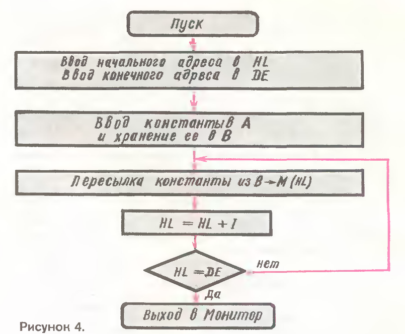

# 7. Примеры программ и игры

Все листинги переписаны по изображениям страниц журнала. Строка дампа — это адрес и 16
байт; заголовок `.0 … .F` — младшая цифра адреса.

## Пример: заполнение области памяти константой

Программа заносит константу в заданную область памяти. Входные параметры — начальный и
конечный адреса области и сама константа.



*Рисунок 4. Структурная схема алгоритма: ввод начального адреса в HL и конечного в DE →
ввод константы в A и хранение её в B → пересылка константы из B в M(HL) → HL = HL + 1 →
если HL ≠ DE, повторить пересылку → выход в МОНИТОР.*

Программу удобно записывать на **бланке (листинге)** с колонками адресов, объектных
кодов, меток и мнемоник, комментариев. Из колонки комментариев понятна работа программы,
из колонок меток и операций — её структура, а колонку кодов можно сразу вводить в ОЗУ.

| Адрес | Код | Метка | Мнемоника | Комментарий |
|-------|-----|-------|-----------|-------------|
| C000H | F7 | | `RST 6` | ввод начального адреса в DE |
| C001H | EB | | `XCHG` | пересылка DE в HL |
| C002H | F7 | | `RST 6` | ввод конечного адреса в DE |
| C003H | D7 | | `RST 2` | ввод константы в A |
| C004H | 47 | | `MOV B,A` | пересылка константы из A в B |
| C005H | 70 | M: | `MOV M,B` | пересылка константы из B в ОЗУ |
| C006H | CD | | `CALL 0259H` | обращение к подпрограмме МОНИТОРА сравнения адресов в HL и DE |
| C007H | 59 | | | |
| C008H | 02 | | | |
| C009H | 23 | | `INX H` | HL = HL + 1 |
| C00AH | C2 | | `JNZ M` | если HL ≠ DE, переход на метку M |
| C00BH | 05 | | | |
| C00CH | C0 | | | |
| C00DH | C7 | | `RST 0` | выход в МОНИТОР (адрес 0000H) |

```
C000  F7 EB F7 D7 47 70 CD 59 02 23 C2 05 C0 C7
```

Порядок работы:

1. Ввести коды директивой «1», проверить директивой «2».
2. Запустить директивой «6», ввести начальный и конечный адреса ОЗУ, затем константу.
3. Окончание работы — «11» на правом индикаторе.
4. Результат можно посмотреть директивой «5», а программу — сохранить на ленту.

Контрольная сумма программы — **0800H**.

---

## Игра «Реакция»

Загружается директивой «1» в C000H–C05FH (в журнале — «с C000H по C050H»). После пуска
директивой «6» нажимают клавишу «0», затем испытуемый нажимает любую клавишу, и на всех
индикаторах появляется «FF». Как только цифры начинают бежать, испытуемый должен нажать
**«УСТ»**. Код на индикаторах характеризует реакцию: чем он меньше, тем реакция быстрее.

```
      .0 .1 .2 .3 .4 .5 .6 .7 .8 .9 .A .B .C .D .E .F
C000  D7 FE 00 CA 27 C0 FE 01 CA 22 C0 FE 02 CA 21 C0
C010  FE 03 CA 31 C0 FE 04 CA 36 C0 FE 05 CA 3B C0 C3
C020  40 C0 06 0B C3 41 C0 06 0E C3 41 C0 06 07 C3 41
C030  C0 06 08 C3 41 C0 06 10 C3 41 C0 06 0D C3 41 C0
C040  06 0F 3E FF 21 FF FF EF DF 05 C2 47 C0 3E 00 21
C050  00 00 EF 23 00 00 C3 51 C0 00 C0 C3 10 C0 FF FF
```

---

## Программа «Гамма»

Загружается директивой «1» в C000H–C082H. Пуск — директивой «7» с адреса **C03EH**. После
ввода пускового адреса вводят длительность звучания нот и интервал пауз между ними —
двузначными шестнадцатеричными числами 01–FFH. Гамму слушают, подключив к разъёму
интерфейса вход магнитофона, включённого на запись.

```
      .0 .1 .2 .3 .4 .5 .6 .7 .8 .9 .A .B .C .D .E .F
C000  00 00 00 D5 1E 01 21 C9 0C 7B D3 A1 CD 1D C0 2F
C010  5F 00 7C B4 C2 09 C0 15 C2 06 C0 D1 C9 41 2B 05
C020  C2 1E C0 C9 21 CA 0C 2B 7D B4 C2 27 C0 C9 D5 21
C030  CA 0C 2B 7D B4 C2 32 C0 1D C2 2F C0 D1 C9 F7 0E
C040  8B CD 03 C0 CD 2E C0 0E 7A CD 03 C0 CD 2E C0 0E
C050  6C CD 03 C0 CD 2E C0 0E 65 CD 03 C0 CD 2E C0 0E
C060  5A CD 03 C0 CD 2E C0 0E 4F 03 CD 03 C0 CD 2E C0
C070  0E 47 CD 03 C0 CD 2E C0 0E 44 CD 03 C0 CD 2E C0
C080  C3 3F C0 00 00 00 00 00 FF FF FF FF FF FF FF FF
```

*Прим.: по адресу C069H стоит лишний байт `03` (`INX B`). Он выбивается из повторяющегося
шаблона `0E nn CD 03 C0 CD 2E C0`, но на работу программы не влияет.*

---

## Игра «Крестики-нолики»

Загружается директивой «1» в C000H–C065H. Поле из 9 клеток пронумеровано так:

```
01  02  03
08  09  04
07  06  05
```

После пуска директивой «6» на крайнем правом индикаторе появляется «09» — первый ход
микроЭВМ, которая всегда ходит первой, в центр. Свой нолик вы ставите, вводя с клавиатуры
номер клетки. Если вы проиграли, на дисплее появляется код **73**, при ничьей — **11**.

```
      .0 .1 .2 .3 .4 .5 .6 .7 .8 .9 .A .B .C .D .E .F
C000  3E 09 32 00 90 D7 CD 1A C0 C3 47 C0 00 00 00 00
C010  7A CD 1A C0 7A CD 1A C0 C7 00 06 01 90 C2 22 C0
C020  3E 08 4F 32 00 90 D7 57 1E 04 79 93 CA 32 C0 F2
C030  35 C0 2E 08 85 6F 7A 95 CA 45 C0 00 00 26 73 7C
C040  32 00 90 EF 76 79 C9 FE 01 CA 5E C0 FE 03 CA 5E
C050  C0 FE 05 CA 5E C0 FE 07 CA 5E C0 C3 10 C0 79 CD
C060  1A C0 90 C3 3D C0 FF FF FF FF FF FF FF FF FF FF
```

---

## Игра «Лабиринт»

«Лабиринт» — это поле 16×16 клеток, заполненное препятствиями. Координаты препятствий
вводятся отдельным набором данных с адреса **C200H** (1 — препятствие, 0 — свободно).

Мысленно представив поле, нужно кратчайшим путём пройти из нижнего правого угла
(координаты **FFH**) в верхний левый (**00H**). Управление:

| Клавиша | Движение |
|:-:|---|
| 1 | на одну клетку влево |
| 2 | на одну клетку вправо |
| 3 | на одну клетку вверх |
| 4 | на одну клетку вниз |

Каждый ход сопровождается коротким звуковым сигналом. Если на пути препятствие, сигнала
нет, но шаг засчитывается. Число шагов выводится на индикаторы HL, координаты — на
индикатор A. Звук выводится через магнитофон, включённый на запись (с остановленной
лентой). Пуск — директивой «6», затем нажатие любой клавиши.

### Программа

```
      .0 .1 .2 .3 .4 .5 .6 .7 .8 .9 .A .B .C .D .E .F
C000  00 00 00 E7 C6 00 C2 0E C0 26 C2 C3 10 C0 26 C1
C010  2E FF 7D 32 F5 C0 32 F6 C0 32 00 90 11 00 00 EF
C020  E7 3D CA 33 C0 FE 01 CA 42 C0 FE 02 CA 64 C0 C3
C030  52 C0 00 3A F6 C0 D6 10 32 F6 C0 DA 8E C0 C3 76
C040  C0 00 3A F6 C0 C6 10 32 F6 C0 DA 8E C0 00 C3 76
C050  C0 00 3A F6 C0 C6 01 32 F6 C0 CD C6 C0 DA 8E C0
C060  C3 76 C0 00 3A F6 C0 D6 01 32 F6 C0 CD C6 C0 DA
C070  8E C0 C3 76 C0 00 6F 7E C6 00 C2 8E C0 00 3A F6
C080  C0 32 F5 C0 32 00 90 CD D5 C0 C3 9C C0 00 3A F5
C090  C0 32 F6 C0 32 00 90 F5 C3 A5 C0 00 3A F5 C0 C6
C0A0  00 CA B7 C0 F5 7B 3C 27 5F D2 AF C0 7A 3C 57 F1
C0B0  EB EF EB C3 20 C0 00 CD D5 C0 DF 00 DB A0 C6 00
C0C0  CA B7 C0 C3 03 C0 C9 C1 79 E6 10 CA D1 C0 37 78
C0D0  C9 37 3F 78 C9 D5 E5 1E 01 16 50 21 FF 00 7B D3
C0E0  A1 CD EF C0 2F 5F 2B 7C B5 C2 DE C0 E1 D1 C9 42
C0F0  05 C2 F0 C0 C9 D2 D2 21 C0 C2 3E FF EF E7 EF DF
```

### Пример поля

```
      .0 .1 .2 .3 .4 .5 .6 .7 .8 .9 .A .B .C .D .E .F
C200  00 00 01 01 01 01 01 01 01 01 01 01 01 01 01 01
C210  00 00 00 00 00 01 00 00 00 01 00 00 00 00 00 01
C220  01 00 00 00 01 00 00 01 00 00 00 01 00 00 00 01
C230  01 00 01 00 00 00 00 00 00 00 01 00 00 01 00 01
C240  01 00 00 00 00 01 00 00 00 00 01 00 00 00 00 01
C250  01 00 01 00 00 00 00 00 01 00 00 00 01 00 00 01
C260  01 00 00 00 00 01 00 00 00 00 00 00 00 00 00 01
C270  01 00 00 00 00 00 00 00 00 00 01 00 00 01 00 01
C280  01 00 01 00 00 01 00 01 00 01 00 00 01 00 00 01
C290  01 00 00 00 00 00 00 00 01 00 00 00 00 00 00 01
C2A0  01 00 00 01 00 00 00 01 00 00 00 01 00 01 00 01
C2B0  01 01 00 00 00 00 00 01 00 00 00 00 00 00 00 01
C2C0  01 00 00 00 00 00 00 00 00 01 00 00 00 01 00 01
C2D0  01 00 01 00 00 01 00 00 00 00 00 01 00 01 00 01
C2E0  01 00 00 01 00 00 00 01 00 00 00 00 00 00 00 00
C2F0  01 01 01 01 01 01 01 01 01 01 01 01 01 01 00 00
```

То же поле наглядно (`#` — препятствие, строка — старшая цифра координаты, столбец —
младшая):

```
   0123456789ABCDEF
0  ..##############
1  .....#...#.....#
2  #...#..#...#...#
3  #.#.......#..#.#
4  #....#....#....#
5  #.#.....#...#..#
6  #....#.........#
7  #.........#..#.#
8  #.#..#.#.#..#..#
9  #.......#......#
A  #..#...#...#.#.#
B  ##.....#.......#
C  #........#...#.#
D  #.#..#.....#.#.#
E  #..#...#........
F  ##############..
```

Далее: [08-sborka-i-nalazhivanie.md](08-sborka-i-nalazhivanie.md)
