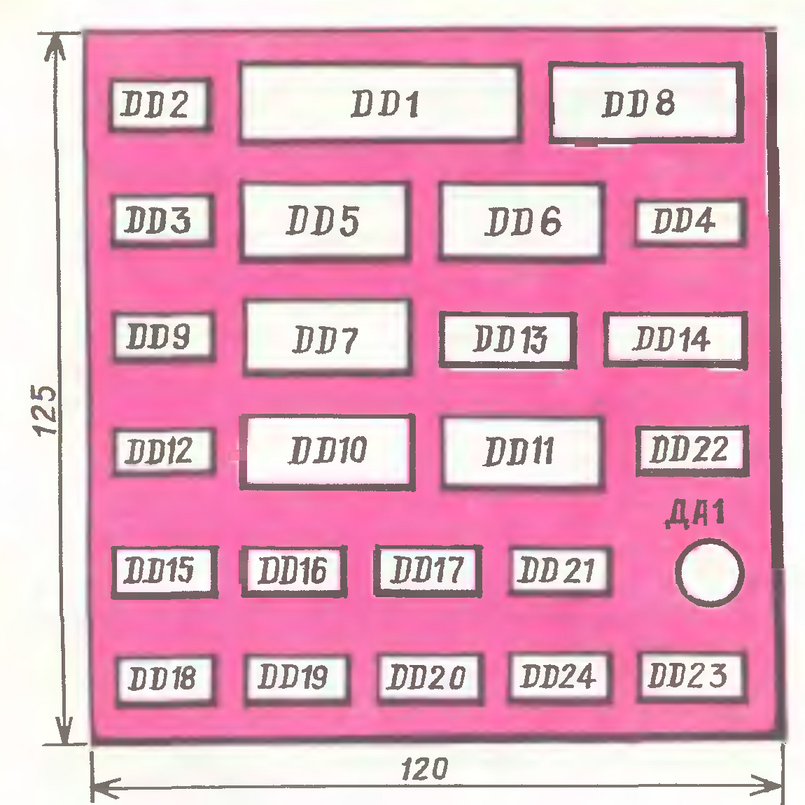
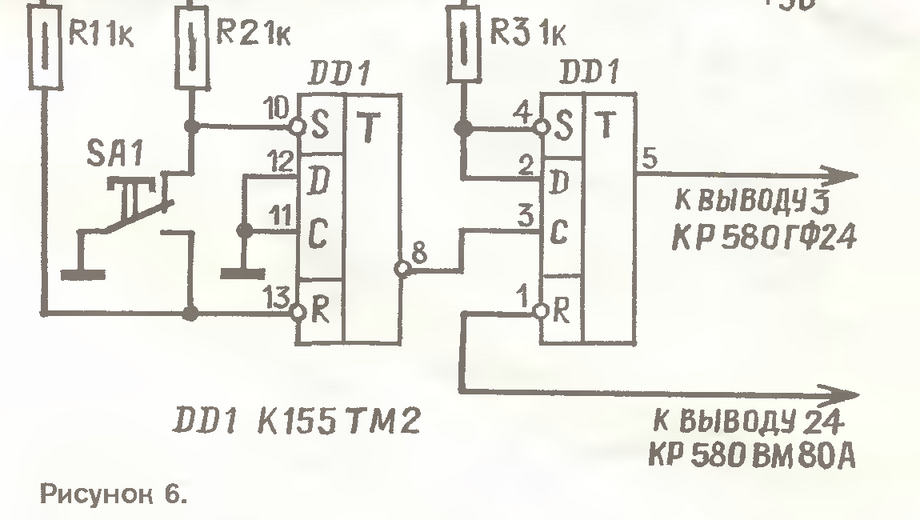

# 8. Сборка и налаживание микроЭВМ

## Конструкция

МикроЭВМ собрана на плате из фольгированного стеклотекстолита размером **120 × 125 мм**.



*Рисунок 5. Расположение микросхем на плате (вид сверху):*

```
DD2    [   DD1   ]    [ DD8 ]
DD3   [DD5]   [DD6]     DD4
DD9   [DD7]   DD13     DD14
DD12  [DD10]  [DD11]   DD22
DD15  DD16  DD17  DD21  (DA1)
DD18  DD19  DD20  DD24  DD23
```

- Общий провод и цепь +5 В выполнены **печатным** способом, проводниками максимальной
  ширины. Остальные соединения — тонким изолированным проводом.
- В местах подключения печатных проводников к выводам питания микросхем ставятся
  **блокировочные конденсаторы 0,22–0,68 мкФ**.
- Чтобы уменьшить паразитные связи и наводки, монтажные провода прокладывают по
  кратчайшим путям между соседними выводами и **не связывают в жгут**. Удобен
  обмоточный провод марки ПЭПЛОТ или ПЭВТЛК.
- Для связи с периферией на плате ставят **разъём СНП34** или контактные штыри. Штыри
  общего провода и +5 В соединяют с клеммами источника питания проводами большого
  сечения.

**Клавиатура** — любая, где каждая клавиша замыкает контакты, например от
микрокалькулятора. Клавиатуру можно разместить и на плате микроЭВМ. Индикаторы дисплея
лучше разместить на монтажной плате, чтобы уменьшить число соединительных проводов.

## Замены микросхем

- Серию К155 можно заменить функциональными аналогами серий **К133, К555, К531**.
- Буфер шины адреса КР580ИР82 можно заменить на **К589ИР12** или на две **К589АП16**.
- ОЗУ можно собрать практически на любых статических микросхемах памяти. Если у
  микросхем раздельные вход и выход, эти выводы соединяют вместе.

## Налаживание

Модуль предельно прост, но аппаратура и программы в нём тесно связаны, поэтому даже
незначительная неисправность делает микроЭВМ неработоспособной.

### 1. Проверка монтажа и питания

- Проверить омметром все связи на плате и устранить дефекты монтажа.
- Особенно тщательно проверить связи между выводами питания микросхем и контактами
  источника питания. Щупами касаться непосредственно выводов микросхем — так видны
  дефекты пайки.
- Проверить наличие питающих напряжений на выводах микропроцессора и других микросхем.

### 2. Тактовый генератор

Нужен осциллограф. Убедиться в наличии синхроимпульсов **Ф1 и Ф2** на выводах
микропроцессора.

### 3. Проверка процессора командой NOP

На шину данных перемычками принудительно подают код **00H** (`NOP`). На шине адреса
должен идти последовательный перебор всех адресов; сигналы на адресных линиях имеют
форму симметричных прямоугольных импульсов, причём частота уменьшается вдвое при
увеличении номера разряда на единицу. Если команда NOP выполняется правильно, переходят
к проверке остальных блоков.

### 4. Статическая проверка (режим ожидания)

1. Вывод 3 микросхемы DD2 соединяют с общим проводом. На выводе 24 микропроцессора (WI)
   должен быть высокий уровень — процессор в состоянии ожидания.
2. Нажать «УСТ». На всех линиях шины адреса должен быть нулевой уровень, на шине данных —
   код **0011 0001** (31H), записанный в нулевой ячейке МОНИТОРА (ПЗУ DD10).

### 5. Проверка индикации

- Сымитировать сигнал выборки индикатора: отключить провод от вывода 10 элемента DD12.3
  и соединить его с общим проводом. На **правом** индикаторе появится код **31**.
- Отключить провода от выводов 13 микросхем DD18 и DD19 — код 31 появится на
  **среднем** индикаторе.
- Припаять провод к выводу 13 на место и отключить провода от выводов 14 DD18 и DD19 —
  код 31 должен появиться на **левом** индикаторе.
- Припаять все отключённые от DD18 и DD19 провода на место. Вынуть ПЗУ DD10 из панельки
  (или отключить провод от её вывода 20).

### 6. Проверка клавиатуры

Отключив провод от вывода 8 микросхемы DD22, имитируют сигнал выборки клавиатуры.
Нажимая клавиши, проверяют, что на правом индикаторе появляются коды нажатых клавиш.
Затем провод к выводу 8 DD22 восстанавливают.

### 7. Пошаговое выполнение МОНИТОРА

1. Снять перемычку с вывода 3 (в журнале — «вывода 3 микросхемы DD1»; по смыслу,
   видимо, имеется в виду DD2, заземлённый на шаге 4).
   Вставить ПЗУ DD10 в панельку.
2. Собрать на отдельной плате узел пошагового режима (рис. 6).
3. Отключить провод от вывода 14 (INT) микропроцессора, чтобы исключить влияние
   прерываний.
4. Нажать «УСТ» и последовательно нажимать кнопку **«ШАГ»** (SA1). Каждое нажатие
   переводит процессор на следующий машинный цикл и снова в ожидание, так что по
   индикаторам можно следить за кодами из ПЗУ и их исполнением.
5. После **девяти** нажатий на правом индикаторе должны появиться две единички, на
   адресной шине — адрес 9000H, на шине управления — активный сигнал ЗПЗУ.
6. При несоответствиях искать замыкания между линиями шины адреса, данных или другими
   сигнальными линиями.



*Рисунок 6. Узел пошагового выполнения на триггерах К155ТМ2 (на рисунке обозначена как
DD1 отдельной платы). Кнопка SA1 через первый триггер (подавление дребезга, выводы
10–13, 8) управляет вторым триггером (выводы 1–5). Выход идёт к выводу 3 (RDYIN)
КР580ГФ24, а сигнал с вывода 24 (WI) КР580ВМ80А сбрасывает триггер. R1–R3 — 1 кОм к
+5 В.*

Добившись исполнения первых команд МОНИТОРА в шаговом режиме, отключают дополнительный
узел. Вывод 10 DD12.3 подключают к своему проводу, отключив его от общего.

### 8. Проверка в динамике

1. Нажать «УСТ» — на правом индикаторе «11».
2. Клавиша **«3»** — тест индикации.
3. Клавиша **«4»** — тест ОЗУ.
4. Директивы работы с памятью: «1» (запись с C000H), «2» (чтение с C000H), «0» (запись с
   любого адреса), «5» (чтение с любого адреса).
5. Если всё работает, набрать программу заполнения памяти константой (см.
   [07-programmy.md](07-programmy.md)) и проверить с её помощью директиву пуска с любого
   адреса.

### 9. Часы

Восстановить провод к выводу 14 микропроцессора. Клавиша **«B»** — индикация времени:
показание на правом индикаторе должно меняться каждую секунду. Проверить установку
времени директивой **«C»**. Часы запускают по сигналам точного времени кнопкой «УСТ».

### 10. Магнитофон

1. Нажать **«9»** и набрать адреса **D000H–DFFFH**. Осциллографом наблюдать непрерывную
   последовательность импульсов на выводе 9 DD4.2. Тон записываемой фонограммы должен
   быть всё время одинаковым.
2. Эту запись используют для проверки формирователя на DA1: при воспроизведении на
   выводе 6 DA1 должна быть прямоугольная последовательность импульсов.
3. Проверить запись и чтение программы заполнения памяти константой.

Как показывает опыт, если все детали исправны и монтаж выполнен без ошибок, микроЭВМ
начинает работать сразу после сборки. Убедиться в этом помогут игровые программы из
[07-programmy.md](07-programmy.md).

Далее: [09-kr580vm80a.md](09-kr580vm80a.md)
