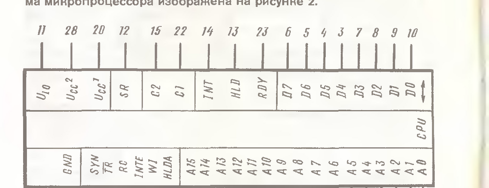
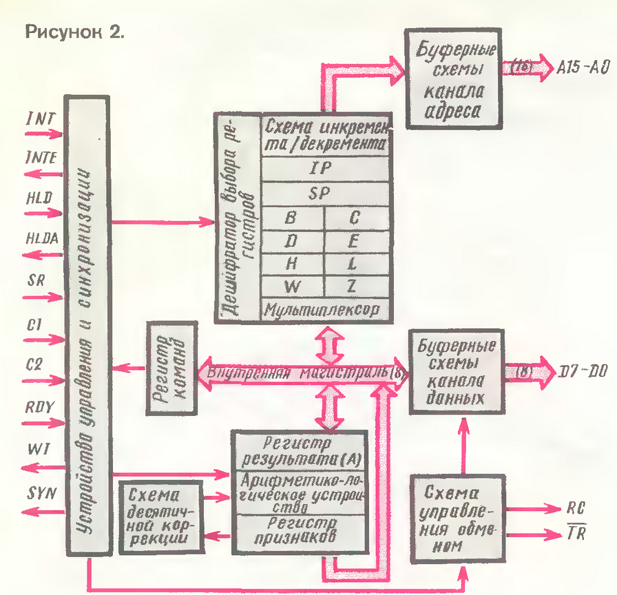
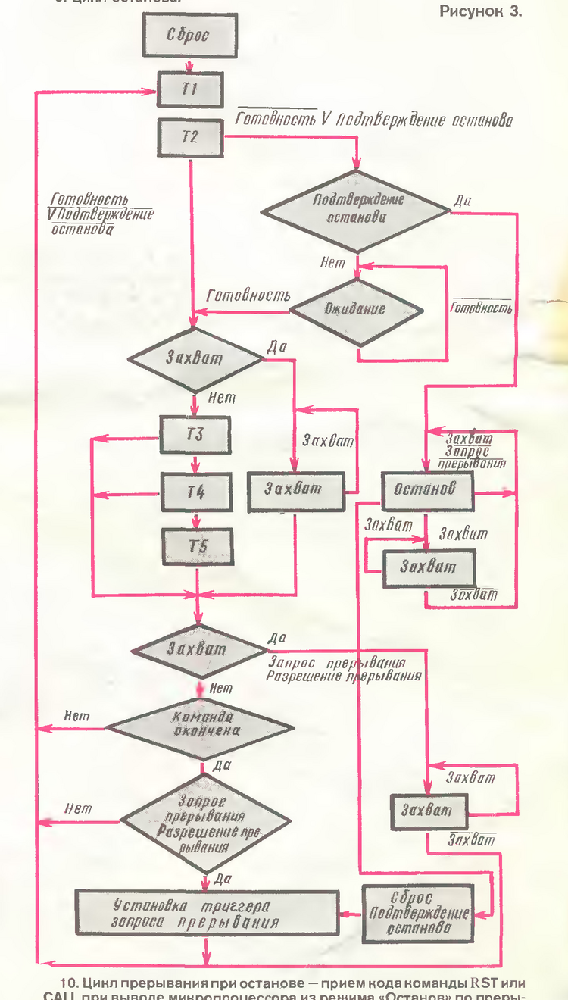

# 9. Справочный листок «ЮТ-88»: микропроцессор КР580ВМ80А

Микросхема **КР580ВМ80А** — функционально законченный однокристальный микропроцессор с
фиксированной системой команд (аналог Intel 8080A). Применяется в устройствах обработки
данных и управления.

У микропроцессора раздельные **16-разрядный канал адреса** и **8-разрядный канал данных**.
Канал адреса обеспечивает прямую адресацию к внешней памяти объёмом до 65 536 байт и к
256 устройствам ввода и 256 устройствам вывода.

## Условное графическое обозначение и выводы

*Рисунок 1. Условное графическое обозначение КР580ВМ80А.*

**Таблица 1. Назначение выводов**

| Вывод | Обозначение | Тип | Назначение | Аналог i8080 |
|-------|-------------|-----|------------|--------------|
| 25, 26, 27, 29, 30, 31, 32, 33, 34, 35, 1, 40, 37, 38, 39, 36 | A0 … A15 | выходы | канал адреса | A0–A15 |
| 2 | GND | — | общий | GND |
| 10, 9, 8, 7, 3, 4, 5, 6 | D0 … D7 | входы/выходы | канал данных | D0–D7 |
| 11 | U₁₀ | вход | напряжение источника смещения −5 В | VBB |
| 12 | SR | вход | установка в исходное состояние (сброс) | RESET |
| 13 | HLD | вход | захват | HOLD |
| 14 | INT | вход | запрос прерывания | INT |
| 22, 15 | C1, C2 | входы | тактовые сигналы | Ф1, Ф2 |
| 16 | INTE | выход | разрешение прерывания | INTE |
| 17 | RC | выход | приём информации | DBIN |
| 18 | TR | выход | выдача информации (инверсный) | WR |
| 19 | SYN | выход | сигнал синхронизации | SYNC |
| 20 | Ucc1 | — | напряжение питания +5 В | VCC |
| 21 | HLDA | выход | подтверждение захвата | HLDA |
| 23 | RDY | вход | сигнал «Готовность» | READY |
| 24 | WI | выход | сигнал «Ожидание» | WAIT |
| 28 | Ucc2 | — | напряжение питания +12 В | VDD |

Соответствие выводов адреса: A0–25, A1–26, A2–27, A3–29, A4–30, A5–31, A6–32, A7–33,
A8–34, A9–35, A10–1, A11–40, A12–37, A13–38, A14–39, A15–36.
Данных: D0–10, D1–9, D2–8, D3–7, D4–3, D5–4, D6–5, D7–6.

## Структура

*Рисунок 2. Структурная схема: устройство управления и синхронизации, регистр команд,
блок регистров с дешифратором выбора регистров и мультиплексором, АЛУ с регистром
результата (A), регистром признаков и схемой десятичной коррекции, буферные схемы
каналов адреса и данных, схема управления обменом.*

- **АЛУ** — восьмиразрядное. Выполняет арифметические и логические операции над
  двоичными числами в дополнительном коде, а также обработку двоично-десятичных
  упакованных чисел.
- **Блок регистров**:
  - 16-разрядный регистр адреса команды (IP, он же PC);
  - 16-разрядный указатель стека (SP);
  - 16-разрядный регистр временного хранения (WZ);
  - 16-разрядная схема инкремента/декремента;
  - шесть 8-разрядных регистров общего назначения B, C, D, E, H, L, которые могут
    использоваться как три 16-разрядных: BC, DE, HL.

## Машинные циклы и такты

Команды выполняются по **машинным циклам**. В зависимости от типа команды их от одного до
пяти. Машинный цикл состоит из **тактов**: от трёх до пяти, в зависимости от кода
команды. Такт равен периоду тактовой частоты; при **2,0 МГц** это **500 нс**.

В начале каждого машинного цикла процессор вырабатывает сигнал синхронизации **SYN**.
Вместе с другими сигналами он используется для организации режимов работы.

*Рисунок 3. Диаграмма состояний типичного машинного цикла с учётом сигналов RDY, HLD и
INT.*

Ход машинного цикла:

- После подачи высокого уровня на вывод **SR** процессор устанавливается в исходное
  состояние.
- **Такт T1**: на канал адреса выдаётся адрес ячейки с командой, на канал данных —
  информация состояния.
- **Такт T2**: анализируются входы RDY и «Подтверждение останова». В зависимости от них
  процессор переходит в состояние ожидания, останова или к такту T3.
- **Такт T3**: при высоком уровне RDY принимается информация по каналу данных и
  анализируется HLD. Если HLD высокий, после T3 процессор переходит в состояние захвата.
- В зависимости от команды цикл завершается после T3, T4 или T5.
- В конце цикла снова анализируется HLD. При низком HLD проверяется, закончена ли
  команда. Если нет, выполняется следующий машинный цикл с T1.
- В конце каждой команды анализируется **INT**. Если INT высокий и прерывание разрешено
  командой EI, выполняется машинный цикл «Прерывание» с такта T1; иначе с T1 начинается
  первый цикл новой команды.

### Информация состояния

Действия процессора в цикле определяет 8-разрядная информация состояния, которая
выдаётся через канал данных в такте T1 каждого машинного цикла. Из неё формируются
сигналы обращения к памяти и устройствам ввода/вывода (в «ЮТ-88» это делает системный
контроллер КР580ВК38).

**Таблица 2. Сигналы состояния по типам машинных циклов**

| Разряд | Сигнал | M1 | Чтение ЗУ | Запись в ЗУ | Чтение стека | Запись в стек | Ввод | Вывод | Прерывание | Останов | Прерывание при останове |
|---|---|:-:|:-:|:-:|:-:|:-:|:-:|:-:|:-:|:-:|:-:|
| D0 | Подтверждение прерывания (INTA) | 0 | 0 | 0 | 0 | 0 | 0 | 0 | 1 | 0 | 1 |
| D1 | Запись/вывод (W̄O) | 1 | 1 | 0 | 1 | 0 | 1 | 1* | 1 | 1 | 1 |
| D2 | Стек (STACK) | 0 | 0 | 0 | 1 | 1 | 0 | 0 | 0 | 0 | 0 |
| D3 | Подтверждение останова (HLTA) | 0 | 0 | 0 | 0 | 0 | 0 | 0 | 0 | 1 | 1 |
| D4 | Вывод (OUT) | 0 | 0 | 0 | 0 | 0 | 0 | 1 | 0 | 0 | 0 |
| D5 | M1 | 1 | 0 | 0 | 0 | 0 | 0 | 0 | 0 | 0 | 1 |
| D6 | Ввод (INP) | 0 | 0 | 0 | 0 | 0 | 1 | 0 | 0 | 0 | 0 |
| D7 | Чтение (MEMR) | 1 | 1 | 0 | 1 | 0 | 0 | 0 | 0 | 1 | 0 |

\* Так напечатано в журнале. По документации Intel 8080 сигнал W̄O активен низким уровнем и в
цикле вывода равен 0.

### Типы машинных циклов

1. **M1** — приём первого байта команды в регистр команд.
2. **Чтение ЗУ** — по содержимому счётчика команд или одной из пар BC, DE, HL.
3. **Запись в ЗУ** — по содержимому одной из пар BC, DE, HL.
4. **Чтение стека** — чтение ЗУ по содержимому указателя стека.
5. **Запись в стек** — запись в ЗУ по содержимому указателя стека.
6. **Ввод** — ввод из внешнего устройства в регистр результата (аккумулятор).
7. **Вывод** — вывод из регистра результата во внешнее устройство.
8. **Прерывание** — приём кода команды RST или CALL от контроллера прерываний.
9. **Останов**.
10. **Прерывание при останове** — приём кода RST или CALL при выходе из режима «Останов»
    по прерыванию.

## Состояния «ожидание», «захват», «останов»

При выполнении команд процессор может переходить в одно из трёх состояний. Их
длительность определяется внешними сигналами.

**Ожидание.** Высокий уровень на **RDY** обеспечивает автоматическое выполнение команд с
тактовой частотой. При низком RDY процессор переходит в режим «Ожидание» и выдаёт высокий
уровень на **WI**. Сигнал RDY используется для согласования с медленными устройствами
(цикл обращения длиннее одного такта), а также для пошагового (по циклам) выполнения
команды или покомандного выполнения программы (см. рис. 6 в
[08-sborka-i-nalazhivanie.md](08-sborka-i-nalazhivanie.md)).

**Захват.** При высоком уровне на **HLD** процессор переходит в состояние «захват» и
подтверждает это высоким уровнем на **HLDA**. Буферы каналов адреса и данных переходят в
высокоимпедансное состояние, выходные управляющие сигналы — в низкий уровень (кроме TR и
HLDA). В захват процессор переходит в такте T3, если выполняется цикл чтения и RDY
высокий, и в такте после T3, если выполняется цикл записи. HLD и HLDA позволяют
организовать **прямой доступ к памяти** для любого внешнего устройства.

**Останов.** По команде **HLT** процессор переходит в «останов», а буферы каналов адреса и
данных — в высокоимпедансное состояние. Выход из останова — по высокому уровню на одном
из входов:

- **SR** — процессор начинает работу с такта T1 цикла M1;
- **HLD** — процессор переходит в «захват», а после снятия HLD возвращается в «останов»;
- **INT** — процессор выполняет цикл «прерывание при останове» с T1, если перед HLT была
  выполнена команда EI; иначе остаётся в останове.

**Прерывание.** Высокий уровень на **INT** позволяет прервать текущую программу и перейти к
подпрограмме обслуживания устройства, выдавшего запрос (например, часов). После окончания
текущей команды процессор с такта T1 выполняет машинный цикл «Прерывание», если
прерывание было разрешено командой EI. В такте T1 этого цикла по шине данных выдаётся
сигнал состояния «Подтверждение прерывания». По окончании подпрограммы происходит возврат
к прерванной программе.

**Сброс.** Высокий уровень на **SR** длительностью не менее трёх периодов тактовой частоты
устанавливает процессор в исходное состояние: триггеры разрешения прерывания и захвата,
регистры команд, признаков и адреса команды обнуляются. После снятия SR процессор
читает первую команду по адресу **0000H**.

## Система команд

Система команд состоит из **78 базовых команд**, которые делятся на пять групп:

- **передачи данных** — из регистра в регистр, из регистра в память;
- **арифметические** — сложение, вычитание, инкремент и декремент регистров или ячеек
  памяти;
- **логические** — И, ИЛИ, сравнение, сдвиги;
- **переходов** — условные и безусловные переходы, вызов подпрограмм и возврат из них;
- **управления, ввода/вывода и работы со стеком** — управление регистром признаков, ввод
  и вывод.

Полная таблица — в [10-sistema-komand.md](10-sistema-komand.md). Общие закономерности
использования команд описаны в [05-programmirovanie.md](05-programmirovanie.md).

### Форматы данных и команд

Информационное слово — 8-разрядный байт `D7 D6 D5 D4 D3 D2 D1 D0` (D7 — старший разряд).
Отрицательные числа хранятся в **дополнительном коде**.

Команда может быть одно-, двух- или трёхбайтной. Байты команды хранятся в
последовательных ячейках, а адрес первого байта — это всегда адрес кода операции.

| Формат | Байт 1 | Байт 2 | Байт 3 |
|--------|--------|--------|--------|
| Однобайтная | код операции | — | — |
| Двухбайтная | код операции | данные или адрес порта | — |
| Трёхбайтная | код операции | данные или адрес (младший байт) | данные или адрес (старший байт) |

Операнды хранятся в программно доступных регистрах или в памяти. Для операнда в регистре
используются регистровая и неявная регистровая адресация, для операнда в памяти —
непосредственная, прямая, косвенная регистровая и стековая.

### Регистр признаков

Регистр признаков хранит пять битов, которые вырабатываются при выполнении некоторых
операций.

| Признак | Название | Равен 1, если… |
|---------|----------|----------------|
| S | знак | старший разряд результата равен 1 (результат отрицательный) |
| Z | нуль | результат равен нулю |
| AC | вспомогательный перенос | был перенос из 3-го разряда в 4-й |
| C | перенос | был перенос из 7-го разряда или заём в 7-й разряд |
| P | чётность | число единиц в результате чётное |

Расположение битов в регистре признаков:

| D7 | D6 | D5 | D4 | D3 | D2 | D1 | D0 |
|:-:|:-:|:-:|:-:|:-:|:-:|:-:|:-:|
| S | Z | 0 | AC | 0 | P | 1 | C |

Далее: [10-sistema-komand.md](10-sistema-komand.md)
