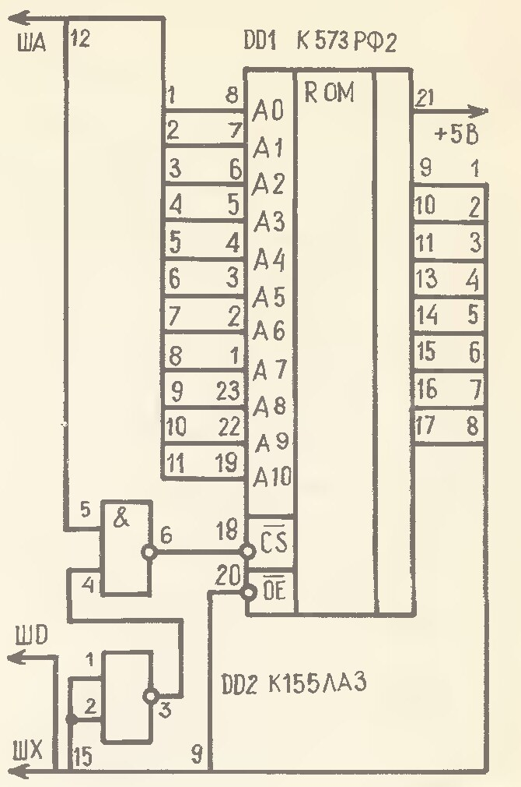

# 11. «ЮТ-88» в роли калькулятора

*«ЮТ» для умелых рук», № 3, 1989, с. 10–11. Рубрика «Твой персональный компьютер».*

> Продолжаем публикацию материалов по персональному компьютеру «ЮТ-88». Тем, кто уже
> собрал первый модуль и хотел бы использовать его в деле, предлагаем библиотечку
> математических программ, которую можно использовать для школьных занятий. В процессе
> освоения компьютера, думаем, вам пригодится и «Словарь программиста». Он поможет вам
> ориентироваться в сложной терминологии, на которую так щедра литература о компьютерах
> и программировании. Тем же, кто решил как следует разобраться в принципах работы
> отдельных узлов микроЭВМ, советуем заглянуть в справочную подборку «Микросхемы для
> «ЮТ-88». Там подробно рассказано, как устроена и работает каждая из них.

С этого номера мы начинаем публиковать прикладные программы для нашего компьютера. Для
начала предлагаем вам библиотечку подпрограмм. Они помогут вам выполнять не только
простейшие математические операции, но и вычисления тригонометрических, показательных и
логарифмических функций, оперируя числами с плавающей запятой. Словом, то, что может
программируемый микрокалькулятор.

Занимает она всего 2 Кбайта ОЗУ. Для работы программы используются ячейки памяти с
адресами C361–C37F. В них заносятся исходные данные, промежуточные вычисления и
окончательный результат.

## Представление чисел

Исходные данные записываются в форме однобайтных и двухбайтных чисел с фиксированной
запятой в прямом коде. Знак числа записывается в старшем разряде. Если в нём записан
«0», то число положительное, а если «1» — отрицательное. У двухбайтного числа в 15-м
разряде записывается бит знака, а в 14-м — бит переполнения. Диапазон представления
чисел однобайтных от FFH до 7FH или от −127 до +127, а двухбайтных — от BFFFH до 3FFFH
(от −16 383 до +16 383).

Для чисел с плавающей запятой используются трёхбайтные числа. Первый их байт определяет
порядок, второй и третий — мантиссу. Двоичное число, представляемое в формате с
плавающей запятой, можно вычислить по формуле:

```
D = (−1)^S · 2^(e·(−1)^P) · f,
```

где P — значение знакового бита порядка, S — бит знака (если S=0 — число положительное,
а если S=1 — отрицательное), e — значение порядка, f — значение мантиссы.

*Прим.: в журнале формула набрана как «D = (−1)^S · 2e(−1)^P · f»; показатель степени
восстановлен по смыслу. По тексту и по коду: байт порядка — бит 7 = P (знак порядка),
биты 6–0 = e; двухбайтная мантисса в прямом коде — бит 15 = S, бит 14 — переполнение,
нормализованная мантисса имеет бит 13 = 1.*

Порядок показывает число двоичных позиций, на которые нужно сдвинуть мантиссу, чтобы
число в ячейках памяти было представлено в форме нормализованного числа, которое меньше
единицы, с первым значащим разрядом после запятой. Если знак порядка «0», то мантисса
сдвигается влево, а если знак порядка «1», то вправо. Диапазон представления чисел в
этом случае составляет от 10⁻³⁵ до 10³⁵.

## Обслуживающие подпрограммы

Подпрограммы библиотеки делятся на основные и обслуживающие. Знакомство с библиотекой мы
начнём с последних.

1. **Нормализация мантиссы.** Трёхбайтное число из ячеек памяти C371H, C372H, C373H
   извлекается и нормализуется путём поразрядного сдвига мантиссы. При этом сдвиг
   мантиссы на 1 бит вправо сопровождается увеличением порядка на единицу, а сдвиг
   мантиссы на 1 бит влево — уменьшением порядка на единицу. В результате нормализации в
   исходные ячейки памяти записывается число, у которого 14-й разряд мантиссы равен
   нулю, а 13-й — единице. Пусковой адрес подпрограммы **092DH**.
2. **Относительное нормирование двух чисел.** Это требуется, например, для сложения чисел
   в формате с плавающей запятой, когда необходимо, чтобы числа имели равные порядки.
   Подпрограмма извлекает из ячеек памяти C371H, C372H, C373H первое число, а из ячеек
   памяти C374H, C375H, C376H второе и сравнивает их порядки по абсолютному значению.
   Больший порядок записывается вместо меньшего, а число с меньшим порядком сдвигается
   вправо без округления на величину, равную разности этих порядков. Пусковой адрес
   подпрограммы **0877H**.
3. **Передача трёхбайтного числа из памяти в регистры A–B–C.** Начальный адрес
   трёхбайтного числа должен находиться в регистровой паре HL. Пусковой адрес **0A8CH**.
4. **Пересылка из регистров A–B–C трёх байтов в ОЗУ** по начальному адресу в
   регистровой паре HL. Пусковой адрес **0A92H**.

*Прим.: в журнале пусковые адреса местами набраны с буквой «О» вместо нуля и «Д» вместо
«D» (например, «ОА8СН», «ОД32Н»); здесь они приведены в нормальной записи.*

## Основные подпрограммы

Теперь расскажем о подпрограммах арифметических операций.

| Операция                                       | Операнды                                        | Результат    | Пуск  |
|------------------------------------------------|-------------------------------------------------|--------------|-------|
| Сложение однобайтных чисел со знаком           | C371H и C374H                                   | C374H        | 0849H |
| Сложение двухбайтных чисел со знаком           | C372H, C373H (первое) и C375H, C376H (второе)   | C375H, C376H | 08DDH |
| Сложение трёхбайтных чисел с плавающей запятой | C371H–C373H (первое) и C374H–C376H (второе)     | C374H–C376H  | 0987H |
| Умножение двухбайтных чисел со знаком          | C372H, C373H и C375H, C376H                     | C375H, C376H | 0994H |
| Умножение трёхбайтных чисел с плав. запятой    | C371H–C373H и C374H–C376H                       | C374H–C376H  | 09ECH |
| Деление двухбайтных чисел с фикс. запятой      | делимое C375H, C376H; делитель C372H, C373H     | C375H, C376H | 09F9H |
| Деление чисел с плавающей запятой              | делимое C374H–C376H; делитель C371H–C373H       | C374H–C376H  | 0A6FH |
| Показательная функция                          | показатель степени C364H; основание C371H–C373H | C374H–C376H  | 0B08H |
| Натуральный логарифм                           | аргумент C361H–C363H                            | C368H–C36AH  | 0B6BH |
| SIN X (0 ≤ X ≤ π/4)                            | аргумент C361H–C363H                            | C365H–C367H  | 0C87H |
| COS X (0 ≤ X ≤ π/4)                            | аргумент C361H–C363H                            | C365H–C367H  | 0D32H |
| TG X (0 ≤ X ≤ π/4)                             | аргумент C361H–C363H                            | C374H–C376H  | 0E47H |
| CTG X (0 ≤ X ≤ π/4)                            | аргумент C361H–C363H                            | C374H–C376H  | 0F61H |
| ARC TG X (0 < X < 1)                           | аргумент C361H–C363H                            | C365H–C367H  | 0E75H |
| ARC SIN X (−1 ≤ X ≤ 1)                         | аргумент C361H–C363H                            | C365H–C367H  | 0D47H |
| ARC COS X (−1 ≤ X ≤ 1)                         | аргумент C361H–C363H                            | C365H–C367H  | 0E40H |
| ARC CTG X (0 < X < 1)                          | аргумент C361H–C363H                            | C365H–C367H  | 0F8FH |

Текст журнала по пунктам:

**Сложение чисел.**

1. Сложение однобайтных чисел со знаком. Слагаемые находятся по адресам C371H и C374H,
   результат размещается в ячейке ОЗУ C374H. Пусковой адрес 0849H.
2. Сложение двухбайтных чисел со знаком. Слагаемые находятся по адресам C372H, C373H
   (первое слагаемое) и по адресам C375H и C376H, сумма размещается в ячейки ОЗУ C375H и
   C376H. Пусковой адрес 08DDH.
3. Сложение трёхбайтных чисел с плавающей запятой. Первое слагаемое заносится в ячейки
   C371H, C372H, C373H, а второе слагаемое в ячейки C374H, C375H, C376H, результат
   сложения помещается в ячейки с адресами C374H, C375H, C376H. Пусковой адрес 0987H.

**Умножение чисел.**

1. Умножение двухбайтных чисел со знаком. Сомножители находятся в памяти по адресам
   C372H, C373H и C375H, C376H. Произведение заносится в ячейки C375H, C376H. Пусковой
   адрес 0994H.
2. Умножение трёхбайтных чисел с плавающей запятой. Сомножители заносятся в ячейки
   памяти C371H, C372H и C373H, а также C374H, C375H и C376H. Произведение находится в
   ячейках C374H, C375H и C376H. Пусковой адрес 09ECH.

**Деление чисел.**

1. Деление двухбайтных чисел с фиксированной запятой. Делимое и делитель находятся в
   памяти по адресам C375H, C376H, C372H, C373H. Частное в ячейках C375H и C376H.
   Пусковой адрес 09F9H.
2. Деление чисел с плавающей запятой. Делимое находится в адресах C374H, C375H, C376H,
   делитель в адресах C371H, C372H, C373H. Частное заносится в адреса C374H, C375H,
   C376H. Пусковой адрес 0A6FH.

**Показательная функция.** Показатель степени заносится в ячейку C364, а основание
степени в ячейки памяти C371H, C372H, C373H. Результат записывается в ячейки памяти
C374H, C375H, C376H. Пусковой адрес 0B08H.

**Логарифмическая функция (натуральный логарифм).** Аргумент заносится в ячейки ОЗУ
C361H, C362H, C363H, а значение функции записывается в ячейки ОЗУ C368H, C369H, C36AH.
Пусковой адрес 0B6BH.

**Тригонометрические функции.**

1. SIN X (0 ≤ X ≤ π/4). Аргумент заносится в ячейки ОЗУ C361H, C362H, C363H, а значение
   функции C365H, C366H, C367H. Пусковой адрес 0C87H.
2. COS X (0 ≤ X ≤ π/4). Аргумент заносится в ячейки ОЗУ C361H, C362H, C363H, а значение
   функции C365H, C366H, C367H. Пусковой адрес 0D32H.
3. TG X (0 ≤ X ≤ π/4). Аргумент заносится в ячейки ОЗУ C361H, C362H, C363H, а значение
   функции в ячейки C374H, C375H, C376H. Пусковой адрес 0E47H.
4. CTG X (0 ≤ X ≤ π/4). Аргумент заносится в ячейки ОЗУ C361H, C362H, C363H, а значение
   функции заносится по адресам C374H, C375H, C376H. Пусковой адрес 0F61H.
5. ARC TG X (0 < X < 1). Аргумент заносится в ячейки ОЗУ C361H, C362H, C363H, а значение
   функции C365H, C366H, C367H. Пусковой адрес 0E75H.
6. ARC SIN X (−1 ≤ X ≤ 1). Аргумент заносится в ячейки ОЗУ C361H, C362H, C363H, а
   значение функции C365H, C366H, C367H. Пусковой адрес 0D47H.
7. ARC COS X (−1 ≤ X ≤ 1). Аргумент заносится в ячейки ОЗУ C361H, C362H, C363H, а
   значение функции в ячейки C365H, C366H, C367H. Пусковой адрес 0E40H.
8. ARC CTG (0 < X < 1). Аргумент заносится в ячейки ОЗУ C361H, C362H, C363H, а значение
   функции в ячейки ОЗУ C365H, C366H, C367H. Пусковой адрес 0F8FH.

*Прим.: для SIN X в журнале напечатано «значение функции C355H, C366H, C367H» — опечатка,
должно быть C365H (как у COS X; так же и в коде, см. 0C95H: `21 65 C3`). Показатель
степени для показательной функции — однобайтное целое со знаком в C364H (по коду: бит 7
— знак, биты 6–0 — величина).*

## Подключение ПЗУ

Листинг библиотечки перепишите в микросхему ПЗУ. Схема её подключения к компьютеру
показана на рисунке.



*Схема подключения ПЗУ: DD1 — К573РФ2 (2 Кбайт; входы A0–A10 — от линий 1–11 шины
адреса, выходы — на шину данных), DD2 — К155ЛА3. Выбор кристалла CS (вывод 18) даёт
элемент DD2 «2И-НЕ» из линии 12 шины адреса (A11) и проинвертированного сигнала с
провода 15 нижней шины; вход OE (вывод 20) — от провода 9 этой же шины. На схеме у ПЗУ
показан только вывод 21 (+5 В).*

*Прим.: нижняя шина на схеме подписана неразборчиво («ШХ», по смыслу — шина
управления/выборки модуля 1). Скорее всего, провод 15 — сигнал выборки сегмента
0000H–0FFFH (активный низкий; в модуле 1 он выведен на разъём расширения, см.
[02-arhitektura.md](02-arhitektura.md)), а провод 9 — ЧТЗУ. Тогда ПЗУ выбирается при
«сегмент 0000H–0FFFH» и A11=1, то есть занимает ровно 0800H–0FFFH. Номера проводов в
статье не расшифрованы — это предположение.*

## Листинг библиотеки (ПЗУ, 0800H–0FFFH)

В журнале — два столбца по 64 строки, 2048 байт. Контрольной суммы в журнале нет.

```
      .0 .1 .2 .3 .4 .5 .6 .7 .8 .9 .A .B .C .D .E .F
0800  00 00 00 00 00 00 00 00 00 00 00 00 00 00 00 00
0810  00 00 00 00 00 00 00 00 00 00 00 00 00 00 00 00
0820  00 00 00 00 00 00 00 00 00 00 00 00 00 00 00 00
0830  00 00 00 00 00 00 00 00 00 00 00 00 00 00 00 00
0840  00 00 00 00 00 00 00 00 00 21 71 C3 0E 02 7E A7
0850  FA 63 08 0D 47 21 74 C3 7E A7 FA 63 08 80 FA 6F
0860  08 77 C9 E6 7F 2F C6 01 0D CA 5D 08 C3 54 08 2F
0870  C6 01 F6 80 C3 61 08 21 74 C3 7E A7 FA 83 08 47
0880  C3 8B 08 E6 7F 2F C6 01 C3 7F 08 21 71 C3 7E A7
0890  FA 9D 08 90 CA CC 08 FA CD 08 C3 A5 08 E6 7F 2F
08A0  C6 01 C3 93 08 4F 21 71 C3 7E 21 74 C3 77 23 7E
08B0  E6 7F 57 23 5E 97 7A 1F 57 7B 1F 37 3F 5F 0D CA
08C0  C5 08 C3 B6 08 73 2B 7E E6 80 B2 77 C9 2F C6 01
08D0  4F 21 74 C3 7E 21 71 C3 77 23 C3 AF 08 21 73 C3
08E0  4E 2B 7E A7 FA FF 08 47 21 76 C3 5E 2B 7E A7 FA
08F0  0E 09 57 EB 09 EB 7A A7 FA 1D 09 72 23 73 C9 E6
0900  7F 2F 47 79 2F C6 01 4F 3E 00 88 C3 E7 08 E6 7F
0910  2F 57 7B 2F C6 01 5F 3E 00 8A C3 F2 08 2F 57 7B
0920  2F C6 01 5F 3E 00 8A F6 80 57 C3 FB 08 7E A7 FA
0930  36 09 4F C3 3E 09 E6 7F 2F C6 01 C3 32 09 23 7E
0940  E6 80 47 7E E6 7F 57 23 7E A7 CA 7E 09 5F 0D 7B
0950  17 5F 7A 17 A7 FA 5C 09 57 C3 4E 09 1F 57 7B 1F
0960  5F 0C 7A 1F 57 7B 1F 5F 0C 73 2B 7A B0 77 2B 79
0970  A7 FA 76 09 77 C9 2F C6 01 F6 80 C3 74 09 7A A7
0980  CA 75 09 97 C3 4D 09 CD 77 08 CD DD 08 21 74 C3
0990  CD 2D 09 C9 21 72 C3 7E 21 75 C3 AE E6 80 F5 7E
09A0  E6 7F 57 23 5E 97 67 6F 06 08 3A 73 C3 1F 4F DA
09B0  C1 09 7C 1F 67 7D 1F 6F AF 05 CA C5 09 79 C3 AD
09C0  09 19 C3 B2 09 06 06 3A 72 C3 1F 4F DA DE 09 7C
09D0  1F 67 7D 1F 6F AF 05 CA E2 09 79 C3 CA 09 19 C3
09E0  CF 09 11 76 C3 7D 12 1B F1 B4 12 C9 CD 49 08 CD
09F0  94 09 21 74 C3 CD 2D 09 C9 21 72 C3 7E 21 75 C3
0A00  AE E6 80 F5 7E E6 7F 57 23 5E 21 72 C3 7E E6 7F
0A10  47 23 4E EB 16 02 1E 01 7D 91 6F 7C 98 67 FA 2D
0A20  0A 17 3F 7A 17 57 DA 50 0A 29 C3 18 0A 17 3F 7A
0A30  17 57 DA 5C 0A 09 29 7C B7 FA 2D 0A C3 18 0A 7D
0A40  91 6F 7C 98 67 FA 54 0A 17 3F 7B 17 5F DA 66 0A
0A50  29 C3 3F 0A 17 3F 7B 17 5F DA 66 0A 09 29 7C B7
0A60  FA 54 0A C3 3F 0A 21 75 C3 F1 B2 77 23 73 C9 21
0A70  71 C3 7E 17 3F 1F 77 CD 49 08 CD F9 09 21 74 C3
0A80  CD 2D 09 21 71 C3 7E 17 3F 1F 77 C9 7E 23 46 23
0A90  4E C9 77 23 70 23 71 C9 0E 01 16 20 1E 00 62 6B
0AA0  FE 02 D2 A8 0A C3 E6 0A 06 08 07 DA B2 0A 05 C3
0AB0  AA 0A 05 CA DB 0A F5 AF 7A 1F 57 7B 1F 5F 0C F1
0AC0  07 D2 B2 0A 19 D2 B2 0A F5 7C 1F 67 7D 1F 6F AF
0AD0  7A 1F 57 7B 1F 5F 0C F1 C3 B2 0A 3D FE 01 CA E6
0AE0  0A 54 5D C3 A8 0A AF 84 FA F0 0A 29 0D C3 E6 0A
0AF0  7C 1F 67 7D 1F 6F 0C AF 7C 1F 32 78 C3 7D 1F 32
0B00  79 C3 0C 79 32 77 C3 C9 3A 64 C3 E6 7F CA 5E 0B
0B10  F5 21 71 C3 CD 8C 0A 21 74 C3 CD 92 0A F1 3D CA
0B20  29 0B F5 CD EC 09 C3 1D 0B 3A 64 C3 A7 F2 6A 0B
0B30  21 71 C3 CD 8C 0A F5 C5 21 74 C3 CD 8C 0A 21 71
0B40  C3 CD 92 0A 21 74 C3 3E 01 06 20 0E 00 CD 92 0A
0B50  CD 6F 0A C1 F1 21 71 C3 CD 92 0A C3 6A 0B 21 74
0B60  C3 3E 01 06 20 0E 00 CD 92 0A C9 3E 02 06 20 0E
0B70  00 21 7A C3 CD 92 0A 3E 01 21 77 C3 CD 92 0A 21
0B80  6B C3 CD 92 0A 21 64 C3 77 06 A0 21 7D C3 CD 92
0B90  0A 21 61 C3 CD 8C 0A 21 71 C3 CD 92 0A 21 77 C3
0BA0  CD 8C 0A 21 74 C3 CD 92 0A CD 87 09 21 74 C3 CD
0BB0  8C 0A 21 65 C3 CD 92 0A 21 7D C3 CD 8C 0A 21 74
0BC0  C3 CD 92 0A CD 87 09 21 65 C3 CD 8C 0A 21 71 C3
0BD0  CD 92 0A CD 6F 0A 21 74 C3 CD 8C 0A 21 65 C3 CD
0BE0  92 0A 21 68 C3 CD 92 0A 21 6B C3 CD 8C 0A 21 71
0BF0  C3 CD 92 0A 21 7A C3 CD 8C 0A 21 74 C3 CD 92 0A
0C00  CD 87 09 21 74 C3 CD 8C 0A 21 6B C3 CD 92 0A 21
0C10  64 C3 34 34 21 65 C3 CD 8C 0A 21 71 C3 CD 92 0A
0C20  CD 08 0B 21 6B C3 CD 8C 0A 21 71 C3 CD 92 0A CD
0C30  6F 0A 21 68 C3 CD 8C 0A 21 71 C3 CD 92 0A CD 87
0C40  09 21 74 C3 CD 8C 0A 21 68 C3 CD 92 0A 21 72 C3
0C50  7E 17 3F 1F 77 CD 77 08 CD DD 08 21 75 C3 7E E6
0C60  7F CA 67 0C C3 E8 0B 23 7E FE 02 DA 71 0C C3 E8
0C70  0B 21 68 C3 7E A7 FA 7D 0C 3C C3 85 0C 3D E6 7F
0C80  CA 85 0C F6 80 77 C9 21 62 C3 21 64 C3 36 01 21
0C90  61 C3 CD 8C 0A 21 65 C3 CD 92 0A 21 6B C3 36 02
0CA0  21 64 C3 34 34 7E CD 98 0A 21 61 C3 CD 8C 0A 21
0CB0  71 C3 CD 92 0A CD 08 0B 21 77 C3 CD 8C 0A 21 71
0CC0  C3 CD 92 0A CD 6F 0A 21 6B C3 35 CA E3 0C 21 75
0CD0  C3 7E 17 3F 1F 77 2B CD 8C 0A 21 68 C3 CD 92 0A
0CE0  C3 A0 0C 21 68 C3 CD 8C 0A 21 71 C3 CD 92 0A CD
0CF0  87 09 21 65 C3 CD 8C 0A 21 71 C3 CD 92 0A CD 87
0D00  09 21 74 C3 CD 8C 0A 21 65 C3 CD 92 0A 21 72 C3
0D10  7E 17 3F 1F 77 CD 77 08 CD DD 08 21 75 C3 7E E6
0D20  7F CA 27 0D C3 9B 0C 23 7E FE 02 DA 31 0D C3 9B
0D30  0C C9 21 62 C3 21 64 C3 36 00 23 36 01 23 36 20
0D40  23 36 00 CD 9B 0C C9 21 62 C3 7E E6 80 F5 7E E6
0D50  7F 77 21 64 C3 36 01 21 61 C3 CD 8C 0A 21 65 C3
0D60  CD 92 0A 23 AF 36 01 23 36 20 23 77 23 36 02 23
0D70  36 20 23 77 23 36 02 23 36 20 23 77 21 77 C3 36
0D80  01 23 36 20 23 77 CD EE 0D CD 34 0F CD 15 0F 21
0D90  77 C3 CD 8C 0A 21 71 C3 CD 92 0A CD EC 09 21 65
0DA0  C3 CD 8C 0A 21 71 C3 CD 92 0A CD 87 09 21 74 C3
0DB0  CD 8C 0A 21 7A C3 CD 92 0A 21 72 C3 7E 17 3F 1F
0DC0  77 CD 77 08 CD DD 08 21 75 C3 7E E6 7F CA DF 0D
0DD0  21 7A C3 CD 8C 0A 21 65 C3 CD 92 0A C3 86 0D 23
0DE0  7E FE 02 D2 D0 0D 21 66 C3 46 F1 B0 77 C9 21 6E
0DF0  C3 CD 8C 0A 21 71 C3 CD 92 0A 21 6B C3 CD 8C 0A
0E00  21 74 C3 CD 92 0A CD 87 09 21 74 C3 CD 8C 0A 21
0E10  6E C3 CD 92 0A 21 68 C3 CD 8C 0A 21 74 C3 CD 92
0E20  0A CD 6F 0A 21 77 C3 CD 8C 0A 21 71 C3 CD 92 0A
0E30  CD EC 09 21 74 C3 CD 8C 0A 21 77 C3 CD 92 0A C9
0E40  CD 47 0D CD 92 0F C9 CD 32 0D 21 65 C3 CD 8C 0A
0E50  21 7B C3 CD 92 0A CD 87 0C 21 65 C3 CD 8C 0A 21
0E60  74 C3 CD 92 0A 21 7B C3 CD 8C 0A 21 71 C3 CD 92
0E70  0A CD 6F 0A C9 21 62 C3 7E E6 80 F5 7E E6 7F 77
0E80  21 64 C3 36 01 23 AF 77 23 77 23 77 23 36 01 23
0E90  36 20 23 77 23 36 02 23 36 20 23 77 CD 15 0F 21
0EA0  74 C3 CD 8C 0A 21 6E C3 CD 92 0A CD 34 0F CD 15
0EB0  0F 21 75 C3 7E 17 3F 1F 77 21 6E C3 CD 8C 0A 21
0EC0  71 C3 CD 92 0A CD 87 09 21 65 C3 CD 8C 0A 21 71
0ED0  C3 CD 92 0A CD 87 09 21 74 C3 CD 8C 0A 21 65 C3
0EE0  CD 92 0A 21 72 C3 7E 17 3F 1F 77 CD 77 08 CD DD
0EF0  08 21 75 C3 7E E6 7F CA 00 0F CD 34 0F C3 9C 0E
0F00  23 7E FE 02 DA 0D 0F CD 34 0F C3 9C 0E 21 66 C3
0F10  46 F1 B0 77 C9 21 61 C3 CD 8C 0A 21 71 C3 CD 92
0F20  0A CD 08 0B 21 68 C3 CD 8C 0A 21 71 C3 CD 92 0A
0F30  CD 6F 0A C9 21 64 C3 34 34 21 68 C3 CD 8C 0A 21
0F40  71 C3 CD 92 0A 21 6B C3 CD 8C 0A 21 74 C3 CD 92
0F50  0A CD 87 09 21 74 C3 CD 8C 0A 21 68 C3 CD 92 0A
0F60  C9 CD 87 0C 21 65 C3 CD 8C 0A 21 7B C3 CD 92 0A
0F70  CD 32 0D 21 65 C3 CD 8C 0A 21 74 C3 CD 92 0A 21
0F80  7B C3 CD 8C 0A 21 71 C3 CD 92 0A CD 6F 0A C9 CD
0F90  75 0E 21 65 C3 CD 8C 0A 21 71 C3 CD 92 0A 2B 7E
0FA0  17 3F 1F 77 23 23 36 01 23 36 32 23 36 42 CD 87
0FB0  09 21 74 C3 CD 8C 0A 21 65 C3 CD 92 0A C9 C3 87
0FC0  09 C3 EC 09 C3 6F 0A C3 C7 0F C3 98 0A C3 08 0B
0FD0  C3 D0 0F C3 6B 0B C3 87 0C C3 32 0D C3 47 0D C3
0FE0  40 0E C3 75 0E C3 61 0F C3 47 0E C3 8F 0F C3 49
0FF0  08 C3 DD 08 C3 94 09 C3 F9 09 C3 8C 0A C3 92 0A
```

*Прим.: дамп переписан по изображению; при сверке с текстовым слоем скана расхождений нет,
кроме неразличимых OCR «B»/«8», которые проверены по изображению. Программа проверена
трассировкой от всех пусковых адресов: все переходы и вызовы попадают на начала команд
внутри 0800H–0FFFH. Сумма всех 2048 байт по алгоритму директивы «8» МОНИТОРА
(16-битная сумма байтов) — **4BF3H** (0800H–0FFFH); в журнале контрольная сумма не
приводилась.*

*Прим.: область 0800H–0848H заполнена нулями. В конце ПЗУ (0FBEH–0FFFH) — таблица
переходов `JMP` на подпрограммы, в статье не описанная:*

| Адрес | Переход на | Подпрограмма                      |
|-------|------------|-----------------------------------|
| 0FBEH | 0987H      | сложение с плавающей запятой      |
| 0FC1H | 09ECH      | умножение с плавающей запятой     |
| 0FC4H | 0A6FH      | деление с плавающей запятой       |
| 0FC7H | 0FC7H      | (переход сам на себя — заглушка?) |
| 0FCAH | 0A98H      | (внутренняя подпрограмма)         |
| 0FCDH | 0B08H      | показательная функция             |
| 0FD0H | 0FD0H      | (переход сам на себя — заглушка?) |
| 0FD3H | 0B6BH      | натуральный логарифм              |
| 0FD6H | 0C87H      | SIN X                             |
| 0FD9H | 0D32H      | COS X                             |
| 0FDCH | 0D47H      | ARC SIN X                         |
| 0FDFH | 0E40H      | ARC COS X                         |
| 0FE2H | 0E75H      | ARC TG X                          |
| 0FE5H | 0F61H      | CTG X                             |
| 0FE8H | 0E47H      | TG X                              |
| 0FEBH | 0F8FH      | ARC CTG X                         |
| 0FEEH | 0849H      | сложение однобайтных              |
| 0FF1H | 08DDH      | сложение двухбайтных              |
| 0FF4H | 0994H      | умножение двухбайтных             |
| 0FF7H | 09F9H      | деление двухбайтных               |
| 0FFAH | 0A8CH      | память → A, B, C                  |
| 0FFDH | 0A92H      | A, B, C → память                  |
