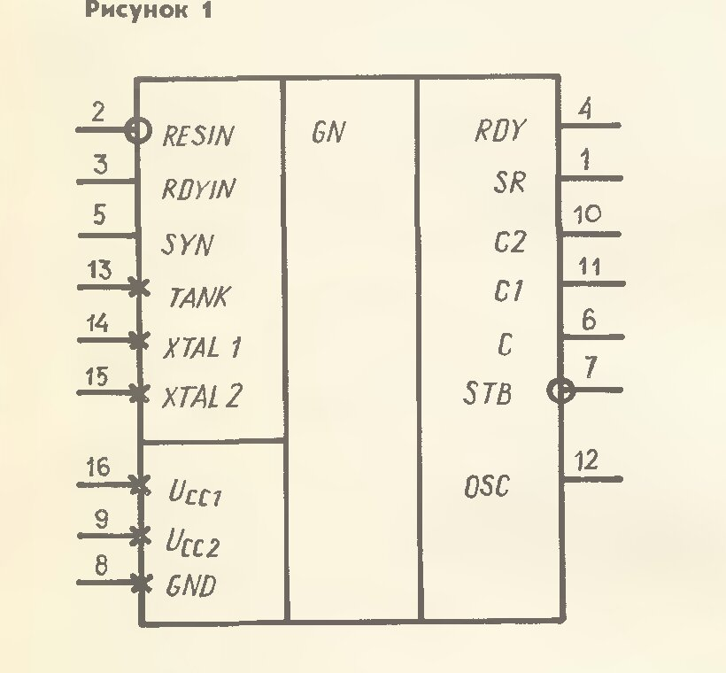
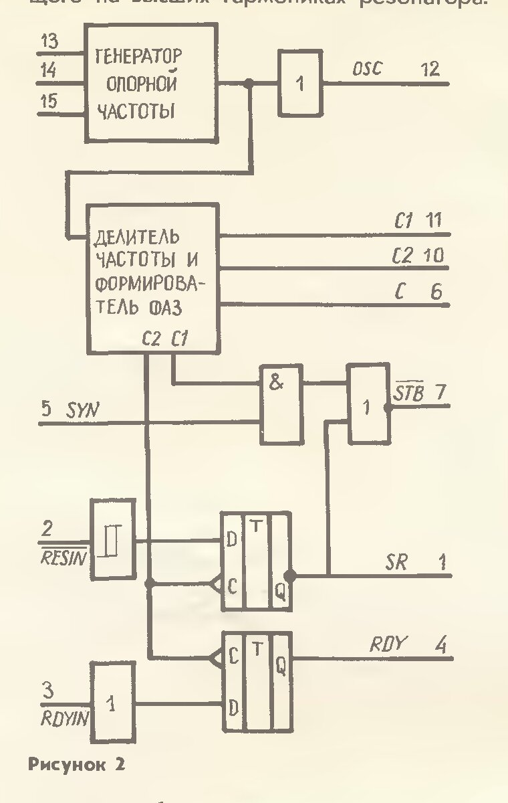
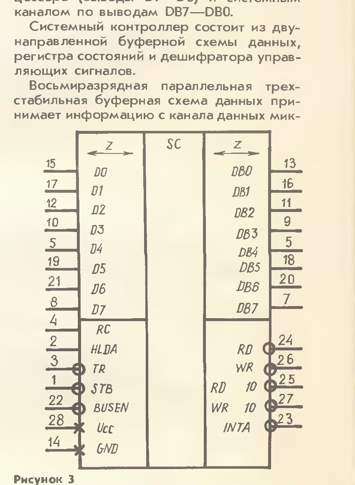
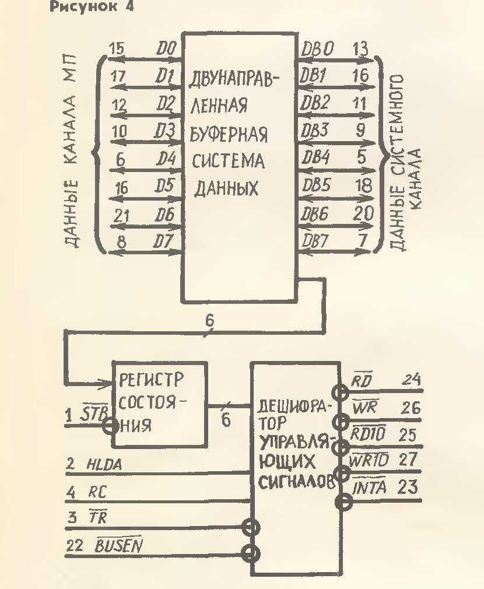
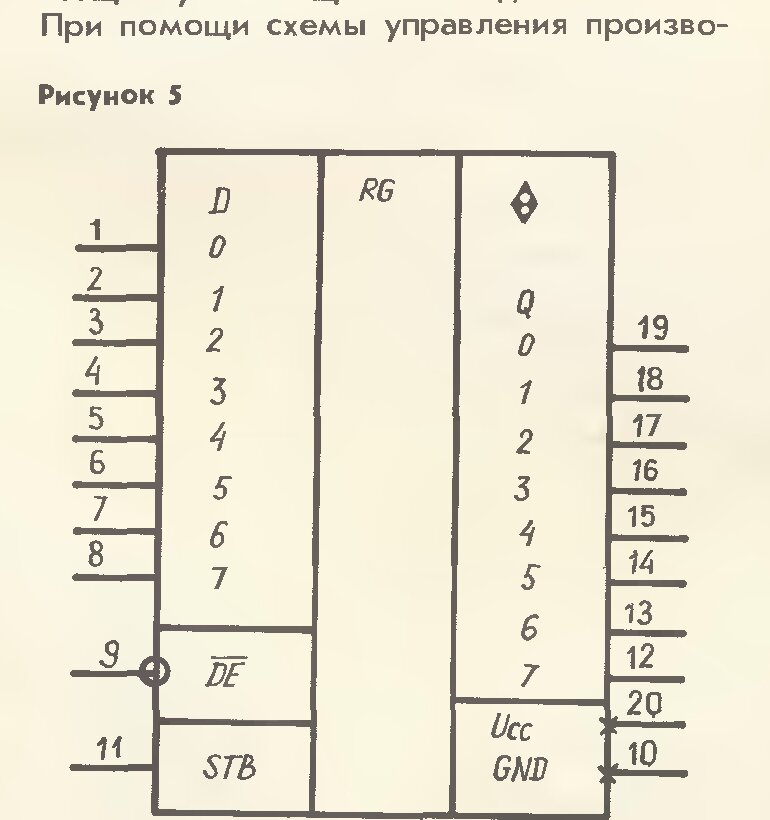
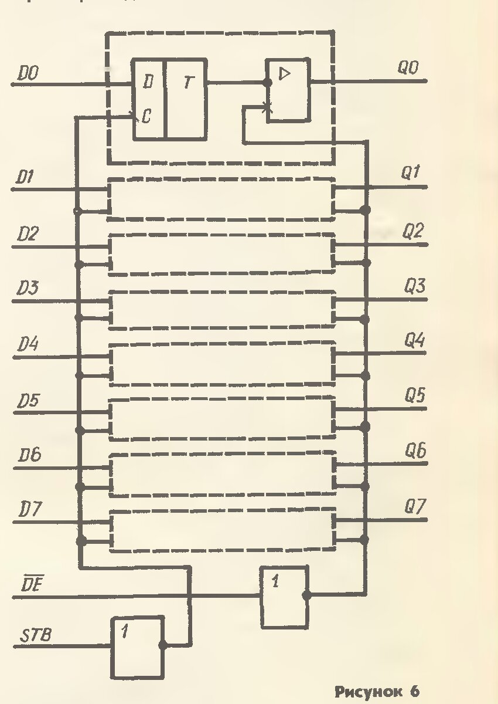

# 12. Микросхемы для «ЮТ-88»

*«ЮТ» для умелых рук», № 3, 1989, с. 12–13. Справочная подборка рубрики «Твой
персональный компьютер»: генератор тактовых сигналов КР580ГФ24, системный контроллер
КР580ВК38, адресный регистр КР580ИР82.*

## КР580ГФ24 — генератор тактовых сигналов

**КР580ГФ24** — микросхема генератора тактовых сигналов, используемого для синхронизации
работы микропроцессора КР580ВМ80А.

Генератор формирует две фазы C1 и C2 с импульсами положительной полярности, амплитудой
12 В и частотой 0,5–3,0 МГц. Кроме того, генератор выдаёт тактовые сигналы опорной
частоты с амплитудой около 5 В (уровень микросхем ТТЛ), стробирующий сигнал состояния
STB и тактовые сигналы C, синхронизированные с фазой C2, с амплитудой ТТЛ уровня.
Генератор синхронизирует сигналы RDYIN и RESIN с фазой C2.

Условное графическое обозначение микросхемы и её структурная схема показаны на рисунках
1 и 2. В таблице 1 приведены назначения её выводов.

*Рисунок 1. Условное графическое обозначение КР580ГФ24.*

Генератор тактовых сигналов состоит из генератора опорной частоты, счётчика-делителя на
9, формирователя фаз C1 и C2 и логических схем. Для стабилизации тактовых сигналов
опорной частоты ко входам XTAL1 и XTAL2 генератора подключается кварцевый резонатор,
частота которого должна быть **в 9 раз больше** частоты выходных сигналов C1 и C2. В
радиолюбительской практике чаще всего используются кварцевые резонаторы 15–20 МГц. Если
частота кварцевого резонатора больше 10 МГц, то последовательно с ним необходимо
включить конденсатор ёмкостью 3–10 пФ.

*Рисунок 2. Структурная схема КР580ГФ24: генератор опорной частоты, делитель частоты и
формирователь фаз, триггеры синхронизации RESIN и RDYIN.*

Выход TANK предназначен для подключения колебательного контура, работающего на высших
гармониках резонатора. Контур стабилизирует тактовые сигналы опорной частоты.

Тактовые сигналы, синхронные с сигналами опорной частоты, с выхода OSC используются в
том случае, если в микропроцессорной системе установлены несколько генераторов и надо
синхронизировать их работу.

Стробирующий сигнал состояния STB формируется при наличии на входе SYN напряжения
высокого уровня, поступающего с выхода микропроцессора КР580ВМ80А в начале каждого
машинного цикла. Сигнал STB используют для занесения информации состояния
микропроцессора в микросхему КР580ВК28 или КР580ВК38 для формирования ими управляющих
сигналов.

Для согласования работы микропроцессора КР580ВМ80А с другими устройствами сигнал RDYIN
синхронизируется по фазе C1 на выходе RDY генератора. Выходной сигнал SR используют для
установки в исходное состояние микропроцессора и других микросхем в системе.

### Таблица 1. Выводы КР580ГФ24

| Вывод | Обозначение | Тип вывода | Функциональное назначение вывода             |
|:-----:|-------------|:----------:|----------------------------------------------|
|   1   | SR          |   Выход    | Установка в исходное состояние МП и системы  |
|   2   | /RESIN      |    Вход    | Установка «0»                                |
|   3   | RDYIN       |    Вход    | Сигнал «Готовность»                          |
|   4   | RDY         |   Выход    | Сигнал «Готовность»                          |
|   5   | SYN         |    Вход    | Сигнал синхронизации                         |
|   6   | C           |   Выход    | Тактовый сигнал, синхронный с фазой C2       |
|   7   | /STB        |   Выход    | Стробирующий сигнал состояния                |
|   8   | GND         |     —      | Общий (земля)                                |
|   9   | Ucc2        |    Вход    | Напряжение питания +12 В                     |
|  10   | C2          |   Выход    | Тактовые сигналы — фаза C2                   |
|  11   | C1          |   Выход    | Тактовые сигналы — фаза C1                   |
|  12   | OSC         |   Выход    | Тактовые сигналы опорной частоты             |
|  13   | TANK        |    Вход    | Вывод для подключения колебательного контура |
|  14   | XTAL1       |    Вход    | Выводы для подключения кварцевого резонатора |
|  15   | XTAL2       |    Вход    | (вместе с выводом 14)                        |
|  16   | Ucc1        |    Вход    | Напряжение питания +5 В                      |

*Прим.: черта над обозначением (инверсный сигнал) передана косой чертой «/».*

## КР580ВК38 — системный контроллер

**КР580ВК38** (прежнее обозначение КР580ИК38) — микросхема системного контроллера и
буферного регистра данных. Используется в компьютерах и микропроцессорных системах,
собранных на базе микропроцессора КР580ВМ80А, как формирователь управляющих сигналов и
как буферный регистр данных. Условное графическое изображение микросхемы и её
структурная схема показаны на рисунках 3 и 4. Назначение выводов — в таблице 2.

Системный контроллер формирует управляющие сигналы по сигналам состояния микропроцессора
при обращении: к запоминающим устройствам — RD и WR, к устройствам ввода/вывода — RDIO и
WRIO, INTA, а также обеспечивает приём и передачу 8-разрядной информации между каналами
данных микропроцессора (выводы D7–D0) и системным каналом по выводам DB7–DB0.

Системный контроллер состоит из двунаправленной буферной схемы данных, регистра
состояний и дешифратора управляющих сигналов.

Восьмиразрядная параллельная трёхстабильная буферная схема данных принимает информацию
с канала данных микропроцессора по выводам D7–D0 и передаёт в регистр состояния
информацию состояния, на системный канал по выводам DB7–DB0 выдаёт данные в цикле
записи по сигналу TR. В цикле чтения по сигналу RC буферная схема принимает данные с
системного канала по выводам DB7–DB0 и передаёт их по выводам D7–D0 на канал данных
микропроцессора.

*Рисунок 3. Условное графическое обозначение КР580ВК38.*

Регистр состояния по входному сигналу /STB фиксирует информацию состояния
микропроцессора в такте T1 каждого машинного цикла микропроцессора.

Дешифратор управляющих сигналов формирует один из управляющих сигналов в каждом машинном
цикле: при чтении ЗУ — RD, при записи в ЗУ — WR, при считывании информации из устройств
ввода/вывода — RDIO, при записи в них — WRIO, при подтверждении запроса прерывания —
сигнал INTA.

### Таблица 2. Выводы КР580ВК38

| Вывод                        | Обозначение                            | Тип вывода | Функциональное назначение вывода               |
|------------------------------|----------------------------------------|:----------:|------------------------------------------------|
| 1                            | /STB                                   |    Вход    | Стробирующий сигнал состояния                  |
| 2                            | HLDA                                   |    Вход    | Подтверждение захвата                          |
| 3                            | /TR                                    |    Вход    | Выдача информации                              |
| 4                            | RS                                     |    Вход    | Приём информации                               |
| 5, 7, 9, 11, 13, 16, 18, 20  | DB4, DB7, DB3, DB2, DB0, DB1, DB5, DB6 | Выход/вход | Канал данных системы                           |
| 6, 8, 10, 12, 15, 17, 19, 21 | D4, D7, D3, D2, D0, D1, D5, D6         | Вход/выход | Канал данных микропроцессора                   |
| 14                           | GND                                    |     —      | Общий (земля)                                  |
| 22                           | /BUSEN                                 |    Вход    | Управление передачей данных и выдачей сигналов |
| 23                           | /INTA                                  |   Выход    | Подтверждение запроса прерывания               |
| 24                           | /RD                                    |   Выход    | Чтение из запоминающего устройства             |
| 25                           | /RDIO                                  |   Выход    | Чтение из устройств ввода/вывода               |
| 26                           | /WR                                    |   Выход    | Запись в запоминающее устройство               |
| 27                           | /WRIO                                  |   Выход    | Запись в устройства ввода/вывода               |
| 28                           | Ucc                                    |    Вход    | Напряжение питания +5 В                        |

*Прим.: в журнале сигналы ввода/вывода набраны как «RD10», «WR10» (цифра 1 и 0 вместо
букв IO); в тексте вход приёма называется то «RS», то «RC».*

*Рисунок 4. Структурная схема КР580ВК38: двунаправленная буферная схема данных,
регистр состояния, дешифратор управляющих сигналов.*

Асинхронный сигнал /BUSEN управляет выдачей данных с буферной схемы и управляющих
сигналов с дешифратора. При напряжении низкого уровня на входе /BUSEN буферная схема
передаёт все данные, и формируется один из управляющих сигналов; при напряжении
высокого уровня все выходы микросхемы переходят в высокоомное состояние.

Напряжение высокого уровня на входе HLDA переводит выходы RD, RDIO и INTA в пассивное
состояние (высокого уровня) и блокирует передачу информации через буферную схему данных.

Управляющие сигналы WR и WRIO формируются в цикле записи по сигналу /STB.

При работе с микропроцессором К580ВМ80А системный контроллер в цикле подтверждения
запроса прерывания формирует три сигнала INTA для приёма трёх байтов команды CALL от
контроллера прерывания (если он есть).

В небольших микропроцессорных системах выход INTA микросхем КР580ВК38 можно подсоединять
к напряжению +12 В через резистор 1 кОм. **Во время действия сигнала RC буферная схема
данных микросхемы формирует код команды RST 7** и передаёт его на канал данных
микропроцессора. Таким образом, микросхема — единственный вектор прерывания с номером 7
без дополнительных компонентов.

*Прим.: именно так в модуле 1 обрабатывается прерывание от часов: процессор получает
код FFH (`RST 7`) без контроллера прерываний.*

## КР580ИР82 — 8-разрядный адресный регистр

**КР580ИР82** — микросхема 8-разрядного адресного регистра, предназначенная для связи
микропроцессора с системной шиной; обладает повышенной нагрузочной способностью.
Микросхема К580ИР82 — восьмиразрядный D-регистр с «защёлкой» без инверсии и с тремя
состояниями на выходе. Условное графическое обозначение и её структурная схема
приведены на рисунках 5 и 6. Назначение выводов — в таблице 3.

Микросхема состоит из восьми одинаковых функциональных блоков и схемы управления. Блок
содержит D-триггер-«защёлку» и мощный выходной вентиль. При помощи схемы управления
производится стробирование записываемой информации и управление третьим состоянием
мощных выходных вентилей.

*Рисунок 5. Условное графическое обозначение КР580ИР82.*

В зависимости от состояния стробирующего сигнала STB микросхемы могут работать в двух
режимах: в режиме шинного формирователя или в режиме хранения. При высоком уровне
сигнала STB и низком сигнале /OE микросхема работает в режиме шинного формирователя:
информация на выходах Q повторяется или инвертируется по отношению к входной информации
D. При переходе сигнала STB из состояния высокого уровня в низкий происходит
«защёлкивание» передаваемой информации во внутреннем триггере, и она сохраняется до тех
пор, пока на входе STB присутствует напряжение низкого уровня. В течение этого времени
информация на входах не влияет на состояние выходов Q. При переходе сигнала STB вновь в
состояние высокого уровня состояние выходов приводится в состояние, соответствующее
информационным входам D.

При переходе сигнала /OE в состояние высокого уровня все выходы Q переходят в
высокоомное состояние независимо от входных сигналов STB и D. При возвращении сигнала
/OE в состояние низкого уровня выходы Q переходят в состояние, соответствующее
внутренним триггерам.

При обращении к внешнему устройству микропроцессор в начальный период цикла выполнения
микрокоманды выдаёт на местную шину адрес этого устройства, который через системную шину
передаётся необходимым числом регистров микросхемы.

*Рисунок 6. Структурная схема КР580ИР82.*

*Прим.: «повторяется или инвертируется» — так в журнале; КР580ИР82 — регистр без
инверсии (инвертирующий вариант — КР580ИР83).*

### Таблица 3. Выводы КР580ИР82

| Вывод | Обозначение | Тип вывода | Функциональное назначение вывода |
|:-----:|-------------|:----------:|----------------------------------|
|  1–8  | D0–D7       |    Вход    | Информационная шина              |
|   9   | /OE         |    Вход    | Разрешение передачи данных       |
|  10   | GND         |     —      | Общий (земля)                    |
|  11   | STB         |    Вход    | Стробирующий сигнал              |
| 12–19 | D7–D0       |   Выход    | Информационная шина              |
|  20   | Ucc         |     —      | Напряжение питания +5 В          |

*Прим.: выходы на выводах 12–19 в журнале обозначены «D7–D0»; по рисунку 5 это выходы
Q7–Q0 (Q0 — вывод 19, Q7 — вывод 12).*
