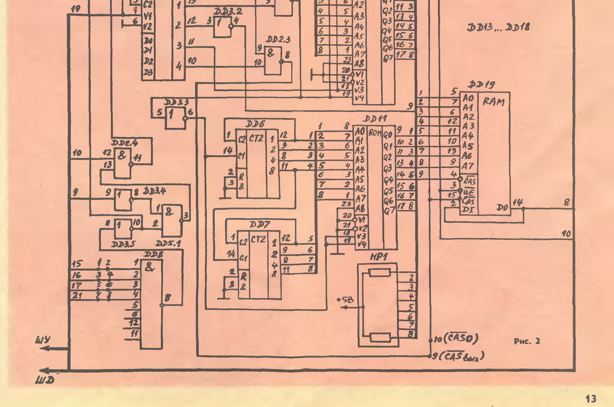

# 15. Модуль дополнительного ОЗУ

*«ЮТ» для умелых рук», № 11, 1989, с. 12–13. Рубрика «Твой персональный компьютер».
Подпись под статьёй — «А. Бартенев, инженер».*

Тема сегодняшнего разговора — блок памяти «ЮТ-88» ёмкостью 64 Кбайт, который позволит
вам использовать всё множество программ, написанных для «Микро-80», «Радио-86РК» и
«Специалиста». Выполнен он на микросхемах ОЗУ динамического типа.

## Динамическое ОЗУ и регенерация

В динамическом ОЗУ используются интегральные микросхемы, в которых хранение информации в
матрице ячеек памяти определяется наличием заряда в запоминающих ёмкостных элементах.
Однако если к этим элементам долгое время не обращаться, то за счёт тока утечки
информация может стереться. Для предотвращения этого эффекта необходимо периодически
считывать информацию из каждой ячейки памяти. При этом усилитель считывания автоматически
восстанавливает заряд на запоминающих ёмкостях, обеспечивая сохранность данных.

Такой режим работы динамического ОЗУ называется **регенерацией**.

В динамическом ОЗУ каждый столбец матрицы ячеек памяти имеет свой усилитель считывания,
поэтому процедуру регенерации можно выполнять одновременно для всей строки. Ограниченное
число выводов на корпусе микросхем ОЗУ потребовало применения мультиплексирования режима
выбора адреса, при котором для выбора строк и столбцов матрицы ячеек памяти используются
одни и те же адресные входы.

Вначале производится выбор строк путём подачи соответствующего кода на адресные входы
A0…A7 и нулевого уровня на вход сигнала выборки строк RAS. При этом код строки
записывается в адресный регистр и с помощью дешифратора строк выбирается регенерируемая
строка. Для надёжного хранения информации необходимо производить режим регенерации по
всему диапазону строк с периодом не более 2 мс.

Существует несколько стандартных алгоритмов процедуры регенерации. В частности, можно до
начала регенерации приостановить работу микропроцессора, воздействуя на его вход ГТ.
Получив ответный сигнал ОЖ, можно произвести цикл регенерации. В описываемом модуле
динамического ОЗУ использован другой путь: регенерация происходит не в моменты остановки
микропроцессора, а в интервале времени между двумя любыми циклами обращения к памяти.
Минимальный цикл между обращениями к памяти для микропроцессора КР580ВМ80А равен трём
тактам (трём периодам тактовой синхросерии Ф2). При используемой в компьютере частоте
кварцевого резонатора 16 МГц длительность такта составляет 0,565 мкс. Для реализации
«прозрачной» регенерации ОЗУ в этом случае имеется достаточно времени даже при
использовании микросхем К565РУ5Д с временем цикла 450 нс.

> *Прим.: при кварце 16 МГц и делителе 9 в КР580ГФ24 такт равен 9/16 мкс = 0,5625 мкс
> (тактовая частота ≈ 1,78 МГц); в журнале округлено до 0,565 мкс.*

Такой режим регенерации позволяет организовать обмен данными в синхронном режиме, не
требует информации о состоянии микропроцессора и, главное, исключает простой
микропроцессора.

В режимах чтения и записи регенерация ячеек памяти, подключённых к выбранной строке,
осуществляется автоматически. В режиме чтения на вход микросхем WE подаётся уровень
логической единицы, а в режиме записи — уровень логического нуля, после чего на входы
A0…A7 подаётся код столбца и с некоторой задержкой нулевой уровень на вход выбора столбца
CAS. С помощью дешифратора столбцов определённая шина столбца через соответствующий ключ
выборки подключается к шине данных, осуществляя запись или считывание информации в
выбранной ячейке памяти.

## Электрическая схема

Электрическая схема модуля динамического ОЗУ изображена на рис. 2. Модуль включает в себя
**контроллер ОЗУ**, реализованный на микросхемах DD1–DD11, и **основной блок ОЗУ**
объёмом 64 Кбайта на микросхемах DD12–DD19, перекрывающий адресное пространство
**0000H–FFFFH**. Модуль динамического ОЗУ может быть использован как с процессорным
модулем, так и совместно с дисплейным модулем.



*Рисунок 2. Принципиальная схема модуля динамического ОЗУ. Слева — шины ША, ШУ, ШД;
вверху справа стрелка «к ОЗУ квазидиска» — продолжение адресной шины для будущего
модуля квазидиска.*

### Перечень микросхем

| Позиция   | Тип       | Назначение                                                   |
|-----------|-----------|--------------------------------------------------------------|
| DD1       | К155ТМ2   | триггеры формирования интервала обращения к ОЗУ              |
| DD2, DD5  | К155ЛА3   | логика управления                                            |
| DD3       | К155ЛН1   | инверторы                                                    |
| DD4       | К155ИР1   | регистр сдвига — формирователь временных шкал (такт 16 МГц)  |
| DD6, DD7  | К155ИЕ5   | счётчик адреса регенерации                                   |
| DD8       | К155ЛА2   | 8-входовая схема блокировки обращения к модулю               |
| DD9–DD11  | КР556РТ5  | мультиплексор адреса (ПЗУ с содержимым рис. 1)               |
| DD12–DD19 | К565РУ5Д  | динамическое ОЗУ 64K×1, по одной микросхеме на разряд данных |
| HP1       | 8 × 1 кОм | резисторная сборка — нагрузка выходов ПЗУ DD9–DD11 (на +5 В) |

*Прим.: назначение по столбцу «Назначение» составлено по тексту статьи и схеме;
расшифровка «HP1 — набор из восьми резисторов 1 кОм» дана в № 12 за 1989 г.
(см. [16-konsultacionnyj-punkt.md](16-konsultacionnyj-punkt.md)).*

## Блокировка: какие адреса занимает модуль

Поскольку в процессорном модуле и в дисплейном модуле могут использоваться свои ПЗУ–ОЗУ, в
модуле динамического ОЗУ имеется **8-входовая схема (DD8) блокировки** запросов обращения
к модулю динамического ОЗУ. Сигналы выборки адресных пространств **низкого уровня**,
поданные на входы блокировки, препятствуют формированию в триггере DD1 сигнала,
длительность которого определяет временной интервал обращения к ОЗУ. При этом модуль ОЗУ
находится в режиме регенерации (то есть не отвечает на обращение процессора).

**Только с микроЭВМ минимальной конфигурации (модуль 1).** На входы блокировки следует
подключить сигналы выборки адресного пространства 0000H–0FFFH, а на входы выборки
кристалла микросхем ОЗУ процессорного модуля КР541РУ2 подать сигналы логической единицы
(то есть статическое ОЗУ C000H–C3FFH модуля 1 отключается). В этом случае доступная
область динамического ОЗУ будет составлять **60 Кбайт от 1000H до FFFFH**.

**С дисплейным модулем.** На входы блокировки подключают сигналы выборки адресного
пространства 0000H–0FFFH, E000H–EFFFH и F000H–FFFFH. Работая с монитором в F800H–FFFFH,
можно на входы выборки кристалла микросхем ПЗУ КР556РТ5 подать сигналы логической
единицы, а со входа блокировки отключить сигналы выборки адресного пространства
0000H–0FFFH. В такой конфигурации доступная область динамического ОЗУ составит
**56 Кбайт от 0000H до DFFFH**.

> *Прим.: в журнале напечатано «0000H—0FFFFH» (лишняя F) и «56 Кбайт от 0000H до 0FFFH».
> По смыслу (56 Кбайт, заблокированы E000H–FFFFH) должно быть 0000H–0FFFH и 0000H–DFFFH
> соответственно.*

Сводка для эмулятора (по тексту статьи):

| Конфигурация                     | Заблокированы (чужая память) | Динамическое ОЗУ | Объём    |
|----------------------------------|------------------------------|------------------|----------|
| Модуль 1 + ОЗУ (РУ2 отключены)   | 0000H–0FFFH (ПЗУ модуля 1)   | 1000H–FFFFH      | 60 Кбайт |
| С дисплейным модулем             | 0000H–0FFFH, E000H–FFFFH     | 1000H–DFFFH      | 52 Кбайт |
| С дисплейным, ПЗУ модуля 1 откл. | E000H–FFFFH                  | 0000H–DFFFH      | 56 Кбайт |

*Прим.: строка «С дисплейным модулем» (до отключения ПЗУ модуля 1) явно в статье не
посчитана — объём выведен из перечисленных диапазонов. Портов ввода/вывода, переключения
страниц или банков в модуле нет: это плоское ОЗУ 64 Кбайт, часть которого «закрывается»
сигналами выборки других модулей. Сигналы ЧТЗУ/ЗПЗУ берутся с шины управления, данные —
с шины данных.*

## Контроллер ОЗУ

Контроллер ОЗУ состоит из мультиплексора адреса, реализованного на микросхемах ПЗУ
DD9–DD11, счётчика адреса регенерации на микросхемах DD6 и DD7 (К155ИЕ5), схемы управления
на регистре DD4 (К155ИР1), триггерах DD1 и логических микросхемах DD2, DD3, DD5. При
поступлении сигналов ЧТЗУ или ЗПЗУ по фронту импульса Ф2ТТЛ с помощью триггеров DD1 на
выходе схемы «2И-НЕ» (DD2.1) формируется импульс, длительность которого определяет цикл
обращения к ОЗУ. С помощью регистра сдвига (DD4), который тактируется импульсами частотой
16 МГц и импульсами Ф2ТТЛ, подаваемыми на входы регистра сдвига, формируются импульсы
временных шкал. После объединения с импульсом обращения к ОЗУ они дают управляющие
сигналы CAS, сигналы подключения адресов строк и столбцов (для мультиплексоров) и сигналы
подключения адреса регенерации.

После завершения обмена данными модуль ОЗУ переходит в режим регенерации с одним сигналом
RAS, формируемым инвертированием одного из импульсов временных шкал (вывод 12 DD4).
Содержимое микросхем ПЗУ, используемых в качестве мультиплексоров (DD9–DD11), изображено
на рис. 1.

*Прим. (по схеме): каждая из ПЗУ DD9–DD11 получает на входы A0–A7 восемь адресных линий
(DD9 и DD10 — с шины адреса, DD11 — с выходов счётчика регенерации DD6, DD7), вход A8
заземлён, выходы Q0–Q7 трёх ПЗУ объединены (выходы КР556РТ5 — с открытым коллектором,
нагрузка — сборка HP1) и идут на адресные входы A0–A7 всех микросхем К565РУ5Д. Таким
образом ПЗУ работают как управляемые буферы: при разрешении (входы V1–V4) выдаётся
входной код без изменения, при запрете выходы закрыты. Какая из ПЗУ подключает младшие, а
какая старшие разряды адреса, на скане однозначно не читается. Выводы микросхем
К565РУ5Д: A0–5, A1–7, A2–6, A3–12, A4–11, A5–10, A6–13, A7–9, RAS–4, WE–3, CAS–15,
DI–2, DO–14 (питание на схеме не показано; по справочнику К565РУ5 — 8 (+5 В) и 16 (общий)). Сигнал CAS выведен также на контакты 10
(CAS0) и 9 (CASвых) — для подключения дополнительного ОЗУ (квазидиска).*

### Рисунок 1. Содержимое ПЗУ DD9–DD11 (КР556РТ5)

Адреса 0000H–00FFH содержат «тождественный» код (байт равен младшему байту адреса),
адреса 0100H–01FFH — FFH.

```
      .0 .1 .2 .3 .4 .5 .6 .7 .8 .9 .A .B .C .D .E .F
0000  00 01 02 03 04 05 06 07 08 09 0A 0B 0C 0D 0E 0F
0010  10 11 12 13 14 15 16 17 18 19 1A 1B 1C 1D 1E 1F
0020  20 21 22 23 24 25 26 27 28 29 2A 2B 2C 2D 2E 2F
0030  30 31 32 33 34 35 36 37 38 39 3A 3B 3C 3D 3E 3F
0040  40 41 42 43 44 45 46 47 48 49 4A 4B 4C 4D 4E 4F
0050  50 51 52 53 54 55 56 57 58 59 5A 5B 5C 5D 5E 5F
0060  60 61 62 63 64 65 66 67 68 69 6A 6B 6C 6D 6E 6F
0070  70 71 72 73 74 75 76 77 78 79 7A 7B 7C 7D 7E 7F
0080  80 81 82 83 84 85 86 87 88 89 8A 8B 8C 8D 8E 8F
0090  90 91 92 93 94 95 96 97 98 99 9A 9B 9C 9D 9E 9F
00A0  A0 A1 A2 A3 A4 A5 A6 A7 A8 A9 AA AB AC AD AE AF
00B0  B0 B1 B2 B3 B4 B5 B6 B7 B8 B9 BA BB BC BD BE BF
00C0  C0 C1 C2 C3 C4 C5 C6 C7 C8 C9 CA CB CC CD CE CF
00D0  D0 D1 D2 D3 D4 D5 D6 D7 D8 D9 DA DB DC DD DE DF
00E0  E0 E1 E2 E3 E4 E5 E6 E7 E8 E9 EA EB EC ED EE EF
00F0  F0 F1 F2 F3 F4 F5 F6 F7 F8 F9 FA FB FC FD FE FF
0100  FF FF FF FF FF FF FF FF FF FF FF FF FF FF FF FF
0110  FF FF FF FF FF FF FF FF FF FF FF FF FF FF FF FF
0120  FF FF FF FF FF FF FF FF FF FF FF FF FF FF FF FF
0130  FF FF FF FF FF FF FF FF FF FF FF FF FF FF FF FF
0140  FF FF FF FF FF FF FF FF FF FF FF FF FF FF FF FF
0150  FF FF FF FF FF FF FF FF FF FF FF FF FF FF FF FF
0160  FF FF FF FF FF FF FF FF FF FF FF FF FF FF FF FF
0170  FF FF FF FF FF FF FF FF FF FF FF FF FF FF FF FF
0180  FF FF FF FF FF FF FF FF FF FF FF FF FF FF FF FF
0190  FF FF FF FF FF FF FF FF FF FF FF FF FF FF FF FF
01A0  FF FF FF FF FF FF FF FF FF FF FF FF FF FF FF FF
01B0  FF FF FF FF FF FF FF FF FF FF FF FF FF FF FF FF
01C0  FF FF FF FF FF FF FF FF FF FF FF FF FF FF FF FF
01D0  FF FF FF FF FF FF FF FF FF FF FF FF FF FF FF FF
01E0  FF FF FF FF FF FF FF FF FF FF FF FF FF FF FF FF
01F0  FF FF FF FF FF FF FF FF FF FF FF FF FF FF FF FF
```

*Прим.: так как вход A8 всех трёх ПЗУ на схеме заземлён, используется только первая
половина (0000H–00FFH). Строка 01F0 на скане частично смазана, но читается как FF.*

## Налаживание

После подключения модуля ОЗУ к микроЭВМ минимальной конфигурации вначале отключают провод
от вывода 8 микросхемы DD8, переводя работу модуля ОЗУ только в режим регенерации. С
помощью осциллографа проверяют наличие на выводах микросхем ОЗУ DD12–DD19 адресов
регенерируемых строк, импульсов RAS, затем с помощью простейшей программы, записанной в
области статического ОЗУ процессорного модуля директивой «1» и запущенной директивой «6»:

```
C000  3E 22       MVI  A,22H
C002  32 00 40    STA  4000H
C005  3A 00 40    LDA  4000H
C008  C3 00 C0    JMP  C000H
```

*Прим.: в журнале даны только адреса и коды; мнемоники добавлены при переводе.*

добиваются появления на выходе логического элемента DD1 импульса обращения к ОЗУ, а на
выводе 15 микросхем ОЗУ сигнала CAS.

Затем с помощью директив «0» и «5» записывают и считывают в ОЗУ данные. С помощью
подпрограммы монитора копирования данных заносят данные из одной области ОЗУ в другую и с
помощью директивы «8» вычисляют контрольные суммы обеих областей. В исправном ОЗУ эти
области должны иметь одинаковые контрольные суммы.

*А. Бартенев, инженер*
