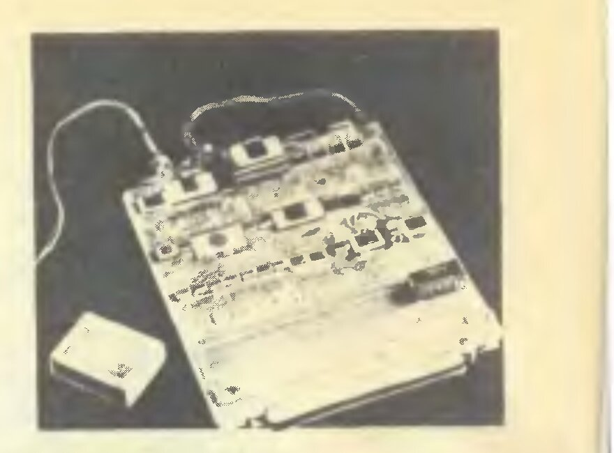
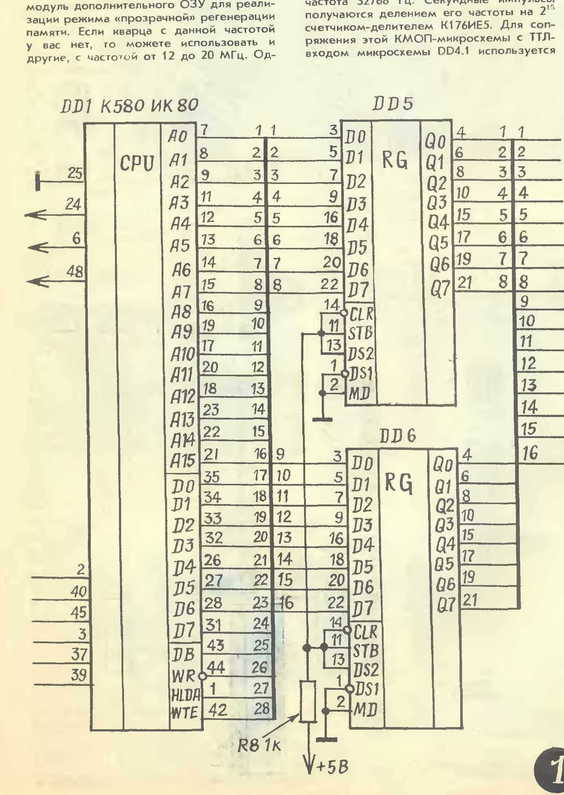
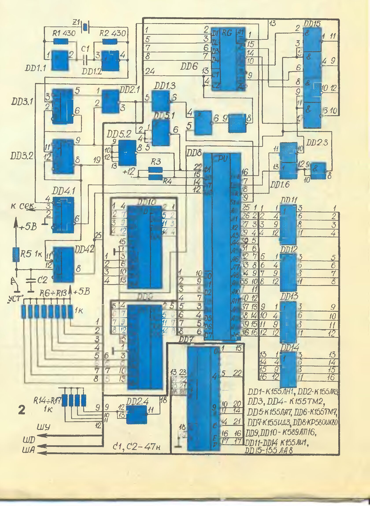
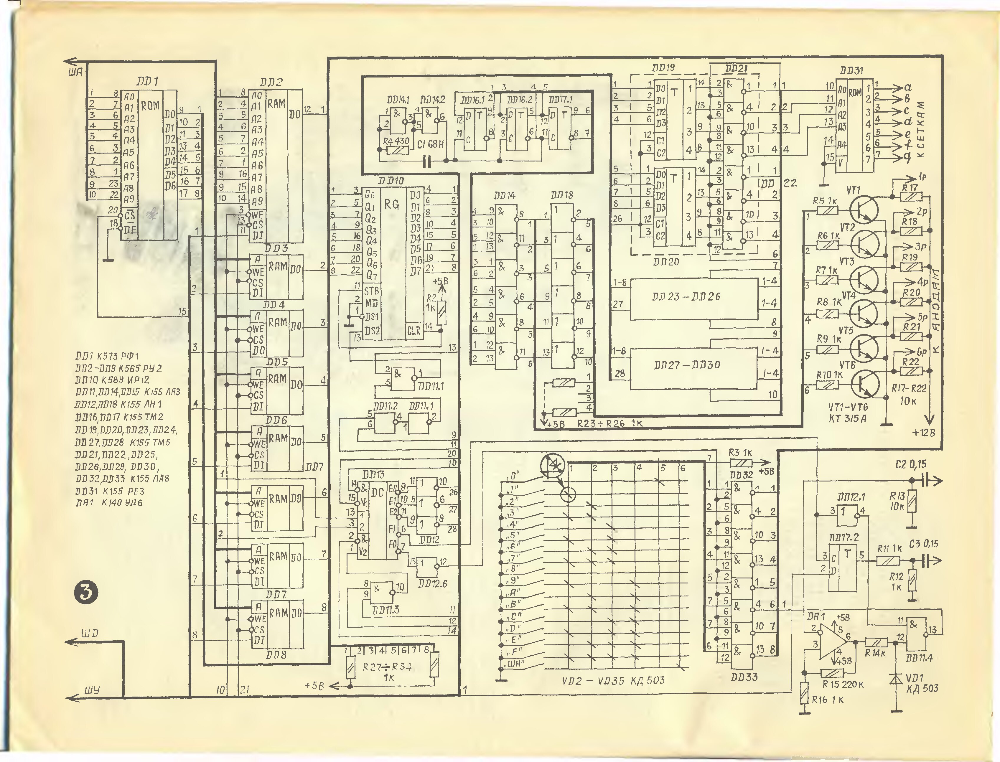

# 16. Консультационный пункт «ЮТ»-88»: отвечаем на вопросы

*«ЮТ» для умелых рук», № 12, 1989, с. 12–14. Автор — В. Бартенев.*

После выхода в свет первого выпуска приложения, посвящённого персональному компьютеру
«ЮТ»-88», редакция получила сотни писем с вопросами, замечаниями и предложениями. Все они
были переданы автору конструкции В. Бартеневу, который подготовил специальную статью с
ответами на интересующие вас вопросы.

## Сводка исправлений

Все исправления к публикациям модуля 1 (№ 2 за 1989 г.) и дисплейного модуля (более
поздние выпуски 1989 г.), найденные в статье, собраны в таблицу. Подробности — в разделах ниже.

|  №  | Где                                                              | Было (в журнале)             | Стало                                            |
|:---:|------------------------------------------------------------------|------------------------------|--------------------------------------------------|
|  1  | схема процессорного модуля, коллектор VT1                        | резистор 56 Ом               | 5,6 кОм                                          |
|  2  | схема процессорного модуля, выход DD21.5                         | номер вывода не указан       | вывод 10                                         |
|  3  | схема процессорного модуля, выход DD21.4                         | номер вывода не указан       | вывод 6                                          |
|  4  | схема процессорного модуля, выход 5-го разр. DD20                | вывод 14                     | вывод 10                                         |
|  5  | схема процессорного модуля, входы R и S DD4.1                    | номера выводов не указаны    | R — вывод 10, S — вывод 13                       |
|  6  | схема процессорного модуля, HP1                                  | не пояснено                  | набор из восьми резисторов по 1 кОм              |
|  7  | таблица команд: MOV D,B … MOV D,L                                | неверные коды                | 50, 51, 52, 53, 54, 55                           |
|  8  | таблица команд: MVI M,DATA[8]                                    | неверное описание действия   | [[HL]] ← DATA[8]                                 |
|  9  | таблица команд: после XRA L                                      | команда XRA M пропущена      | XRA M, код AE                                    |
| 10  | таблица команд: команда с кодом CA (JZ)                          | неверный признак             | условие Z=1                                      |
| 11  | дисплейный модуль: вход «16 МГц»                                 | куда подключать — не указано | к выводу 12 DD2 (КР580ГФ24) процессорного модуля |
| 12  | дисплейный модуль: вывод 13 DD21.2                               | не указано                   | к проводу 16 шины данных и управления            |
| 13  | дисплейный модуль: выводы 11, 12, 13, 14 DD25                    | не указано                   | к проводам 1, 2, 3, 4 шины данных                |
| 14  | таблица 2 (дешифратор 7-сегм. кода) — только для варианта рис. 3 | как в № 2                    | все единицы заменить на нули и наоборот          |

*Прим.: «Было» для пунктов 7–10 в журнале не приведено — указано только, как
должно быть. В нашем переводе таблицы команд ([10-sistema-komand.md](10-sistema-komand.md))
эти места уже даны в исправленном виде. Пункт 14 относится не к основной схеме, а к
альтернативному варианту клавиатуры и дисплея (рис. 3), где данные инвертируются
микросхемами К155ЛА8. Исправлений в дампах МОНИТОРА и программ модуля 1 в статье нет.*

## Процессорный модуль

Многие спрашивают, какая частота у кварцевых резонаторов Z1 и Z2. Частота **Z1 —
16 МГц**. Импульсы этой частоты с вывода 12 микросхемы DD2 КР580ГФ24 поступают в
дисплейный модуль для формирования видеосинхросигналов и в модуль дополнительного ОЗУ для
реализации режима «прозрачной» регенерации памяти. Если кварца с данной частотой у вас
нет, то можете использовать и другие, с частотой от 12 до 20 МГц. Однако в этом случае
для дисплейного модуля вам понадобится отдельный кварцевый резонатор с частотой около
8 МГц. При этом варианте опорную частоту на модуль динамического ОЗУ подайте с вывода 12
микросхемы КР580ГФ24 процессорного модуля.

Кварц **Z2** — от электронных часов, его частота **32768 Гц**. Секундные импульсы
получаются делением его частоты на 2¹⁵ счётчиком-делителем К176ИЕ5. Для сопряжения этой
КМОП-микросхемы с ТТЛ-входом микросхемы DD4.1 используется транзистор VT1. **Номинал
резистора в его коллекторной цепи 5,6 кОм, а не 56 Ом, как ошибочно указано на схеме.**

Многих интересует, как используется вывод 3 микросхемы DD2, обозначенный в шине под
номером 9. Он подключается только при реализации пошагового режима тестирования
процессорного модуля с помощью приставки, схема которой показана на рис. 6 (см. № 2 за
1989 год).

На схеме процессорного модуля не обозначены выводы некоторых микросхем:

- выход DD21.5 — вывод 10;
- выход DD21.4 — вывод 6;
- выход 5 разряда DD20 — вывод 10 (**на схеме ошибочно указан вывод 14**);
- входы R и S микросхемы DD4.1 — выводы 10 и 13.

Для тех, кто не понял, что такое **HP1**, поясняем — это набор из восьми резисторов
сопротивлением 1 кОм.

### Замена микросхем

Несколько слов о возможной замене некоторых микросхем процессорного модуля на другие,
более доступные. Микросхему КР580ВМ80А можно заменить на К580ИК80. Схема её включения
приведена на рис. 1. Микросхему DD8 КР580ВК38 можно заменить на КР580ВК28, цоколёвка у
них полностью совпадает. Вместо регистров КР580ИР82 (DD5 и DD6) можно использовать
микросхемы К589ИР12. Схема их включения также приведена на рис. 1.

*Рисунок 1. Схема включения микропроцессора К580ИК80 (DD1) и регистров К589ИР12 (DD5,
DD6) вместо КР580ВМ80А и КР580ИР82; R8 — 1 кОм.*

На рис. 2 показан фрагмент схемы процессорного модуля, в которой вместо микросхем
КР580ГФ24, КР580ВК38 и КР580ИР82 используются только микросхемы 155-й серии.

Генератор синхросерий в этом варианте выполнен на элементах DD1.1 и DD1.2. Импульсы с
него поступают на вход делителя частоты, собранного на триггерах DD3.1 и DD3.2. Его
коэффициент деления равен 4, поэтому частота кварца должна быть около 8 МГц. В качестве
буферных усилителей шины адреса использованы микросхемы К155ЛИ1 (DD11–DD14). Для
буферирования шины данных применены двунаправленные 4-разрядные шинные формирователи
К589АП16 (DD9 и DD10). Сигналы управления формируются на основе байта состояния,
выдаваемого микропроцессором на шину данных.

*Рисунок 2. Фрагмент схемы процессорного модуля без КР580ГФ24, КР580ВК38 и КР580ИР82.
Перечень на схеме: DD1 — К155ЛН1, DD2 — К155ЛА3, DD3, DD4 — К155ТМ2, DD5 — К155ЛА7,
DD6 — К155ТМ7, DD7 — К155ИД3, DD8 — КР580ИК80, DD9, DD10 — К589АП16, DD11–DD14 —
К155ЛИ1, DD15 — 155ЛА8; R1, R2 — 430 Ом; R5, R6–R13, R14–R17 — 1 кОм; C1, C2 — 47 нФ.*

*Прим.: перечень микросхем рис. 2 написан от руки; DD2 («К155ЛА3») и DD5 («К155ЛА7»)
читаются не вполне уверенно.*

### Альтернативный вариант клавиатуры и дисплея

Альтернативный вариант клавиатуры и дисплея процессорного модуля представлен на рис. 3.
Число микросхем в нём заметно больше, но все они относительно доступны. В ПЗУ
использована одна микросхема К573РФ1, а в ОЗУ — восемь микросхем К565РУ2 или К132РУ1.
Регистры индикаторов выполнены на микросхемах К155ТМ2, которые образуют три
восьмиразрядные ячейки памяти. Выходы их подсоединены к 4-разрядному коммутатору,
подключающему выходы регистров к дешифратору, превращающему двоичный 4-разрядный код в
семисегментный шестнадцатеричный. Динамический режим индикации обеспечен с помощью
генератора на микросхеме DD14, счётчика импульсов (DD16, DD17), дешифраторов управляющих
импульсов (DD14, DD15) и ключей на транзисторах VT1–VT6.

**Заметим, что в содержимом дешифратора семисегментного кода (см. № 2 за 1989 год,
таблица 2) все единички надо заменить на нули и наоборот.** Связано это с инверсией
информации микросхемами К155ЛА8 в шине данных. В качестве индикаторов в данном случае
могут быть использованы люминесцентные индикаторы ИВ-3, ИВ-6 либо индикаторные панели
ИВ-18 или ИВ-21.

В клавиатуре используется простейший диодный дешифратор. Нажатие на любую клавишу
приводит к формированию соответствующего двоичного кода.

*Рисунок 3 (вкладка, с. 14, повёрнута). Перечень на схеме: DD1 — К573РФ1, DD2–DD9 —
К565РУ2, DD10 — К589ИР12, DD11, DD14, DD15 — К155ЛА3, DD12, DD18 — К155ЛН1, DD16, DD17 —
К155ТМ2, DD19, DD20, DD23, DD24, DD27, DD28 — К155ТМ5, DD21, DD22, DD25, DD26, DD29,
DD30, DD32, DD33 — К155ЛА8, DD31 — К155РЕ3, DA1 — К140УД6; VT1–VT6 — КТ315А;
VD1–VD35 — КД503.*

*Прим.: в тексте генератор назван «на микросхеме DD14», и DD14 же — среди дешифраторов;
на схеме генератор собран на DD14.1, DD14.2. Перечень микросхем рис. 3 написан от руки
и читается не везде уверенно (особенно группы К155ТМ5/К155ЛА8). На схеме ОЗУ DD2–DD9
обозначены как 1-разрядные микросхемы (входы A, WE, CS, DI, выход DO).*

## Источник питания

В источнике питания процессорного модуля диоды VD1–VD4 можно заменить на диоды типа
Д226, а диодную сборку КЦ410Б — четырьмя диодами Д202 или Д203 с любым буквенным
индексом. Транзистор VT1 может быть типа КТ803, КТ808 или КТ805. Его обязательно
установите на радиатор с площадью рассеивания не менее 150 см².

## Таблица команд микропроцессора

Коды команд, начиная с `MOV D,B` по `MOV D,L`, должны иметь значение 50, 51, 52, 53, 54,
55. При объяснении действия команды `MVI M, DATA[8]` следует записать
[[HL]] ← DATA[8]. После команды `XRA L` должна идти команда `XRA M`, код которой `AE`.
Команда `CA` должна иметь признак Z=1.

*Прим.: в журнале напечатано «MVI V, DATA[8]» — опечатка, имеется в виду `MVI M`.
«Команда CA» — команда с кодом CAH, то есть `JZ` (переход, если Z=1).*

## Дисплейный модуль

Вход «16 МГц» подключается к выводу 12 микросхемы DD2 КР580ГФ24 процессорного модуля.
Вывод 13 микросхемы DD21.2 подключается к проводу 16 шины данных и управления. Выводы 11,
12, 13, 14 микросхемы DD25 подключаются соответственно к проводам 1, 2, 3, 4 шины данных.

В источнике питания дисплейного модуля транзисторную сборку К159НТ1 можно заменить
транзисторами КТ315, а К159НТ5 — на КТ361. Все они должны быть подобраны по коэффициенту
передачи тока. Корпуса их желательно склеить попарно. В качестве понижающего
трансформатора рекомендуем использовать ТН-46-127/220-50.

Напоминаем разводку питания микросхем дисплейного модуля (вывод «Общий»/«+5 В»):

| Микросхемы                   | «Общий»/«+5 В» |
|------------------------------|:--------------:|
| К555КП11, К589АП16, К155ИР13 |      8/16      |
| К573РФ2                      |     12/24      |
| К155ЛП5, К155ЛА1             |      7/14      |
| К155ИЕ4, К155ИЕ2             |      10/5      |
| К155ИМ3                      |      5/12      |
| КР580ВВ55                    |      7/26      |

*Прим.: в журнале строка напечатана как «К555КП11, К589АП16 — 8/16; К155ИР13; К573РФ2 —
12/24; …» — для К155ИР13 значение отдельно не указано. По справочнику у К155ИР13
(корпус 24 вывода) питание 12/24, так что К155ИР13, вероятно, должна стоять в группе с
К573РФ2.*

## Разводка питания микросхем процессорного модуля

| Микросхема | Тип        | Вывод «Общий»/«+5 В»            |
|------------|------------|---------------------------------|
| DD1        | КР580ВМ80А | 2/20; 28 («+12 В»), 11 («−5 В») |
| DD2        | КР580ГФ24  | 8/16; 9 («+12 В»)               |
| DD3        | К176ИЕ5    | 7/14                            |
| DD4        | К155ТМ2    | 8/16                            |
| DD5, DD6   | КР580ИР82  | 10/20                           |
| DD7        | К155ИД3    | 12/24                           |
| DD8        | КР580ВК38  | 14/28                           |
| DD9, DD21  | К155ЛН1    | 7/14                            |
| DD10, DD11 | КР556РТ5   | 12/24                           |
| DD12, DD17 | К155ЛА8    | 7/14                            |
| DD13, DD14 | КР541РУ2   | 9/18                            |
| DD15, DD16 | К556РТ4    | 8/16                            |
| DD18, DD19 | К155РП1    | 8/16                            |
| DD20       | К155ИД4    | 8/16                            |
| DD22       | К155ЛЕ4    | 7/14                            |
| DD23       | К155РЕ3    | 8/16                            |
| DD24       | К155ИЕ5    | 10/5                            |

*Прим.: для DD4 К155ТМ2 в журнале указано 8/16, хотя у К155ТМ2 (корпус 14 выводов)
питание 7/14 — вероятно, опечатка журнала; оставлено как напечатано.*

## Заключение

В заключение хотелось бы поблагодарить всех, кто откликнулся на публикацию материалов по
«ЮТ»-88». Самые интересные предложения в редакцию прислали Иванов А. И. (г. Симферополь),
Малофеев А. А. (г. Липецк), Диженков А. А. (г. Свердловск), Донецков Е. В. (г. Нальчик)
и многие другие читатели.

*В. Бартенев*

## Советуем прочитать

1. Зеленко Г. В. и др. Радиолюбителю о микропроцессорах и микроЭВМ. — «Радио», 1982,
   № 9–12; 1983, № 3–12.
2. Мальцева Л. А. и др. Основы цифровой техники. М., «Радио и связь», 1986.
3. Гилмор Ч. Введение в микропроцессорную технику. М., «Мир», 1984.
4. Коффрон Дж. Технические средства микропроцессорных систем. М., «Мир», 1983.
5. Микропроцессоры и микропроцессорные комплекты интегральных микросхем. Справочник. М.,
   «Радио и связь», 1988.
6. Зеленко Г. В., Панов В. В., Попов С. П. «Электронный квазидиск» для персональной
   ЭВМ. — «Микропроцессорные средства и системы», 1986, № 4.
7. Назаров Н. А. Программатор для микросхем. — «В помощь радиолюбителю», 1983, вып. 83.
