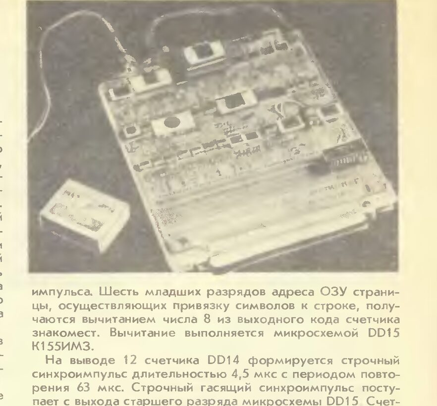
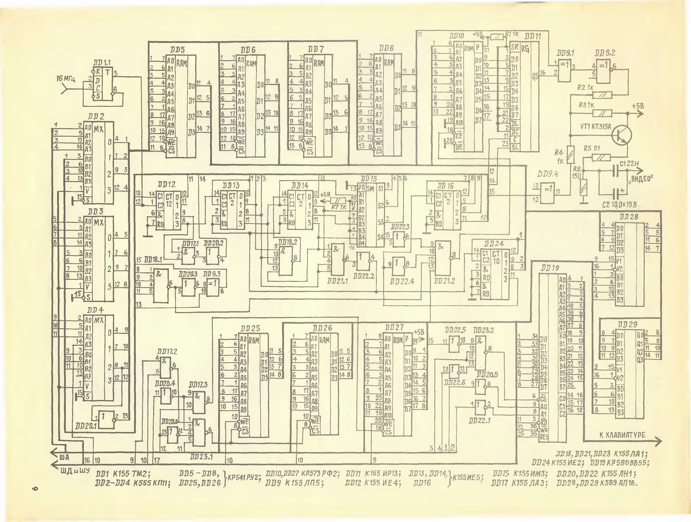

# 20. От индикаторов — к экрану. Дисплейный модуль «ЮТ-88»

*Источник: «ЮТ для умелых рук», 1989, № 4, с. 8–9 (рубрика «Твой персональный компьютер»).
Автор — В. Бартенев.*

Пришло время сделать первый шаг к расширению конфигурации нашего персонального компьютера —
дополнить его **дисплейным модулем**. Он позволит не только выводить информацию на экран
телевизора (дисплей), но и подключить к компьютеру стандартную клавиатуру, оснащённую буквами
русского и латинского алфавитов, цифрами, математическими и другими символами.

Как вы помните, в первом модуле «ЮТ-88» дисплей был шестиразрядным на светодиодных индикаторах.
Каждый символ в нём складывался из комбинации семи светящихся сегментов. Теперь, подключив
дисплейный модуль, вы сможете выводить на экран и записывать в специальное экранное ОЗУ целую
страницу текста объёмом **28 строк по 64 символа**. Начертание каждого символа формируется
специальным дешифратором на стандартной матрице размером **5×7 точек**.

Принцип работы дисплейного модуля такой же, как и в первом, сегментном. Но теперь положение
каждого символа на экране записывается в определённую ячейку экранного ОЗУ.

## Экранное ОЗУ

ОЗУ страницы располагается в адресном пространстве **от E000H до EFFFH**. Адрес E000H
соответствует верхнему крайнему слева знакоместу, а EFFFH — нижнему крайнему справа.

> *Прим.: на самом деле ОЗУ страницы — 2 Кбайта (четыре микросхемы КР541РУ2 1К×4: DD5–DD8),
> а окно E000H–EFFFH — 4 Кбайта, так что половины окна, по-видимому, дублируют друг друга.
> МОНИТОР дисплейного модуля работает с адресами **E800H–EEFFH** (28 × 64 = 1792 байта),
> см. [27-monitor-f.md](27-monitor-f.md).*

Соответствие между адресами ячеек и положением символа на экране достигается синхронизацией
импульсов строчной и кадровой развёрток. Вырабатываются они дисплейным модулем. Адресация
ячеек памяти при **записи** информации происходит от шины адреса микроЭВМ, а при **чтении** — от
счётчиков, тактируемых синхроимпульсами дисплейного модуля. Переключение адресных выводов ОЗУ
производится с помощью коммутатора.

ОЗУ страницы выполнено на микросхемах **КР541РУ2**, а ПЗУ знакогенератора — на микросхеме
**К573РФ2**. В дисплейном модуле имеется специальный разряд ОЗУ, который используется для
хранения информации о текущем положении очередного символа — **курсоре**. Эта одноразрядная
информация размещается в адресном пространстве всей страницы, занимающей около 2000 ячеек
памяти. При считывании информации из ОЗУ страницы одновременно считывается она и из ячеек
курсора. **Наличие единицы в ячейке курсора приводит к инверсии высвечиваемого на экране
символа** — фон становится светлым, а контуры символа тёмными.

> *Прим.: по схеме и по программе МОНИТОРА «разряд курсора» — это старший бит D7 байта
> экранного ОЗУ; код символа занимает биты D0–D6. Подробности — в
> [29-displey-dlya-emulyatora.md](29-displey-dlya-emulyatora.md).*

Наш дисплейный модуль позволяет организовать не только постраничный вывод информации, но и так
называемый **«ролик»**, когда информация бежит на экране непрерывным потоком.

## Формирование видеосигнала

Луч кинескопа модулируется сигналами, поступающими с выхода **сдвигового регистра DD11**, в
который предварительно записывается параллельный код строки одного символа. Таких строк для
каждого символа в ПЗУ знакогенератора **восемь**. Начальный адрес каждой группы ячеек,
соответствующих отдельному символу, определяется его адресом в знакогенераторе и снимается с
ячеек памяти страницы. Считанный параллельный код записывается в регистр DD11, а затем
преобразуется в последовательный. Импульсы, управляющие параллельной/последовательной работой
регистра, формируются в микросхемах **DD12 (делитель на шесть)**, DD17 и DD20.2. На выходе
логического элемента «2И-НЕ» DD17 формируются импульсы, период следования которых определяет
длительность одного знакоместа в строке экрана.

**Счётчик знакомест в строке** построен на микросхемах DD13 и DD14. В каждой строке может быть
отображено 64 символа, причём отображение первого из них начинается спустя **8 знакомест после
окончания строчного синхроимпульса**. Шесть младших разрядов адреса ОЗУ страницы,
осуществляющих привязку символов к строке, получаются вычитанием числа 8 из выходного кода
счётчика знакомест. Вычитание выполняется микросхемой **DD15 К155ИМ3**.

На выводе 12 счётчика DD14 формируется **строчный синхроимпульс длительностью 4,5 мкс с
периодом повторения 63 мкс**. Строчный гасящий синхроимпульс поступает с выхода старшего разряда
микросхемы DD15. **Счётчик DD24** формирует восемь строк по горизонтали, которые отводятся под
одно знакоместо по вертикали. С выхода этого счётчика импульсы подаются на адресацию трёх
младших разрядов ПЗУ знакогенератора.

**Счётчик DD16 и один триггер микросхемы DD12** образуют счётчик строк с коэффициентом пересчёта
**32**. С выхода этого счётчика импульсы подаются на адресацию ОЗУ страницы и курсора (старшие
пять разрядов), осуществляя привязку символов по вертикали. На логических элементах DD18.1 и
DD20.3 формируется **кадровый синхроимпульс длительностью 1250 мкс с периодом повторения
20160 мкс**.

Узел на элементах микросхем DD21.2, DD22.3 и DD22.4 формирует сигнал запрета отображения,
поступающий на вход CE микросхемы ПЗУ знакогенератора и отключающий её выходы при высоком
уровне сигнала. Благодаря этому на входах регистра сдвига в узле формирования видеосигнала
также устанавливается высокий уровень, что соответствует гашению изображения.
Синхроимпульсы строк и кадров смешиваются в элементе DD9.3, а затем, после смешивания с
видеосигналами в транзисторе VT1, подаются на модулятор или на вход «ВИДЕО» телевизора.

## Коммутатор адресов и связь с процессором

Коммутатор адресов ОЗУ страницы и курсора выполнен на мультиплексорах **DD2–DD4**. Управление
коммутатором осуществляется **сигналом выборки адресного пространства низкого уровня
E000–EFFF**, поступающим на вывод 1 мультиплексоров.

Через шинные формирователи **DD28, DD29** и мультиплексоры DD2–DD4 ОЗУ страницы и курсора
подключается к шине данных и адреса микропроцессора. Это происходит при обращении к нему
микропроцессора. Если при наличии сигнала выборки адресов E000–EFFF будет активен сигнал
управления **ЗПОЗУ**, то произойдёт запись кода с шины данных в ОЗУ страницы, а если будет
активен сигнал **ЧТОЗУ**, то информация из ОЗУ страницы и курсора поступит на шину данных.

Как и в первом модуле, микросхемы дисплея размещаются на отдельной плате из фольгированного
стеклотекстолита. Общий провод и цепи питания выполните печатным способом, а все остальные
соединения — тонким проводом в пластмассовой оболочке.

В следующем номере мы расскажем о подключении к дисплейному модулю полной клавиатуры, приведём
таблицы ПЗУ знакогенератора и МОНИТОРА.

## Принципиальная схема

Схема напечатана в журнале на с. 9 повёрнутой на 90°; в файле она развёрнута для чтения:

### Перечень микросхем (по подписи к схеме)

| Позиция          | Тип       | Назначение (по тексту и схеме)                                              |
|------------------|-----------|-----------------------------------------------------------------------------|
| DD1              | К155ТМ2   | DD1.1 — счётный триггер: делит 16 МГц из процессорного модуля на 2          |
| DD2–DD4          | К555КП11  | мультиплексоры адреса ОЗУ страницы (процессор / счётчики развёртки)         |
| DD5–DD8          | КР541РУ2  | ОЗУ страницы, 4 × (1К×4) = 2 Кбайта                                         |
| DD25, DD26       | КР541РУ2  | ОЗУ МОНИТОРА (стек и рабочие ячейки), 1 Кбайт, F400H–F7FFH                  |
| DD9              | К155ЛП5   | «исключающее ИЛИ»: инверсия курсором (DD9.1), смешение синхроимпульсов      |
| DD10             | КР573РФ2  | ПЗУ знакогенератора (2К×8)                                                  |
| DD27             | КР573РФ2  | ПЗУ МОНИТОРА дисплейного модуля, F800H–FFFFH                                |
| DD11             | К155ИР13  | сдвиговый регистр видеосигнала                                              |
| DD12             | К155ИЕ4   | делитель на шесть (точки знакоместа) + триггер счётчика строк               |
| DD13, DD14, DD16 | К155ИЕ5   | DD13, DD14 — счётчик знакомест в строке; DD16 — счётчик строк               |
| DD15             | К155ИМ3   | сумматор: вычитание 8 из кода счётчика знакомест                            |
| DD17             | К155ЛА3   | 2И-НЕ: импульсы загрузки регистра (период = знакоместо)                     |
| DD18, DD21, DD23 | К155ЛА1   | 4И-НЕ: кадровый синхроимпульс, запрет отображения, дешифрация               |
| DD20, DD22       | К155ЛН1   | инверторы                                                                   |
| DD24             | К155ИЕ2   | счётчик строк растра внутри знакоместа (адрес A0–A2 знакогенератора)        |
| DD19             | КР580ВВ55 | программируемый адаптер клавиатуры (см. [22](22-klaviatura-i-direktivy.md)) |
| DD28, DD29       | К589АП16  | шинные формирователи (связь ОЗУ страницы с шиной данных)                    |
| VT1              | КТ315А    | смеситель видеосигнала и синхроимпульсов, выход «ВИДЕО»                     |

Резисторы на схеме: R1 1 к, R2 1 к, R3 1 к, R4 1 к, R5 51 Ом, R6 150 Ом, R7 1 к; конденсаторы
C1 22 н, C2 10,0 × 15 В. Справа внизу — шина «К КЛАВИАТУРЕ» (контакты 1–18), слева внизу — шины
ША и ШД и ШУ процессорного модуля.

> *Прим. (прочитано по схеме):*
>
> - *Тактовая частота 16 МГц поступает с процессорного модуля на триггер DD1.1, включённый
>   делителем на 2 (D соединён с инверсным выходом) — частота точек, по-видимому, 8 МГц.*
> - *У знакогенератора DD10 входы A0–A2 — от счётчика строк растра, A3–A9 — от разрядов
>   D0–D6 ОЗУ страницы, а **A10 соединён с общим проводом**: используется только нижний
>   килобайт ПЗУ (символы 00H–7FH). Выходы D0–D5 ПЗУ идут на входы D0–D5 регистра DD11, D6
>   и D7 ПЗУ никуда не подключены; входы D6, D7, DL и SR регистра подтянуты к +5 В через R1.
>   Видеосигнал снимается с выхода Q5 регистра — знакоместо **6 точек**, слева бит 5.*
> - *Выход Q5 регистра проходит через элемент «исключающее ИЛИ» DD9.1, на второй вход которого
>   подаётся линия 11 внутренней шины (линии 4–10 — это разряды D0–D6 ОЗУ страницы, поэтому
>   линия 11 — по-видимому, разряд D7, «курсор») — так получается инверсия символа.*
