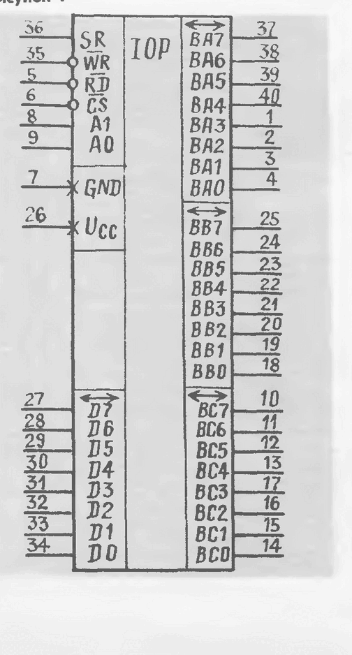
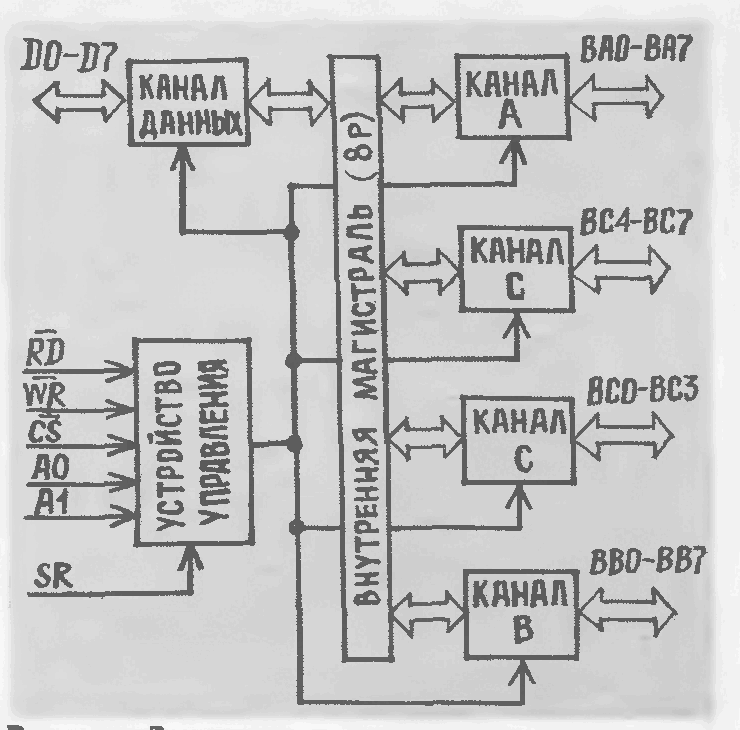
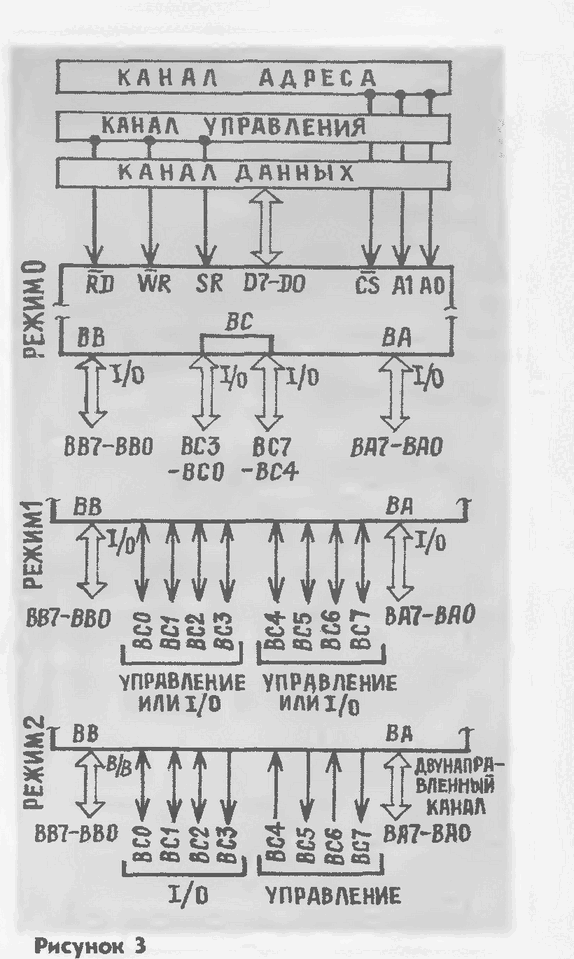

# 21. Микросхемы для «ЮТ-88»: КР580ВВ55А

*Источник: «ЮТ для умелых рук», 1989, № 4, с. 10 (справочный листок «Микросхемы для
„ЮТ-88“»).*

Микросхема **КР580ВВ55А** (старое обозначение К580ИК55А) — программируемое устройство
ввода/вывода параллельной информации. Применяется в микропроцессорной технике в качестве
элемента ввода/вывода общего назначения для подключения интерфейсных устройств (клавиатуры,
принтера, накопителя на магнитной ленте и т. д.) к магистралям данных. Условное графическое
изображение микросхемы показано на рисунке 1, а её структурная схема — на рисунке 2. Данные о
назначении выводов вы найдёте в таблице 1.

|        Рисунок 1 — условное обозначение        |           Рисунок 2 — структурная схема           |
|:----------------------------------------------:|:-------------------------------------------------:|
|  |  |

Обмен информацией между магистралью данных системы и микросхемой КР580ВВ55А осуществляется
через 8-разрядный двунаправленный канал данных (D). Для связи с периферийными устройствами
используются **24 линии ввода/вывода**, сгруппированные в три 8-разрядных канала **ВА, ВВ и
ВС**, режимы работы которых и направление передачи информации определяются программным
способом.

**Таблица 1. Назначение выводов**

| Вывод      | Обозначение      | Тип вывода   | Функциональное назначение      |
|------------|------------------|--------------|--------------------------------|
| 1–4, 37–40 | ВА3–ВА0, ВА7–ВА4 | входы/выходы | информационный канал А         |
| 5          | RD               | вход         | чтение информации              |
| 6          | CS               | вход         | выбор микросхемы               |
| 7          | GND              | —            | общий                          |
| 8, 9       | A1, A0           | вход         | младшие разряды адреса         |
| 10–17      | ВС7–ВС4, ВС0–ВС3 | входы/выходы | информационный канал С         |
| 18–25      | ВВ0–ВВ7          | входы/выходы | информационный канал В         |
| 26         | Ucc              | —            | напряжение питания +5 В        |
| 27–34      | D7–D0            | входы/выходы | канал данных                   |
| 35         | SR               | вход         | установка в исходное состояние |
| 36         | WR               | вход         | запись информации              |

*Прим.: в журнале в первой строке напечатано «1–1» — опечатка, должно быть 1–4.*

Микросхема имеет **три режима работы**.

- В **режиме 0** обеспечивается синхронная, программно-управляемая передача данных через два
  независимых 8-разрядных канала ВА и ВВ и два 4-разрядных канала ВС.
- В **режиме 1** обеспечивается ввод или вывод информации «в» или «из» периферийного
  устройства через каналы ВА и ВВ по специальным сигналам. При этом линии канала С
  используются для приёма и выдачи сигналов управления обменом информацией.
- В **режиме 2** обеспечивается возможность обмена информацией с периферийными устройствами
  через двунаправленный 8-разрядный канал ВА по специальным сигналам. Для передачи и приёма
  сигналов управления обменом используются пять линий канала ВС.

Выбор соответствующего канала и направление передачи информации через канал определяется
сигналами A0, A1 (обычно соединяются с младшими разрядами канала адреса системы), RD, WR, CS в
соответствии с таблицей 2.

**Таблица 2. Выбор канала и направление передачи**

| A1  | A0  | RD  | WR  | CS  | Направление передачи информации |
|:---:|:---:|:---:|:---:|:---:|---------------------------------|
|     |     |     |     |     | *Операции ввода (чтение)*       |
|  0  |  0  |  0  |  1  |  0  | ВА → канал данных               |
|  0  |  1  |  0  |  1  |  0  | ВВ → канал данных               |
|  1  |  0  |  0  |  1  |  0  | ВС → канал данных               |
|     |     |     |     |     | *Операции вывода (запись)*      |
|  0  |  0  |  1  |  0  |  0  | канал данных → ВА               |
|  0  |  1  |  1  |  0  |  0  | канал данных → ВВ               |
|  1  |  0  |  1  |  0  |  0  | канал данных → ВС               |
|  1  |  1  |  1  |  0  |  0  | канал данных → РУС              |
|     |     |     |     |     | *Операции блокировки*           |
|  X  |  X  |  X  |  X  |  1  | канал данных → третье состояние |
|  1  |  1  |  0  |  1  |  0  | запрещённая комбинация          |

*Прим.: в журнале столбцы подписаны «AI, A0, P0, P, C» — это A1, A0, RD (чтение), WR (запись)
и CS.*

Режим работы каждого из каналов ВА, ВВ и ВС определяется содержимым **регистра управляющего
слова (РУС)**. Записав в него управляющее слово, микросхему можно перевести в один из трёх
режимов работы: режим 0 — простой ввод/вывод, режим 1 — стробируемый ввод/вывод, режим 2 —
двунаправленный канал.

При подаче сигнала **SR** регистр управляющего слова устанавливается в состояние, при котором
все каналы настраиваются в режиме 0 для ввода информации. Режим работы каналов можно изменять
не только в начале, но и в самом процессе выполнения программы. Благодаря этому одна
микросхема может в определённом порядке последовательно обслуживать несколько различных
периферийных устройств. При изменении режима работы любого канала все входные и выходные
регистры каналов и триггеры состояния сбрасываются. Разобраться в режимах работы каналов вам
поможет рисунок 3.

> *Прим. (не из журнала, справочно для эмулятора): формат управляющего слова стандартный для
> i8255. Бит 7 = 1 — слово режима: биты 6–5 — режим группы А, бит 4 — канал А (1 — ввод),
> бит 3 — старшая тетрада С (1 — ввод), бит 2 — режим группы В, бит 1 — канал В (1 — ввод),
> бит 0 — младшая тетрада С (1 — ввод). Бит 7 = 0 — установка/сброс отдельного бита канала С
> (биты 3–1 — номер бита, бит 0 — значение). В «ЮТ-88» используются слова **8BH** (клавиатура:
> А — вывод, В и С — ввод, режим 0) и **82H** (дополнительный интерфейс ПЗУ, порт FBH).*
