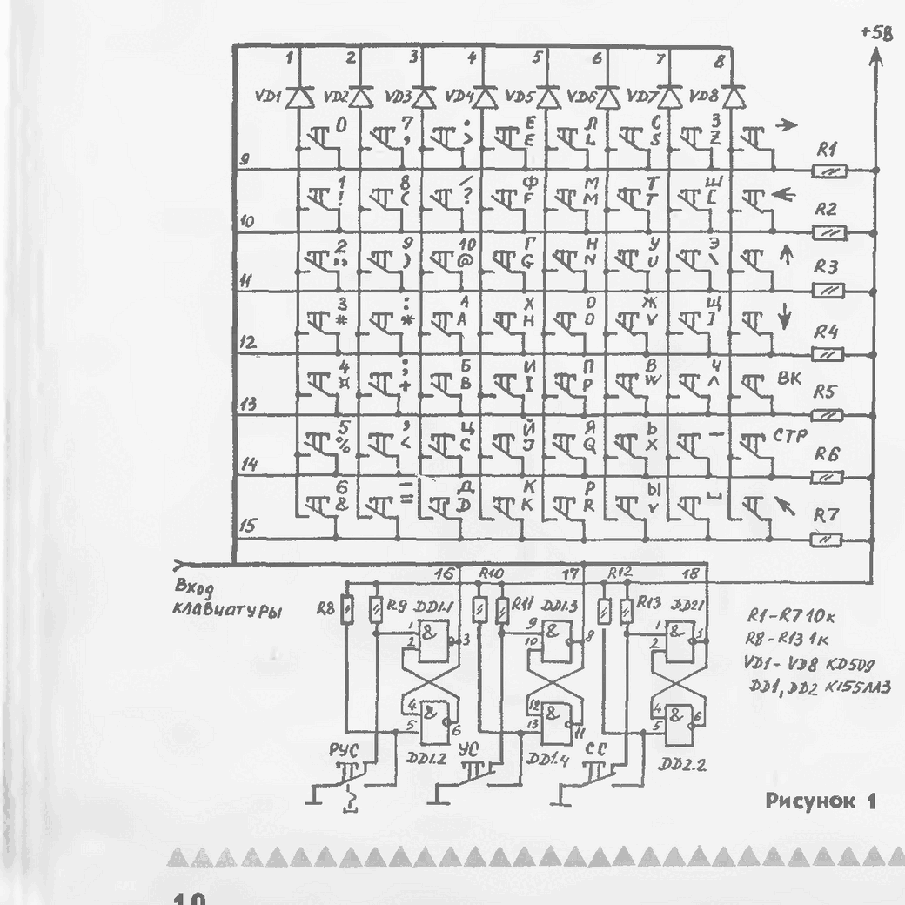
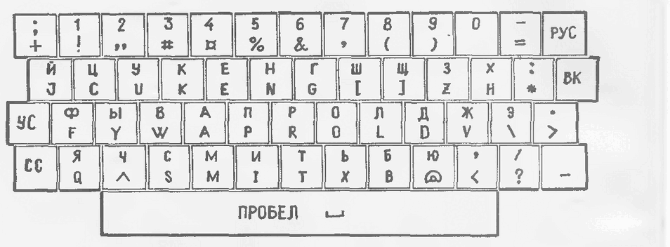

# 22. Дисплейный модуль: клавиатура, ПЗУ/ОЗУ, директивы МОНИТОРА

*Источник: «ЮТ для умелых рук», 1989, № 5, с. 10–11 (рубрика «Твой персональный компьютер»,
«От индикаторов — к экрану. Дисплейный модуль „ЮТ-88“», продолжение).*

## Клавиатура

В состав дисплейного модуля входит и полная клавиатура, которая формирует все необходимые
символы. Реализована она на программном уровне. В ней используется микросхема **DD19 —
программируемый периферийный адаптер (ППА) КР580ВВ55**. Обмен информацией, засылка в ППА
управляющих слов, вырабатываемых монитором, и передача в микропроцессор сведений о состоянии
клавиатуры происходят по шине данных. Низкий уровень сигнала на управляющем входе CS (вывод 6)
разрешает обмен информацией между ППА и микропроцессором. В состав ППА входят три порта — А, В
и С. Их функциональное назначение определяется кодом управляющего слова, которое загружается
микропроцессором в регистр управляющего слова (РУС). Сигналы на адресных входах A0 и A1
производят селекцию одного из трёх портов или регистра управляющего слова. Для работы
клавиатуры ППА настроен на режим ввода-вывода (**код управляющего слова 8BH**). В этом случае
**канал А работает на вывод, а каналы В и С — на ввод** информации.

Как следует из схемы на рисунке 1, клавиатура представляет собой **матрицу нормально
разомкнутых контактов**. Замыкаются они при нажатии на клавиши. Диоды VD1–VD8 служат для защиты
канала А от повреждения при одновременном нажатии на несколько клавиш. Специальная программа
осуществляет формирование нулевого уровня на каждом выходе канала А. Если не нажата ни одна из
клавиш, то на всех разрядах канала В будут записаны единички. Если же какая-то клавиша нажата,
то нулевой уровень с соответствующего канала А попадает на один из входов канала В. Монитор
определяет, какая клавиша нажата, и соответствующий ей семиразрядный код записывается в
аккумулятор микропроцессора. Сократить число клавиш удаётся, использовав **клавиши модификации
кода РУС, УС и СС**. При нажатии на клавишу РУС формируются коды русского алфавита, клавиша УС
позволяет формировать управляющие и графические символы, а клавиша СС служит для формирования
кодов специальных символов. Микросхемы DD1, DD2 устраняют дребезг контактов. Типовое
расположение клавиш показано на рисунке 2.

На схеме: R1–R7 — 10 к, R8–R13 — 1 к, VD1–VD8 — КД509, DD1, DD2 — К155ЛА3. Цифры 1–18 —
контакты разъёма «К КЛАВИАТУРЕ» дисплейного модуля.

### Матрица клавиатуры (по рисунку 1)

Столбцы (контакты 1–8) подключены через диоды VD1–VD8 к выходам канала А (по общей схеме,
контакты 1–8 разъёма — выводы ВА0–ВА7 микросхемы DD19). Строки (контакты 9–15) — к входам
канала В ВВ0–ВВ6, подтянуты к +5 В резисторами R1–R7. Клавиши РУС, УС и СС — с
переключающими контактами, через RS-триггеры на DD1.1/DD1.2, DD1.3/DD1.4, DD2.1/DD2.2
(подавление дребезга) — на контакты 16, 17, 18 (входы ВС0, ВС1, ВС2).

| Строка (вход) | Столбец 1 (ВА0) | 2 (ВА1) | 3 (ВА2) | 4 (ВА3) | 5 (ВА4) | 6 (ВА5) | 7 (ВА6) | 8 (ВА7) |
|---------------|-----------------|---------|---------|---------|---------|---------|---------|---------|
| 9 (ВВ0)       | 0               | 7 '     | . >     | E Е     | L Л     | S С     | Z З     | →       |
| 10 (ВВ1)      | 1 !             | 8 (     | / ?     | F Ф     | M М     | T Т     | [ Ш     | ←       |
| 11 (ВВ2)      | 2 "             | 9 )     | @ Ю     | G Г     | N Н     | U У     | \ Э     | ↑       |
| 12 (ВВ3)      | 3 #             | : *     | A А     | H Х     | O О     | V Ж     | ] Щ     | ↓       |
| 13 (ВВ4)      | 4 ¤             | ; +     | B Б     | I И     | P П     | W В     | ^ Ч     | ВК      |
| 14 (ВВ5)      | 5 %             | , <     | C Ц     | J Й     | Q Я     | X Ь     | _       | СТР     |
| 15 (ВВ6)      | 6 &             | - =     | D Д     | K К     | R Р     | Y Ы     | пробел  | ↖       |

*Прим.: в клетках — латинский/основной символ и (через пробел) символ, получаемый с
модификатором (СС — для цифр и знаков, РУС — для букв). Порядок кодов совпадает с
ASCII/КОИ-7: код = 30H + 7 × (столбец − 1) + (строка − 9), кроме «, - . /» и столбца 8,
которые МОНИТОР перекодирует особо; см. разбор подпрограммы опроса в
[27-monitor-f.md](27-monitor-f.md).*

## ПЗУ и ОЗУ дисплейного модуля

В дисплейный модуль входят также микросхемы ПЗУ/ОЗУ, которые необходимы для реализации
программной части дисплейного модуля. В ПЗУ на микросхеме **DD27** записана управляющая
программа — **МОНИТОР объёмом 2 Кбайта**, обслуживающая дисплей и клавиатуру. **ОЗУ** выполнено
на двух микросхемах **DD25 и DD26 объёмом 1 Кбайт** и используется для организации стековой
памяти и рабочих ячеек МОНИТОРА. **ПЗУ расположено в адресном пространстве F800–FFFFH, а ОЗУ —
F400–F7FFH.** (Распечатка МОНИТОРА и знакогенератора будет опубликована в следующем номере.) В
дисплейном модуле используются сигналы шин адреса, данных и управления первого модуля «ЮТ-88».

| Номер сигнала шины управления на рис. (№ 2, 1989, с. 8–9) | Обозначение | Назначение сигнала         |
|-----------------------------------------------------------|-------------|----------------------------|
| 9                                                         | ЧТЗУ        | чтение ПЗУ/ОЗУ             |
| 10                                                        | ЗПОЗУ       | запись в ОЗУ               |
| 11                                                        | ЧТУВВ       | чтение портов              |
| 12                                                        | ЗПУВВ       | запись в порты             |
| 15                                                        | 0XXX        | выборка области 0FFFH      |
| 16                                                        | EXXX        | выборка области E000–EFFFH |
| 17                                                        | FXXX        | выборка области F000–FFFFH |

*Прим.: все сигналы — активный низкий уровень (в журнале надчёркнуты). «Выборка области
0FFFH» напечатано так; по смыслу — область 0000H–0FFFH (сегмент 0 дешифратора первого
модуля).*

## Директивы МОНИТОРА

После настройки ППА-клавиатуры на экране дисплея выводится сообщение **«ЮТ/88»**. Появление на
экране стрелки и курсора говорит о том, что можно вводить директиву (команду). Директивы
МОНИТОРА «ЮТ-88» приведены в таблице 1.

Все директивы МОНИТОРА задаются соответствующими **латинскими буквами**. Затем вводятся
параметры директивы. Записываются они в виде шестнадцатеричных чисел и отделяются друг от
друга запятыми. Символ H после шестнадцатеричных чисел опускают. Незначащие нули в левых
разрядах чисел можно не набирать. Символом окончания ввода директивы или директивы с
параметром является символ **«ВК»**.

Директивы имеют те же самые обозначения, что и директивы мониторов **«Микро-80», «РК-86» и
«МИКРОША»**. Введены новые директивы, которые отсутствуют в указанных выше микро-ЭВМ, это «К»,
«V», «В», «W».

*Прим.: в журнале напечатано «К», «У», «В», «W»; «У» — это латинская V (директива измерения
константы чтения).*

**Таблица 1. Директивы МОНИТОРА «ЮТ-88»**

| Директива | Параметры                  | Назначение                                                                                                                   |
|:---------:|----------------------------|------------------------------------------------------------------------------------------------------------------------------|
|     D     | АДР1, АДР2, ВК             | просмотр содержимого области памяти в шестнадцатеричном виде                                                                 |
|     L     | АДР1, АДР2, ВК             | просмотр содержимого области памяти в символьном виде                                                                        |
|     K     | АДР1, АДР2, ВК             | вычисление контрольной суммы области памяти                                                                                  |
|     F     | АДР1, АДР2, Констан.       | запись константы в виде байта во все ячейки области памяти                                                                   |
|     C     | АДР1, АДР2, АДР3, ВК       | сравнение содержимого двух областей памяти                                                                                   |
|     T     | АДР1, АДР2, АДР3, ВК       | пересылка содержимого одной области памяти в другую                                                                          |
|     S     | АДР1, АДР2, Байт, ВК       | поиск байта в области памяти                                                                                                 |
|     M     | АДР, ВК                    | просмотр или изменение содержимого ячеек памяти                                                                              |
|     V     | ВК                         | измерение константы чтения данных с магнитофона                                                                              |
|     G     | АДР, ВК                    | запуск программы с заданного адреса                                                                                          |
|     W     | ВК                         | запуск программы с адреса C000H                                                                                              |
|     X     | ВК                         | вывод и модификация содержимого регистров микропроцессора                                                                    |
|     O     | АДР1, АДР2, КОНСТ., ВК     | вывод содержимого области памяти на магнитную ленту                                                                          |
|     I     | АДР (смещение), КОНСТ., ВК | ввод информации с магнитной ленты                                                                                            |
|     B     | ВК                         | вывод информации о времени на светодиодные индикаторы (при одновременной работе МОНИТОРА микро-ЭВМ минимальной конфигурации) |
|     R     | АДР1, АДР2, АДР3           | ввод данных из ПЗУ с адресами АДР1, АДР2 в ОЗУ с начальным адресом АДР3                                                      |

**Директива «D»** позволяет просмотреть на экране дисплея содержимое области памяти в виде
двухразрядных шестнадцатеричных чисел, представленных в формате таблицы. Сначала набирается
буква D, затем начальный адрес области памяти, запятая и конечный адрес области памяти,
нажимается кнопка «ВК».

**Директива «L»** аналогична предыдущей, но только вместо вывода шестнадцатеричных чисел на
экран выводятся их символьные представления. Если при исполнении этой директивы встречается
код, не соответствующий ни одному алфавитно-цифровому символу, то выводятся точки. После буквы
набирается начальный адрес области памяти, запятая и конечный адрес области памяти,
нажимается клавиша «ВК».

**Директива «M»** позволяет просматривать и при необходимости изменять содержимое одной или
нескольких ячеек памяти. После набора директивы, набора адреса и нажатия на клавишу «ВК» на
экран дисплея выводится двухразрядное шестнадцатеричное число — содержимое ячейки памяти
набранного адреса. Можно нажать клавишу «ВК», и тогда содержимое ячейки не изменится. Можно до
нажатия «ВК» набрать новое двухразрядное шестнадцатеричное число и затем «ВК». Для выхода из
этой директивы нужно нажать клавишу «.» (точка).

**Директива «F»** позволяет во все ячейки заданной области памяти записывать одинаковые коды.
После набора директивы набирают начальный адрес, запятую, конечный адрес, запятую,
шестнадцатеричное двухразрядное число и «ВК».

С помощью **директивы «T»** можно копировать содержимое одной области памяти в другую. После
набора директивы набирают начальный и конечный адреса копируемой области памяти через запятую,
затем начальный адрес копии и «ВК».

**Директива «C»** позволяет проверить идентичность двух областей памяти путём побайтного
сравнения. После набора директивы набирают начальный адрес, запятую, конечный адрес первой
области, затем запятую и начальный адрес другой сравниваемой области и «ВК». При несовпадении
содержимого ячеек памяти на дисплей выводится адрес ячейки из первой области и содержимое
несовпадающих ячеек памяти.

**Директива «S»** осуществляет поиск байта в заданной области памяти. После набора директивы
вводят начальный адрес, запятую, конечный адрес области поиска, запятую, искомый байт и «ВК».
В результате на экран дисплея будут выведены адреса ячеек памяти, в которых будут обнаружены
байты, равные заданному.

**Директива «K»** вычисляет контрольную сумму данных в определённой области ОЗУ и ПЗУ и выдаёт
её на экран дисплея в виде четырёхразрядного шестнадцатеричного числа. После набора директивы
вводят начальный адрес, запятую, конечный адрес области памяти и «ВК».

**Директива «O»** применяется для записи данных на ленту кассетного магнитофона. После набора
директивы набирают начальный адрес, запятую, конечный адрес области памяти с записываемыми
данными, запятую, байт, определяющий скорость вывода информации. Затем включают магнитофон в
режим записи, пускают лентопротяжный механизм и нажимают клавишу «ВК». Если в директиве не
указать байт скорости, то будет использовано либо значение скорости предыдущей записи (если не
была нажата клавиша «УСТ»), либо стандартное значение, записываемое в рабочую ячейку
**F7D0H** при нажатии на клавишу «УСТ». После завершения вывода информации на экране
отображаются начальный и конечный адреса и контрольная сумма выведенной информации.

**Директива «V»** служит для измерения константы чтения при вводе информации с кассетного
магнитофона. Для этого после набора директивы пускают магнитофон на воспроизведение и,
услышав начало записи по однотонному звучанию, нажимают клавишу «ВК». Измеренная константа
чтения выводится на дисплей и заносится в ячейку **F7CFH**.

*Прим.: в журнале здесь тоже «Директива „У“».*

## Стандартные подпрограммы МОНИТОРА дисплейного модуля

| Назначение                                    | Адрес вызова | Параметры                                     |
|-----------------------------------------------|:------------:|-----------------------------------------------|
| ввод с клавиатуры                             |    F803H     | введённый код в регистре A                    |
| ввод байта с магнитофона                      |    F806H     | введённый байт в регистре A                   |
| вывод символа на экран                        |    F809H     | выводимый символ в виде кода в регистре C     |
| вывод байта на магнитофон                     |    F80CH     | выводимый байт в регистре C                   |
| опрос состояния клавиатуры                    |    F812H     | не нажата — в регистре A 00, нажата — A = FFH |
| вывод байта на экран в шестнадцатеричном виде |    F815H     | выводимый байт в регистре A                   |
| вывод сообщения на экран                      |    F818H     | адрес начала сообщения в HL                   |

Полный вектор переходов МОНИТОРА (F800H–F835H) и разбор подпрограмм — в
[27-monitor-f.md](27-monitor-f.md). Продолжение описания директив (I, X, G, W) — в
[25-monitor-f-chasy-i-magnitofon.md](25-monitor-f-chasy-i-magnitofon.md).
