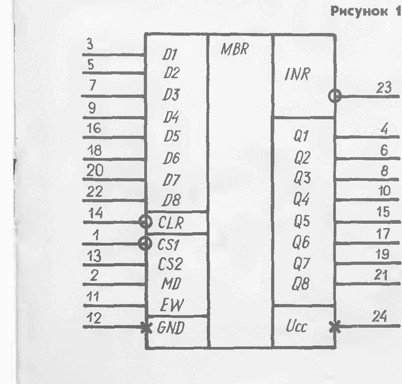
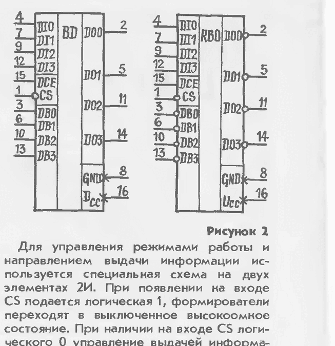
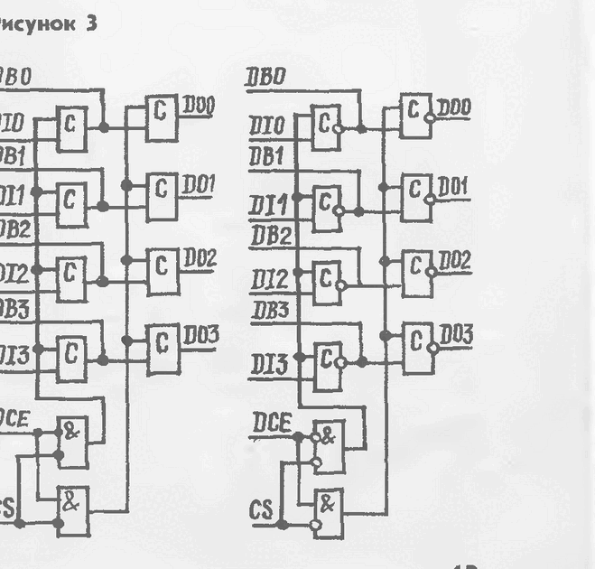

# 23. Микросхемы для «ЮТ-88»: К589ИР12, К589АП16 и К589АП26

*Источник: «ЮТ для умелых рук», 1989, № 5, с. 13 (справочный листок «Микросхемы для
„ЮТ-88“»).*

*Прим.: в дисплейном модуле применены шинные формирователи К589АП16 (DD28, DD29), см.
[20-displeynyy-modul.md](20-displeynyy-modul.md). Регистр К589ИР12 в дисплейном модуле не
используется.*

## К589ИР12

Микросхема **К589ИР12** — многорежимный восьмиразрядный универсальный буферный регистр. На
одной или нескольких микросхемах этого типа можно реализовать ряд интерфейсных и
вспомогательных устройств: регистры данных, буферные регистры со стробированием данных,
мультиплексоры, двунаправленные шинные формирователи, прерываемые каналы ввода/вывода и
другие.

Условное графическое обозначение микросхемы показано на рисунке 1. Назначение выводов указано
в таблице 1.

**Таблица 1**

| Вывод                       | Обозначение | Тип вывода | Функциональное назначение вывода |
|-----------------------------|-------------|------------|----------------------------------|
| 1, 13                       | CS1, CS2    | входы      | выбор кристалла                  |
| 2                           | MD          | вход       | выбор режима                     |
| 3, 5, 7, 9, 16, 18, 20, 22  | D1–D8       | входы      | информация                       |
| 4, 6, 8, 10, 15, 17, 19, 21 | Q1–Q8       | выходы     | информация                       |
| 11                          | EW          | вход       | стробирующий сигнал              |
| 12                          | GND         | —          | общий                            |
| 14                          | CLR         | вход       | установка нуля                   |
| 23                          | INR         | выход      | запрос прерывания                |
| 24                          | Ucc         | —          | напряжение питания               |

Микросхема состоит из восьми информационных триггеров, восьми выходных буферных устройств с
тремя устойчивыми состояниями, отдельного D-триггера для формирования запроса на прерывания и
гибкой схемы управления режимами работы регистра. Управляющие выводы микросхемы — **CS1, CS2,
MD и EW**. Эти входы используются для управления выборкой устройств, информацией регистра,
состоянием выходных буферных каскадов и триггером запроса на прерывание.

Вход **MD** (выбор режима) определяет один из двух режимов работы. При наличии на входе MD
логического 0 устройство работает для **ввода** информации. В этом случае выходные буферные
каскады открыты. Управление записью осуществляется сигналом по входу EW. При появлении на
входе MD логической 1 устройство будет работать в режиме **вывода**. В этом случае выходные
буферные каскады будут находиться в открытом состоянии независимо от выборки устройства. Вход
EW используется как синхросигнал для записи информации в регистр при наличии на входе MD
логического 0 и для синхронной установки триггера запроса прерывания.

Триггер запроса прерывания служит для выработки соответствующего сигнала в микропроцессорной
системе. При установке системы в исходное состояние низким уровнем сигнала CLR триггер запроса
устанавливается в состояние запрета прерывания. Этот же сигнал заведует и разрешением
прерывания. Считается, что микросхема находится в состоянии прерывания, когда на выходе INR
устанавливается логический 0.

## К589АП16 и К589АП26

Микросхемы **К589АП16 и К589АП26** — двунаправленные шинные формирователи, своего рода
усилители цифровых сигналов. Отличаются они тем, что, проходя через микросхему К589АП16, сигнал
остаётся неизменным, а через К589АП26 — инвертируется. Используются эти микросхемы для
управления шинами (магистралями) в цифровой и микропроцессорной технике. Обе микросхемы
представляют собой **4-канальные коммутаторы**, имеющие в каждом канале одну шину только для
приёма информации и одну двунаправленную шину для приёма и выдачи информации.

Условное графическое обозначение микросхем показано на рисунке 2, а структурная схема — на
рисунке 3. Назначение выводов указано в таблице 2.

| Рисунок 2 — К589АП16 (BD) и К589АП26 (RBD) |      Рисунок 3 — структурные схемы      |
|:------------------------------------------:|:---------------------------------------:|
|     |  |

**Таблица 2**

| Вывод        | Обозначение | Тип вывода   | Функциональное назначение вывода        |
|--------------|-------------|--------------|-----------------------------------------|
| 1            | CS          | вход         | выборка кристалла                       |
| 2, 5, 11, 14 | DO0–DO3     | выходы       | информация                              |
| 3, 6, 10, 13 | DB0–DB3     | входы/выходы | передача информации в двух направлениях |
| 4, 7, 9, 12  | DI0–DI3     | входы        | информация                              |
| 8            | GND         | —            | общий                                   |
| 15           | DCE         | вход         | управление передачей информации         |
| 16           | Ucc         | —            | напряжение питания                      |

Для управления режимами работы и направлением выдачи информации используется специальная
схема на двух элементах 2И. При появлении на входе **CS** логической 1 формирователи переходят
в выключенное высокоомное состояние. При наличии на входе CS логического 0 управление выдачей
информации по шинам DO и DB осуществляется сигналом на входе управления выдачей информации
**DCE**. Если на входе DCE логический 0, то открыта передача информации со входов DI на выходы
DB. При сигнале с уровнем логической 1 на этом же входе происходит передача информации с
входов DB на выходы DO (см. таблицу 3).

**Таблица 3**

| CS  | DCE | Направление передачи информации      | Выходы в состоянии «выключено» |
|:---:|:---:|--------------------------------------|--------------------------------|
|  0  |  0  | от входов DI0–DI3 до выходов DB0–DB3 | DO0–DO3                        |
|  0  |  1  | от входов DB0–DB3 до выходов DO0–DO3 | DB0–DB3                        |
|  1  |  1  | передачи нет                         | DO0–DO3, DB0–DB3               |

*Прим.: в тексте журнала встречается опечатка «К589ДП16» (имеется в виду К589АП16).*
