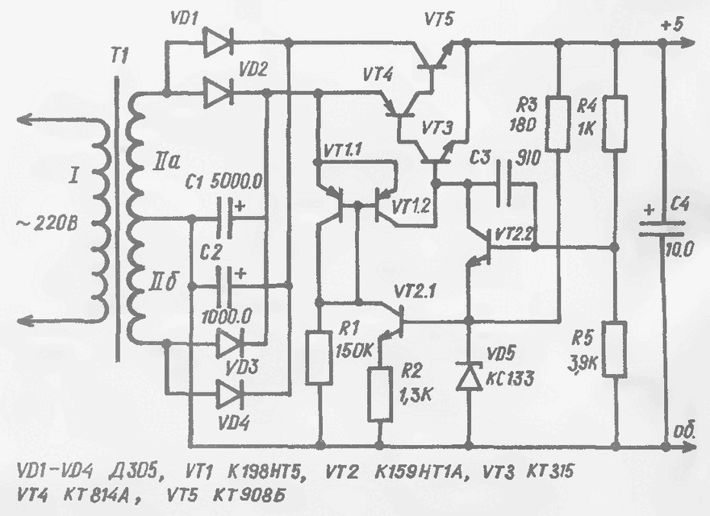

# 24. Дополнительный источник питания дисплейного модуля. Переписка с читателем

*Источник: «ЮТ для умелых рук», 1989, № 5, с. 12.*

## Дополнительный источник питания дисплейного модуля

При работе с дисплейным модулем и в дальнейшем с **модулем динамического ОЗУ** необходимо
использовать дополнительный источник питания **+5 В повышенной мощности**. Электрическая схема
дополнительного источника питания приведена на рисунке.

Элементы: VD1–VD4 — Д305; VT1 — К198НТ5; VT2 — К159НТ1А; VT3 — КТ315; VT4 — КТ814А;
VT5 — КТ908Б; VD5 — КС133; C1 — 5000,0; C2 — 1000,0; C3 — 910; C4 — 10,0; R1 — 150 к;
R2 — 1,3 к; R3 — 180; R4 — 1 к; R5 — 3,9 к. T1 — сетевой трансформатор (обмотка I — ~220 В,
вторичные обмотки IIа и IIб).

Источник питания включает в себя понижающий трансформатор T1, двухполупериодные выпрямители с
фильтрующими конденсаторами и стабилизатор напряжения. Номинальное действующее значение
напряжения на вторичной обмотке трансформаторов, при котором стабилизатор имеет максимальный
КПД при токе нагрузки **5 А** и максимальном размахе пульсаций **10 мВ**, составляет около
**8 В**.

Для получения высокого КПД стабилизатора его регулирующий элемент на транзисторах VT3–VT5
запитан от дополнительного выпрямителя источника смещения, выполненного на диодах. С целью
упрощения стабилизатора дифференциальный усилитель в нём заменён обычным на транзисторе VT2.2,
а образцовое напряжение формирует из стабилизированного выходного стабилитрон VD5. Этот
стабилитрон напряжения вместе с транзистором VT2.1 образует генератор стабильного тока. Для
получения минимального напряжения работы генератора тока применено «токовое зеркало» на
транзисторах VT1.1, VT1.2. Режим генератора тока устанавливают резистором R2 на уровне 2 мА.
При установке требуемого напряжения на выходе +5 В может потребоваться небольшая подстройка
резистора R4.

*Прим.: в журнале «резистором 2» — пропущена буква, имеется в виду R2.*

## Переписка с читателем: «И кому он нужен, этот компьютер?!»

*Пересказ; на той же странице журнала.*

В редакцию после выхода приложения № 2, посвящённого «ЮТ-88», пришло немало писем. Редакция
публикует одно из них — письмо В. Ткаченко (г. Заозёрный, Красноярский край): он считает, что
подборка «отпугнёт» юных читателей, что публикация нужна редакции и автору для рекламы и
поиска партнёров «для промышленного и мелкосерийного производства», и просит не поддаваться
«кооперативомании»; «деятельные мечтатели» найдут нужные схемы в других журналах.

Ответ редакции: спецномер заинтересует далеко не всех подписчиков, это было ясно заранее;
выпуск даже перенесли с 1988 на 1989 год по просьбе читателей. Журналы «Радио» и
«Моделист-конструктор» уже публиковали схемы несложных, но дорогих компьютеров. Промышленность
выпускает в основном дорогие профессиональные машины, «БК», «Радио-86РК» и «Специалист» выходят
малыми партиями, компьютерные классы есть не во всех школах. Поэтому по заданию редакции был
разработан несложный компьютер «ЮТ-88», который можно собирать **модуль за модулем**; редакция
выступила организатором производства самого дешёвого персонального компьютера (в полном
варианте — 300–400 рублей), сначала в виде наборов для отдельных модулей. Поступили заявки от
заводов. В дальнейшем объём публикаций о «ЮТ-88» будет сокращён.
