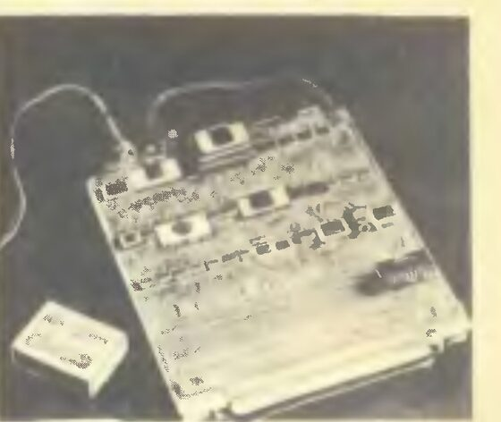

# 25. МОНИТОР дисплейного модуля: директивы I, X, G, W; часы, магнитофон, директива R

*Источники: «ЮТ для умелых рук», 1989, № 6, с. 8 и № 8, с. 10–11 (рубрика «Твой
персональный компьютер», «От индикаторов — к экрану»). Автор — В. Бартенев.*

## Продолжение рассказа о директивах (№ 6)

Продолжаем рассказ о директивах управляющей программы «МОНИТОР» дисплейного модуля «ЮТ-88».

По **директиве «I»** осуществляется ввод информации с кассетного магнитофона. У неё два
параметра. Указываются они только в случае необходимости. Первый параметр — **смещение**. Если
он есть, то вводимая информация будет загружаться по адресу, который является суммой
указанного в записи на ленте и значения смещения. Второй параметр задаёт **скорость чтения**
данных с ленты. Если он опущен, используется константа чтения, установленная либо при
начальной настройке рабочих ячеек «МОНИТОРА», либо при предыдущем чтении. По окончании ввода
МОНИТОР сообщает начальный и конечный адреса загрузки и контрольную сумму, подсчитанную при
вводе информации. Если она не совпадёт с записанной на магнитной ленте, то на следующей строке
будет выведено значение считанной контрольной суммы со знаком вопроса.

Для просмотра и изменения содержимого внутренних регистров микропроцессора используется
**директива «X»**. При её выполнении на экран выводятся символические имена регистров: PC, HL,
BC, DE, AF, SP. Работа с содержимым регистров и выход из директивы такие же, как и у директивы
«M».

*Прим.: в ПЗУ (FE8CH) строки имён идут в порядке PC, HL, BC, DE, SP, AF.*

**Директивы запуска программ «G» и «W».** С помощью первой директивы можно запускать
программу, адрес которой используется в качестве параметра этой директивы. Вторая запускает
программы с адреса **C000H**.

На той же странице напечатана таблица знакогенератора — см.
[26-znakogenerator.md](26-znakogenerator.md).

## Часы реального времени (№ 8)

МОНИТОР дисплейного модуля (как и МОНИТОР процессорного модуля) позволяет осуществить привязку
работы программ к реальному времени благодаря специально встроенной программе часов. При
совместном использовании этих двух модулей возможны **два режима работы**.

**Первый режим.** Используется МОНИТОР процессорного модуля (для удобства в дальнейшем мы будем
обозначать его как **МОНИТОР-«0»**). После запуска происходит установка времени и пуск часов.
Затем после запуска МОНИТОРА дисплейного модуля (в дальнейшем это **МОНИТОР-«F»**) с помощью
директивы «B», «ВК» можно вывести показания времени из ячеек памяти **C3FDH, C3FEH, C3FFH** на
светодиодные индикаторы процессорного модуля.

**Второй режим** предполагает отключение МОНИТОРА-«0» и использование программы часов в
МОНИТОРЕ-«F». В этом случае информация о времени содержится в следующих ячейках памяти:
**F6FDH — секунды, F6FEH — минуты, F6FFH — часы**. Чтобы запустить программу часов в
МОНИТОРЕ-«F», необходимо убедиться до отключения МОНИТОРА-«0», что часы «идут», с помощью
директивы «B». Затем директивой «M» загрузить в ячейки ОЗУ следующие коды:

| Адрес | Код | Примечание (не из журнала)   |
|-------|-----|------------------------------|
| C000H | F3H | `DI`                         |
| C001H | C3H | `JMP F800H`                  |
| C002H | 00H |                              |
| C003H | F8H |                              |
| C038H | C3H | `JMP FFC1H` — вектор `RST 7` |
| C039H | C1H |                              |
| C03AH | FFH |                              |
| F6FDH | 00H | секунды                      |
| F6FEH | —   | код минут                    |
| F6FFH | —   | код часов                    |

*Прим.: в журнале напечатано «C000H — F3H7, C003H — C3H, C002H — 00H, C003H — F8H» — опечатки;
по смыслу (и по разбору МОНИТОРА-«F») должно быть C000H — F3H, C001H — C3H, C002H — 00H,
C003H — F8H. Время хранится в двоично-десятичном коде (счёт ведётся командой `DAA`).*

Далее переключают ОЗУ из области **C000–C3FFH в область 0000–03FFH**, одновременно отключив
МОНИТОР-«0» (для этого подойдёт любой сдвоенный тумблер). Затем по сигналам точного времени
необходимо нажать на клавишу «УСТ», пустив тем самым часы в дисплейном модуле.

*Прим.: после переключения по адресу 0000H оказываются коды F3 C3 00 F8 — сброс «УСТ»
передаёт управление МОНИТОРУ-«F» (F800H), а по адресу 0038H — переход на обработчик
прерывания часов FFC1H. Прерывание `RST 7` раз в секунду вырабатывает процессорный модуль
(датчик секундных импульсов DD3 К176ИЕ5, см. [04-elektricheskaya-shema.md](04-elektricheskaya-shema.md)).*

## Магнитофон и прерывания

Несколько слов следует сказать о пользовании директивами записи и чтения данных с магнитофона
при наличии прерываний в микроЭВМ. Директивами записи и чтения МОНИТОРА-«0» (директивы «9», «A»
соответственно) следует пользоваться при небольшом объёме информации, так как в драйверах
записи и чтения байта на магнитофон этого МОНИТОРА программно не делается запрет прерывания, и
при большом объёме данных для надёжной записи и чтения на магнитофон следует аппаратно (с
помощью дополнительного тумблера) отключать запрос прерывания от вывода 14 микропроцессора и
подключать этот вывод на общий провод. Директивы записи и чтения данных «O» и «I»
МОНИТОРА-«F» дисплейного модуля используют **программный запрет прерывания** в драйверах записи
и чтения байта на магнитофон (останов часов на время вывода или ввода байта). Это требует
коррекции времени после работы с магнитофоном, например, с помощью директивы «M».

Используемый в «ЮТ-88» формат записи данных на магнитную ленту в МОНИТОРЕ-«0» совпадает с
форматом записи, используемым в **«Микро-80»**, а при использовании директив МОНИТОРА-«F»
совпадает с форматом записи **«РК-86»**. Благодаря этому обеспечивается программная
совместимость по вводу данных с этими наиболее распространёнными среди радиолюбителей
микроЭВМ. Следует лишь помнить, что контрольная сумма в «РК-86» и «Микро-80» считается
по-разному и совпадает лишь в младшем байте. В «ЮТ-88» контрольная сумма считается, как в
«Микро-80». В частности, **контрольная сумма МОНИТОРА-«F» — ED46H**.

*Прим.: проверено — 16-разрядная сумма всех байтов F800H–FFFFH переписанного дампа равна
ED46H (см. [27-monitor-f.md](27-monitor-f.md)).*

При работе с МОНИТОРОМ-«F» порт ввода/вывода данных на кассетный магнитофон используется также
для сигнализации **коротким однотональным звуком нажатия клавиш**. Поэтому удобно подключить к
этому порту магнитофон в режиме записи (с остановленной лентой).

## Директива R и вектор подпрограмм

Последняя директива МОНИТОРА-«F», которую осталось рассмотреть, — **директива «R»**. Она
служит для чтения информации из ПЗУ, подключённого к дополнительному интерфейсу. Параметрами
этой директивы являются начальный адрес ПЗУ, конечный адрес ПЗУ и адрес загрузки ОЗУ.

*Прим.: по коду МОНИТОРА дополнительный интерфейс — ППА в портах F8H–FBH: при старте в порт
FBH пишется 82H; директива R для каждого байта выводит старший байт адреса в порт FAH,
младший — в F9H и читает данные из порта F8H. Схема интерфейса в этих номерах не
публиковалась.*

МОНИТОР-«F» имеет стандартный набор подпрограмм (см. таблицу в № 5,
[22-klaviatura-i-direktivy.md](22-klaviatura-i-direktivy.md)), которыми можно пользоваться при
написании программ на «ЮТ-88». Набор подпрограмм в виде **вектора переходов** расположен в самом
начале МОНИТОРА-«F» и полностью соответствует подпрограммам «Микро-80» и «РК-86». Это также
обеспечивает программную совместимость «ЮТ-88» с «РК-86» и «Микро-80», конечно, при условии,
что используются ресурсы «ЮТ-88» через вектор стандартных подпрограмм МОНИТОРА-«F».

Распечатка «Коды „Монитора“ дисплейного модуля „ЮТ-88“» (с. 10 № 8) — в
[27-monitor-f.md](27-monitor-f.md).
