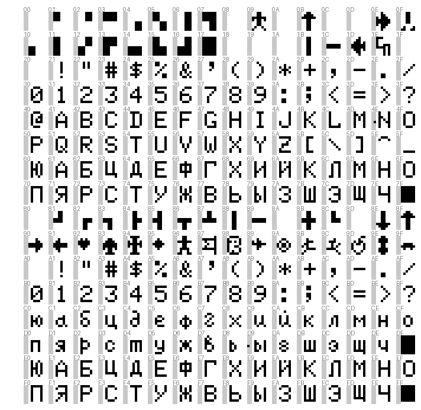

# 26. Знакогенератор «ЮТ-88»

*Источник: «ЮТ для умелых рук», 1989, № 6, с. 8 (таблица «Знакогенератор „ЮТ-88“») и № 9,
с. 12 (таблица «Алфавитно-цифровые коды „ЮТ-88“»).*

Знакогенератор — ПЗУ **DD10 КР573РФ2** (2К × 8) дисплейного модуля. В журнале напечатан полный
дамп 0000H–07FFH (2048 байт), контрольная сумма к нему не приводилась.

Файлы: [`../roms/chargen.hex`](../roms/chargen.hex) (текстовый дамп, как в журнале) и
[`../roms/chargen.bin`](../roms/chargen.bin) (двоичный образ 2048 байт).

## Формат

*Разбор — не из журнала, по данным дампа и по схеме ([20-displeynyy-modul.md](20-displeynyy-modul.md)).*

- Каждому символу отведено **8 байт подряд**: адрес = код × 8 + номер строки растра (0–7,
  сверху вниз). Всего в ПЗУ 256 образов.
- В байте используются **биты 5…0**: бит 5 — левая точка, бит 0 — правая (знакоместо 6 точек).
  Биты 7 и 6 на экран не выводятся (выходы D6, D7 ПЗУ не подключены).
- Изображение **инверсное**: бит = 0 — точка светится, бит = 1 — тёмная. Пробел — FFH × 8,
  сплошной прямоугольник (код 7FH) — C0H.
- Буквы и цифры нарисованы в матрице 5 × 7 (биты 4…0, строки 0–6, строка 7 пустая);
  псевдографика (коды 00H–1FH и 80H–9FH) использует все 6 × 8 точек.
- На схеме вход **A10** знакогенератора соединён с общим проводом, а адрес A3–A9 берётся из
  разрядов D0–D6 экранного ОЗУ. Поэтому реально отображаются только символы **00H–7FH**
  (первый килобайт). Вторая половина ПЗУ (80H–FFH): 80H–9FH — ещё одна псевдографика, A0H–BFH —
  копия 20H–3FH, C0H–DFH — строчные русские буквы, E0H–FFH — копия 60H–7FH.

Раскладка (по образам из дампа):

| Коды    | Содержимое                                                                                  |
|---------|---------------------------------------------------------------------------------------------|
| 00H–1FH | псевдографика (блоки 2 × 2 из квадрантов, стрелки, значки) — см. рисунок                    |
| 20H–3FH | пробел, знаки, цифры (как ASCII)                                                            |
| 40H–5FH | @, латинские прописные A–Z, [ \ ] ^ _                                                       |
| 60H–7EH | русские прописные (КОИ-7 Н2): Ю А Б Ц Д Е Ф Г Х И Й К Л М Н О П Я Р С Т У Ж В Ь Ы З Ш Э Щ Ч |
| 7FH     | сплошной прямоугольник ■                                                                    |



*Рисунок построен программой по переписанному дампу (не из журнала): 16 × 16 символов, код —
в левом верхнем углу клетки; чёрное — светящаяся точка; серые столбцы — неиспользуемые биты 7
и 6.*

## Алфавитно-цифровые коды «ЮТ-88» (№ 9)

| Код | Символ | Код | Символ | Код | Символ | Код | Символ |
|-----|--------|-----|--------|-----|--------|-----|--------|
| 20  | пробел | 38  | 8      | 50  | P      | 68  | Х      |
| 21  | !      | 39  | 9      | 51  | Q      | 69  | И      |
| 22  | "      | 3A  | :      | 52  | R      | 6A  | Й      |
| 23  | #      | 3B  | ;      | 53  | S      | 6B  | К      |
| 24  | $      | 3C  | <      | 54  | T      | 6C  | Л      |
| 25  | %      | 3D  | =      | 55  | U      | 6D  | М      |
| 26  | &      | 3E  | >      | 56  | V      | 6E  | Н      |
| 27  | '      | 3F  | ?      | 57  | W      | 6F  | О      |
| 28  | (      | 40  | @      | 58  | X      | 70  | П      |
| 29  | )      | 41  | A      | 59  | Y      | 71  | Я      |
| 2A  | *      | 42  | B      | 5A  | Z      | 72  | Р      |
| 2B  | +      | 43  | C      | 5B  | [      | 73  | С      |
| 2C  | ,      | 44  | D      | 5C  | \      | 74  | Т      |
| 2D  | -      | 45  | E      | 5D  | ]      | 75  | У      |
| 2E  | .      | 46  | F      | 5E  | ^      | 76  | Ж      |
| 2F  | /      | 47  | G      | 5F  | _      | 77  | В      |
| 30  | 0      | 48  | H      | 60  | Ю      | 78  | Ь      |
| 31  | 1      | 49  | I      | 61  | А      | 79  | Ы      |
| 32  | 2      | 4A  | J      | 62  | Б      | 7A  | Ъ      |
| 33  | 3      | 4B  | K      | 63  | Ц      | 7B  | Ш      |
| 34  | 4      | 4C  | L      | 64  | Д      | 7C  | Э      |
| 35  | 5      | 4D  | M      | 65  | Е      | 7D  | Щ      |
| 36  | 6      | 4E  | N      | 66  | Ф      | 7E  | Ч      |
| 37  | 7      | 4F  | O      | 67  | Г      | 7F  | ■      |

*Прим.:*

- *Код 24H в таблице журнала изображён как «$» (перечёркнутое S), а в ПЗУ и на клавиатуре
  (рисунок 2 в № 5) — значок «¤».*
- *Код 63H в таблице напечатан как «С»; по знакогенератору и по КОИ-7 это **Ц** (в таблице
  исправлено).*
- *Код 7AH в таблице — «Ъ», но в знакогенераторе под этим кодом нарисована буква **З** (как в
  КОИ-7 Н2); буквы Ъ в знакогенераторе нет.*
- *Код 5FH в таблице — «_» (подчёркивание, в журнале — короткий штрих).*

## Замеченные особенности дампа

Дамп переписан по изображению построчно (каждая строка — 16 байт) и сверен глазами; затем по
нему построены образы символов (рисунок выше), все они выглядят осмысленно. Несколько мест
напечатаны в журнале так (оставлены как напечатано):

| Адрес | Напечатано | Ожидалось бы | Комментарий                                                                               |
|-------|------------|--------------|-------------------------------------------------------------------------------------------|
| 0274H | AC         | EC           | строка 4 буквы N (4EH); отличие только в бите 6, который на экран не выводится            |
| 06CCH | 6A         | EA           | строка 4 символа D9H; отличие только в бите 7, на экран не выводится                      |
| 078AH | FE         | EE           | строка 2 символа F1H (копия «Я» 71H, где EE); A10 = 0, на экран не попадает               |
| 07C8H | EF         | EE           | строка 0 символа F9H (копия «Ы» 79H, где EE); в журнале знак смазан; на экран не попадает |

## Дамп

```
      .0 .1 .2 .3 .4 .5 .6 .7 .8 .9 .A .B .C .D .E .F
0000 FF FF FF FF FF FF FF FF C7 C7 C7 C7 FF FF FF FF
0010 F8 F8 F8 F8 FF FF FF FF C0 C0 C0 C0 FF FF FF FF
0020 FF FF FF FF F8 F8 F8 F8 C7 C7 C7 C7 F8 F8 F8 F8
0030 F8 F8 F8 F8 F8 F8 F8 F8 C0 C0 C0 C0 F8 F8 F8 F8
0040 FF FF FF FF FF FF FF FF F3 F3 C0 D2 F3 F3 ED DE
0050 FF FF FF FF FF FF FF FF F3 E1 C0 F3 F3 F3 F3 F3
0060 FF FF FF FF FF FF FF FF FF FF FF FF FF FF FF FF
0070 F7 F3 D1 C0 C0 D1 F3 F7 F3 F3 F3 F3 F3 FF EE CC
0080 FF FF FF FF C7 C7 C7 C7 C7 C7 C7 C7 C7 C7 C7 C7
0090 F8 F8 F8 F8 C7 C7 C7 C7 C0 C0 C0 C0 C7 C7 C7 C7
00A0 FF FF FF FF C0 C0 C0 C0 C7 C7 C7 C7 C0 C0 C0 C0
00B0 F8 F8 F8 F8 C0 C0 C0 C0 C0 C0 C0 C0 C0 C0 C0 C0
00C0 FF FF FF FF FF FF FF FF FF FF FF FF FF FF FF FF
00D0 FF FF FF FF FF FF FF FF F3 F3 F3 F3 F3 F3 F3 F3
00E0 FF FF FF C0 C0 FF FF FF FB F3 E2 C0 C0 E2 F3 FB
00F0 C7 DF DF D8 C2 FA FA FA FF FF FF FF FF FF FF FF
0100 FF FF FF FF FF FF FF FF FB FB FB FB FB FF FB FF
0110 F5 F5 F5 FF FF FF FF FF F5 F5 E0 F5 E0 F5 F5 FF
0120 FB F0 EB F1 FA E1 FB FF E7 E6 FD FB F7 EC FC FF
0130 FB F5 F5 F3 EA ED F2 FF F9 F9 FD FB FF FF FF FF
0140 FD FB F7 F7 F7 FB FD FF F7 FB FD FD FD FB F7 FF
0150 FF FB EA F1 EA FB FF FF FF FB FB E0 FB FB FF FF
0160 FF FF FF F3 F3 FB F7 FF FF FF FF E0 FF FF FF FF
0170 FF FF FF FF FF F3 F3 FF FF FE FD FB F7 EF FF FF
0180 F1 EE EC EA E6 EE F1 FF FB F3 FB FB FB FB F1 FF
0190 F1 EE FE F9 F7 EF E0 FF E0 FE FD F9 FE EE F1 FF
01A0 FD F9 F5 ED E0 FD FD FF E0 EF E1 FE FE EE F1 FF
01B0 F8 F7 EF E1 EE EE F1 FF E0 FE FD FB F7 F7 F7 FF
01C0 F1 EE EE F1 EE EE F1 FF F1 EE EE F0 FE FD E3 FF
01D0 FF F3 F3 FF FF F3 F3 FF F3 F3 FF F3 F3 FB F7 FF
01E0 FD FB F7 EF F7 FB FD FF FF FF E0 FF E0 FF FF FF
01F0 F7 FB FD FE FD FB F7 FF F1 EE FE FD FB FF FB FF
0200 F1 EE EC EA E8 EF F1 FF FB F5 EE EE E0 EE EE FF
0210 E1 EE EE E1 EE EE E1 FF F1 EE EF EF EF EE F1 FF
0220 E1 F6 F6 F6 F6 F6 E1 FF E0 EF EF E1 EF EF E0 FF
0230 E0 EF EF E1 EF EF EF FF F1 EE EF EF EC EE F0 FF
0240 EE EE EE E0 EE EE EE FF F1 FB FB FB FB FB F1 FF
0250 FE FE FE FE EE EE F1 FF EE ED EB E7 EB ED EE FF
0260 EF EF EF EF EF EE E0 FF EE E4 EA EA EE EE EE FF
0270 EE EE E6 EA AC EE EE FF F1 EE EE EE EE EE F1 FF
0280 E1 EE EE E1 EF EF EF FF F1 EE EE EE EA ED F2 FF
0290 E1 EE EE E1 EB ED EE FF F1 EE EF F1 FE EE F1 FF
02A0 E0 FB FB FB FB FB FB FF EE EE EE EE EE EE F1 FF
02B0 EE EE EE F5 F5 FB FB FF EE EE EE EA EA EA F5 FF
02C0 EE EE F5 FB F5 EE EE FF EE EE F5 FB FB FB FB FF
02D0 E0 FE FD F1 F7 EF E0 FF F1 F7 F7 F7 F7 F7 F1 FF
02E0 FF EF F7 FB FD FE FF FF F1 FD FD FD FD FD F1 FF
02F0 F1 EE FF FF FF FF FF FF FF FF FF FF FF FF E0 FF
0300 ED EA EA E2 EA EA ED FF FB F5 EE EE E0 EE EE FF
0310 E0 EF EF E1 EE EE E1 FF ED ED ED ED ED E0 FE FF
0320 F9 F5 F5 F5 F5 E0 EE FF E0 EF EF E1 EF EF E0 FF
0330 FB E0 EA EA E0 FB FB FF E0 EE EF EF EF EF EF FF
0340 EE EE F5 FB F5 EE EE FF EE EE EC EA E6 EE EE FF
0350 EA EE EC EA E6 EE EE FF EE ED EB E7 EB ED EE FF
0360 F8 F6 F6 F6 F6 F6 E6 FF EE E4 EA EA EE EE EE FF
0370 EE EE EE E0 EE EE EE FF F1 EE EE EE EE EE F1 FF
0380 E0 EE EE EE EE EE EE FF F0 EE EE F0 FA F6 EE FF
0390 E1 EE EE E1 EF EF EF FF F1 EE EF EF EF EE F1 FF
03A0 E0 FB FB FB FB FB FB FF EE EE EE F5 FB F7 EF FF
03B0 EE EA EA F1 EA EA EE FF E1 EE EE E1 EE EE E1 FF
03C0 EF EF EF E1 EE EE E1 FF EE EE EE E6 EA EA E6 FF
03D0 F1 EE FE F9 FE EE F1 FF EE EA EA EA EA EA E0 FF
03E0 F1 EE FE F8 FE EE F1 FF EA EA EA EA EA E0 FE FF
03F0 EE EE EE E0 FE FE FE FF C0 C0 C0 C0 C0 C0 C0 FF
0400 FF FF FF FF FF FF FF FF F3 F3 F3 C3 C3 FF FF FF
0410 FF FF FF F0 F0 F3 F3 F3 FF FF FF C3 C3 F3 F3 F3
0420 F3 F3 F3 F0 F0 F3 F3 F3 F3 F3 F3 C3 C3 F3 F3 F3
0430 FF FF FF C0 C0 F3 F3 F3 F3 F3 F3 C0 C0 FF FF FF
0440 F3 F3 F3 F3 F3 F3 F3 F3 FF FF FF C0 C0 FF FF FF
0450 FF FF FF FF FF FF FF FF F3 F3 F3 C0 C0 F3 F3 F3
0460 F3 F3 F3 F0 F0 FF FF FF FF FF FF FF FF FF FF FF
0470 F3 F3 F3 F3 F3 C0 E1 F3 F3 E1 C0 F3 F3 F3 F3 F3
0480 FF FB F9 C0 C0 F9 FB FF FF F7 E7 C0 C0 E7 F7 FF
0490 FF EB C1 C1 E3 F7 FF FF FF F3 E1 C0 C0 D2 F3 E1
04A0 E1 F3 D2 C0 D2 F3 F3 E1 FF F7 E3 C1 E3 F7 FF FF
04B0 F3 F3 C0 F3 F3 E1 ED CC FE C0 EE F6 EE C0 FE FE
04C0 E1 DE CA DE D9 DE D6 E1 FF F7 D3 C0 F3 F7 FF FF
04D0 FF F3 ED D2 D2 ED F3 FF FF F7 F1 E7 D7 F0 EF DF
04E0 FF FB E3 F6 F5 C3 FD FE FC FB E9 D2 DE DE ED F3
04F0 F3 E1 E1 F3 F3 E1 E1 F3 FF FF FF E1 C0 ED FF FF
0500 FF FF FF FF FF FF FF FF FB FB FB FB FB FF FB FF
0510 F5 F5 F5 FF FF FF FF FF F5 F5 E0 F5 E0 F5 F5 FF
0520 FB F0 EB F1 FA E1 FB FF E7 E6 FD FB F7 EC FC FF
0530 FB F5 F5 F3 EA ED F2 FF F9 F9 FD FB FF FF FF FF
0540 FD FB F7 F7 F7 FB FD FF F7 FB FD FD FD FB F7 FF
0550 FF FB EA F1 EA FB FF FF FF FB FB E0 FB FB FF FF
0560 FF FF FF F3 F3 FB F7 FF FF FF FF E0 FF FF FF FF
0570 FF FF FF FF FF F3 F3 FF FF FE FD FB F7 EF FF FF
0580 F1 EE EC EA E6 EE F1 FF FB F3 FB FB FB FB F1 FF
0590 F1 EE FE F9 F7 EF E0 FF E0 FE FD F9 FE EE F1 FF
05A0 FD F9 F5 ED E0 FD FD FF E0 EF E1 FE FE EE F1 FF
05B0 F8 F7 EF E1 EE EE F1 FF E0 FE FD FB F7 F7 F7 FF
05C0 F1 EE EE F1 EE EE F1 FF F1 EE EE F0 FE FD E3 FF
05D0 FF F3 F3 FF FF F3 F3 FF F3 F3 FF F3 F3 FB F7 FF
05E0 FD FB F7 EF F7 FB FD FF FF FF E0 FF E0 FF FF FF
05F0 F7 FB FD FE FD FB F7 FF F1 EE FE FD FB FF FB FF
0600 FF FF ED EA E2 EA ED FF FF FF FD F1 ED ED F2 FF
0610 F1 EF EF F3 ED ED F3 FF FF FF ED ED ED ED F0 FE
0620 F3 FD FD F1 ED ED F3 FF FF FF F3 ED E3 EF F1 FF
0630 FF FF FB F1 EA EA F1 FB FF F3 ED FB F7 ED F3 FF
0640 FF FF EE F5 FB F5 EE FF FF FF ED ED ED E9 F6 FF
0650 FB FF ED ED ED E9 F6 FF FF FF ED EB E7 EB ED FF
0660 FF FF F9 F5 F5 F5 ED FF FF FF EE E4 EA EE EE FF
0670 FF FF ED ED E1 ED ED FF FF FF F3 ED ED ED F3 FF
0680 FF FF E1 ED ED ED ED FF FF FF F1 ED F1 F9 E5 FF
0690 FF EF E3 ED ED E3 EF EF FF FF F3 ED EF ED F3 FF
06A0 FF FF E0 EA EA EA EA FF FF FF ED ED ED F1 FD E3
06B0 FF FF EA F1 F1 EA EE FF F7 EB E7 E3 ED ED F3 FF
06C0 FF FF EF E7 EB EB E7 FF FF FF EE E6 6A EA E6 FF
06D0 FF FF F3 ED F3 ED F3 FF FF FF EA EA EA EA E0 FF
06E0 FF FF F3 ED F9 ED F3 FF FF FF EA EA EA EA E0 FE
06F0 FF FF ED ED ED F1 FD FF C0 C0 C0 C0 C0 C0 C0 C0
0700 ED EA EA E2 EA EA ED FF FB F5 EE EE E0 EE EE FF
0710 E0 EF EF E1 EE EE E1 FF ED ED ED ED ED E0 FE FF
0720 F9 F5 F5 F5 F5 E0 EE FF E0 EF EF E1 EF EF E0 FF
0730 FB E0 EA EA E0 FB FB FF E0 EE EF EF EF EF EF FF
0740 EE EE F5 FB F5 EE EE FF EE EE EC EA E6 EE EE FF
0750 EA EE EC EA E6 EE EE FF EE ED EB E7 EB ED EE FF
0760 F8 F6 F6 F6 F6 F6 E6 FF EE E4 EA EA EE EE EE FF
0770 EE EE EE E0 EE EE EE FF F1 EE EE EE EE EE F1 FF
0780 E0 EE EE EE EE EE EE FF F0 EE FE F0 FA F6 EE FF
0790 E1 EE EE E1 EF EF EF FF F1 EE EF EF EF EE F1 FF
07A0 E0 FB FB FB FB FB FB FF EE EE EE F5 FB F7 EF FF
07B0 EE EA EA F1 EA EA EE FF E1 EE EE E1 EE EE E1 FF
07C0 EF EF EF E1 EE EE E1 FF EF EE EE E6 EA EA E6 FF
07D0 F1 EE FE F9 FE EE F1 FF EE EA EA EA EA EA E0 FF
07E0 F1 EE FE F8 FE EE F1 FF EA EA EA EA EA E0 FE FF
07F0 EE EE EE E0 FE FE FE FF C0 C0 C0 C0 C0 C0 C0 FF
```
