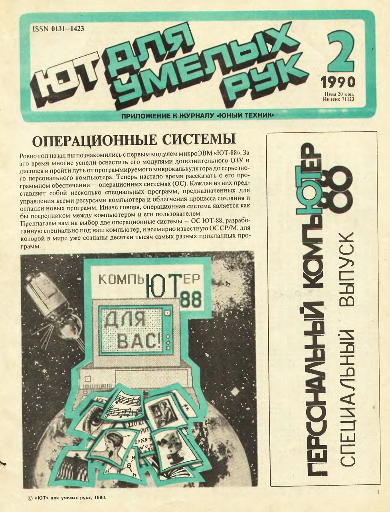

# 30. Операционная система ЮТ-88

*Источник: «ЮТ для умелых рук» 1990-02 (специальный выпуск «Персональный компьютер ЮТ-88»,
«Операционные системы»), с. 1–6. Авторы выпуска — В. Бартенев при участии И. Грищенко,
А. Блохина и С. Аксенова.*



## Вступление (с. 1)

Ровно год назад читатели познакомились с первым модулем микроЭВМ «ЮТ-88». За это время многие
успели оснастить её модулями дополнительного ОЗУ и дисплея и пройти путь от программируемого
микрокалькулятора до серьёзного персонального компьютера. Теперь настало время рассказать о
его программном обеспечении — операционных системах (ОС). Каждая из них представляет собой
несколько специальных программ, предназначенных для управления всеми ресурсами компьютера и
облегчения процесса создания и отладки новых программ. Иначе говоря, операционная система —
посредник между компьютером и его пользователем.

На выбор предлагаются две ОС:

- **ОС ЮТ-88**, разработанная специально под этот компьютер (этот файл);
- всемирно известная **ОС CP/M**, для которой в мире созданы десятки тысяч прикладных
  программ (см. [31-cpm.md](31-cpm.md)).

## Состав ОС ЮТ-88

ОС ЮТ-88 — простейшая **резидентная** операционная система. Она состоит из относительно
компактного ядра — **монитора**, размещаемого в ОЗУ по адресам **F800H–FFFFH**, — и набора
системных программ и данных:

| Компонент         | Адреса (рабочие) |
|-------------------|------------------|
| ОТЛАДЧИК          | D000H–DADBH      |
| ЭКРАННЫЙ РЕДАКТОР | C000H–C7FFH      |
| АССЕМБЛЕР         | C800H–CFFFH      |
| монитор (ядро ОС) | F800H–FFFFH      |

Дополнительные компоненты, не входящие в резидентную часть, могут загружаться в ОЗУ по мере
необходимости (например, интерпретатор языка «Бейсик»).

## Ввод и запуск

Первоначально ОС «ЮТ-88» размещается в виде **загрузочного модуля по адресам 3000H–58AFH**.
Распечатка кодов приведена в таблице с метками **UT-88** (журнал, с. 2–6 и левая колонка с. 15 — блок 3C00H–3FFFH; в репозитории —
[`../roms/ut88-os.hex`](../roms/ut88-os.hex) и [`../roms/ut88-os.bin`](../roms/ut88-os.bin),
10 416 байт с адреса 3000H; подробности переписывания — в [35-dampy.md](35-dampy.md)).

Используя директиву «M» (монитор «F») или директиву «0» (монитор «0»), наберите коды ОС в ОЗУ
компьютера, проверяя правильность набора по блокам в 1 Кбайт с помощью таблицы контрольных
сумм. Затем запишите ОС ЮТ-88 на магнитофон.

### Контрольные суммы ОС ЮТ-88

Даны в виде директивы «K» монитора: `Kначало, конец` → сумма.

| Директива   | Сумма |
|-------------|-------|
| K3000, 33FF | 2C39  |
| K3400, 37FF | 8317  |
| K3800, 3BFF | 4907  |
| K3C00, 3FFF | DB45  |
| K4000, 43FF | 249D  |
| K4400, 47FF | 3BF9  |
| K4800, 4BFF | 313C  |
| K4C00, 4FFF | 1B18  |
| K5000, 53FF | D02F  |
| K5400, 57FF | EF1B  |
| K5800, 58AF | 3CA0  |
| K3000, 58AF | 7C70  |

Контрольная сумма — простая 16-битная сумма всех байтов блока (директива «K» МОНИТОРА-«F»,
подпрограмма F82AH, см. [27-monitor-f.md](27-monitor-f.md); то же, что директива «8» монитора «0»,
см. [06-monitor.md](06-monitor.md)). Таблица сверена со сканом (с. 2). Сверка с переписанной
распечаткой: совпали блоки 3400H, 3C00H, 4000H, 4800H, 4C00H, 5000H, 5800H; не сошлись
3000H, 3800H, 4400H, 5400H (подробно — в [35-dampy.md](35-dampy.md)).

### Запуск

Запуск ОС ЮТ-88 производят директивой **«G» с адреса 3000H**. После этого на экране дисплея
появляется сообщение:

```
СТАРТЕР ОС ЮТ-88, ВЫКЛЮЧИТЕ ПЗУ МОНИТОРОВ И НАЖМИТЕ ЛЮБУЮ КЛАВИШУ!
```

Этот текст означает, что необходимо **реконфигурировать адресное пространство** «ЮТ-88»:

- отключить сигналы выборки областей **0000H–0FFFH** и **F000H–FFFFH** от ПЗУ мониторов «0» и
  «F»;
- отключить область **C000H–CFFFH** от статического ОЗУ;
- всё адресное пространство 0000H–FFFFH, **кроме экранной области дисплейного модуля
  E000H–EFFFH**, передаётся модулю динамического ОЗУ.

Сделать это можно тумблерами или галетным переключателем. В процессорном модуле отключаются и
прерывания от датчика секунд. После всех подготовительных операций нажмите любую клавишу — на
экране появится сообщение «ОС ЮТ-88», а ниже «ЮТ/88».

Появление скобки с мигающим курсором означает, что ОС загружена в рабочие адреса и ждёт
ввода директив.

*Прим. (не из журнала, по коду стартера): стартер выводит сообщение подпрограммой F818H
МОНИТОРА-«F», записывает 8BH в регистр управляющего слова ППА клавиатуры (порт 04H), выдаёт 00H в порт
07H (все столбцы) и ждёт нажатия любой клавиши (порт 06H ≠ 7FH), затем
переписывает 30B0H–38AFH в **F800H–FFFFH** (монитор ОС), записывает C3H (код `JMP`) в ячейку
0000H, переписывает 38B0H–58AFH в **C000H–DFFFH** (редактор, ассемблер, отладчик) и командой
`RET` передаёт управление на F800H. Текст сообщения стартера в распечатке закодирован в КОИ-7
(строчные латинские коды — русские буквы): в коде написано «…ВЫКЛЮЧИТЕ ПЗУ МОНИТОРА…»,
в тексте статьи — «МОНИТОРОВ». Подробнее — [35-dampy.md](35-dampy.md).*

## Директивы ОС ЮТ-88

Директивы ОС ЮТ-88 во многом схожи с директивами монитора дисплейного модуля, но их
возможности гораздо шире. Например, знакомая директива «F» имеет две модификации: если набрать
`FY АДР1, АДР2, БАЙТ, ВК`, то область ОЗУ с АДР1 по АДР2 заполнится константой; если набрать
`F АДР1, АДР2, БАЙТ, ВК` — это команда сверки содержимого ОЗУ с АДР1 по АДР2 с константой.
Введены и такие полезные директивы, как «P» — релокации программ, «W» — двухоконного
дизассемблирования и другие.

В обозначениях ниже `Y` после буквы директивы — модификатор «выполнить» (запись, заполнение,
копирование), без `Y` — «проверить/сверить».

### Магнитофон

| Директива                    | Назначение                      |
|------------------------------|---------------------------------|
| `IY ADR1, ADR2`              | чтение с магнитофона            |
| `I ADR1, ADR2`               | сверка записи                   |
| `O ADR1, ADR2, ADR3, (байт)` | вывод на магнитофон             |
| `V`                          | автоподстройка константы чтения |

Адреса в директивах «I»/«IY»:

- а) без адресов — запись читается в свои адреса;
- б) с одним или двумя адресами (**с пробелом**) — информация считывается не с адресов,
  указанных на плёнке, а с адреса, указанного в директиве первым. Второй адрес ограничивает
  область сверху; при его отсутствии запись читается до конца;
- в) с одним или двумя адресами (**без пробела**) — указанные адреса являются **именем** (в
  дополнение) для выбора записи на плёнке.

`O` — директива с четырьмя параметрами через запятую: адрес начала, адрес конца, смещение и
константа записи (две шестнадцатеричные цифры). Третий и четвёртый параметры можно не
указывать; по умолчанию константа записи равна 20H.

`V` включается на ракорде магнитной ленты (нулевые байты), выдаёт на экран оптимальную
константу чтения и заносит её в служебную ячейку.

### Память и запуск программ

| Директива                        | Назначение                                                                                                      |
|----------------------------------|-----------------------------------------------------------------------------------------------------------------|
| `M ADR`                          | вывод на экран содержимого ячейки памяти с возможностью изменения; УС+Ч (код 1EH) — ввод текстовой строки до ВК |
| `G ADR`                          | запуск программы с указанного адреса                                                                            |
| `GY ADR`                         | отладочный запуск программы                                                                                     |
| `GY ADR1, ADR2, ADR3, счётчик`   | отладочный запуск с двумя остановами                                                                            |
| `X`                              | просмотр (и изменение) регистров процессора                                                                     |
| `K ADR1, ADR2`                   | подсчёт контрольной суммы области памяти                                                                        |
| `D [ADR1, ADR2]`                 | дамп памяти                                                                                                     |
| `FY ADR1, ADR2, БАЙТ`            | заполнение памяти константой                                                                                    |
| `F ADR1, ADR2, БАЙТ`             | сверка с константой                                                                                             |
| `CY ADR1, ADR2, ADR3`            | копирование зон ОЗУ                                                                                             |
| `C ADR1, ADR2, ADR3`             | сверка зон ОЗУ                                                                                                  |
| `S …`                            | поиск строки                                                                                                    |
| `P ADR1, ADR2, ADR3, ADR4, ADR5` | релокатор                                                                                                       |
| `H число, число`                 | сумма и разность шестнадцатеричных чисел                                                                        |
| `T символы`                      | распечатка ASCII-кодов символов (для узнавания кодов)                                                           |
| `L ADR1, /ADR2/`                 | распечатка текста                                                                                               |
| `R символ` / `R`                 | разрешает / запрещает скроллинг                                                                                 |
| `W ADR`                          | дизассемблер                                                                                                    |
| `E`                              | вход в экранный редактор «МИКРОН»                                                                               |
| `N`, `A`, `B`, `Z`               | ассемблеры (см. ниже)                                                                                           |

Подробности:

- **GY ADR** — используя её совместно с директивой «X», можно перед началом выполнения
  программы зарядить регистры микропроцессора, в том числе указатель стека. По окончании
  работы программы записанные в регистры значения сохранятся, и вы вернётесь обратно в
  систему.
- **GY ADR1, ADR2, ADR3, счётчик** — останов происходит по ADR2 и ADR3, причём ADR3 будет
  закольцован до исчерпания счёта (от 0 до 255). Останов — это выход в операционную систему на
  директиву «X» и показ состояния регистров с возможностью изменения их значений.
- **X** — показывает строку `A=[Ak.F] B=[BC] D=[DE] H=[HL] S=[SP] O=[адрес останова]` (адрес
  останова не изменяется). Изменение регистров — вводом названия регистровой пары, например
  `BC`; ёмкость регистра 2 байта. Выход из директивы — пустое ВК.
- **D [ADR1, ADR2]** — просмотр зон ОЗУ в числовом и символьном виде. Если адрес не указан, он
  берётся по HL (из «X»); если адрес один — на экран выводится 16 строк, выполнение директивы
  запоминается; если указаны два адреса — выводится вся соответствующая область.
- **S** имеет две модификации: а) `S ADR1, ADR2, ADR3, ADR4` — ADR1, ADR2 — зона поиска, ADR3,
  ADR4 — зона эталона; б) `S ADR1, ADR2, строка символов` — поиск строки символов.
- **P ADR1, ADR2, ADR3, ADR4, ADR5** — ADR1, ADR2 — зона, куда перенесена программа; ADR3,
  ADR4 — где программа была работоспособна до действия директивы; ADR5 — начало зоны, где
  будет работать программа. Если вместо «P» использовать «P§», релокатор подействует только на
  таблицу меток (F400H–F5FFH).
- **L ADR1, /ADR2/** — начиная с указанного ADR1 выводятся байты в виде символов. Код символа
  больше 80H останавливает работу директивы.
- **E** — вход в экранный редактор «МИКРОН». Зона буфера текста — с 3000H по AFFFH. Признак
  конца — байт больше 80H.
- **W ADR** — дизассемблер. Запрашивает W-окно (ответы: пробел — поочерёдно, 1 — левое окно,
  2 — правое окно, любой другой символ — выход в монитор).

*Прим.: в журнале «S.............. — ПОИСК СТРОКИ»; символ «§» напечатан так в журнале
(вероятно, это клавиша с кодом, отображаемым на «ЮТ-88» как §).*

## Директивы редактора «МИКРОН»

| Клавиши     | Действие                                                                         |
|-------------|----------------------------------------------------------------------------------|
| УС+N        | очистка буфера текста с подтверждением                                           |
| УС+L        | отображение страницы, подтверждение ВК                                           |
| УС+L+символ | ищет в тексте страницу с заданной последовательностью символов                   |
| УС+T        | перевод маркера в конец текста (переход на создание текста, ведомого символом $) |
| СТР         | завершение режима (кнопка стирания экрана)                                       |
| УС+A        | ввод от маркера в середину текста вставки, завершается ВК и стиранием экрана     |
| УС+D        | уничтожение строк                                                                |
| УС+O        | запись текста на магнитофон                                                      |
| УС+I        | чтение текста с магнитофона                                                      |
| УС+V        | сверка с памятью                                                                 |

*Прим.: в журнале «УС+0 — запись текста на магнитофон»; по аналогии с УС+I и УС+V скорее
всего имеется в виду буква O.*

## Директивы ассемблера

- **N — интерактивный ассемблер.** Обозначение меток — `§XX` (XX — две шестнадцатеричные
  цифры). Выход из ассемблера — пустое ВК. Если директива «N» имеет адрес ADR, то начало
  программ будет с ADR, иначе по умолчанию с A000H. Можно пользоваться командой `ORG ADR`.
- **A — ассемблер исходного текста.** Текст размещён с адреса 3000H и заканчивается байтом,
  большим 80H (адрес с A000H по умолчанию, либо директива «A» с адресом):
  - `A§` — один проход;
  - `N§` — оба прохода сразу;
  - `Z` — карта загрузки (просмотр меток);
  - `Z0` — очистка карты загрузки (таблицы меток) F400H–F5FFH.
- **B — ассемблер «МИКРОН»** с тремя директивами:
  1. «слепое транслирование» двухпроходного исходного текста с адреса 3000H до байта,
     большего чем 80H. Зона трансляции независима от ORG в A000H, но ORG действует на метки,
     то есть программу нужно переносить;
  2. то же самое, но с протоколом трансляции;
  3. то же самое, но с таблицей меток на экране; СТР (кнопка стирания экрана) — выход в
     МОНИТОР.

## Сводка для эмулятора

- Загрузочный модуль: 3000H–58AFH (10 416 байт), запуск `G3000`.
- Резидентная часть после старта: монитор F800H–FFFFH, редактор C000H–C7FFH, ассемблер
  C800H–CFFFH, отладчик D000H–DADBH, таблица меток F400H–F5FFH, буфер текста 3000H–AFFFH.
- Требуется конфигурация «всё ОЗУ»: ПЗУ мониторов «0» (0000H–0FFFH) и «F» (F000H–FFFFH) и
  статическое ОЗУ C000H–CFFFH отключены, всё, кроме E000H–EFFFH (экран), — динамическое ОЗУ.
  Стартер выводит сообщение ещё через монитор «F» (`CALL F818H`), затем ждёт клавишу,
  после чего переписывает 30B0H–38AFH → F800H–FFFFH и 38B0H–58AFH → C000H–DFFFH и переходит
  на F800H.
- Образ: [`../roms/ut88-os.bin`](../roms/ut88-os.bin) (загружать с 3000H).
