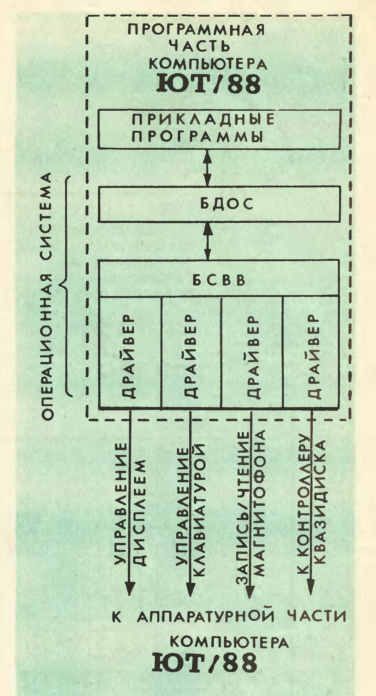
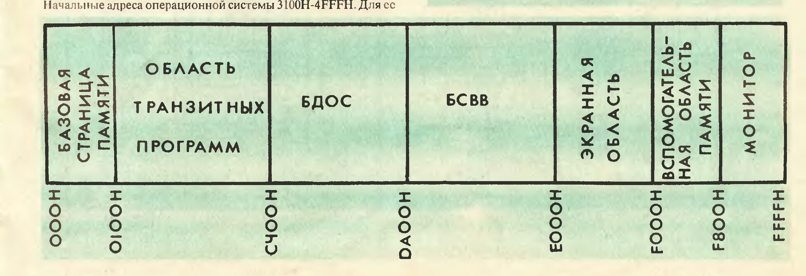

# 31. Операционная система CP/M для ЮТ-88

*Источник: «ЮТ для умелых рук» 1990-02, с. 7–12 (статья «Операционная система CP/M»,
В. Бартенев при участии И. Грищенко, А. Блохина и С. Аксенова).*

## Зачем CP/M

Операционная система ЮТ-88 ([30-os-ut88.md](30-os-ut88.md)) не обладает таким важным
свойством, как **файловая организация** программ и данных. Файл — место постоянного хранения
информации. Благодаря удобству работы, скорости доступа к файлам и переносимости программ
файловая структура является оптимальной для системного программного обеспечения современных
персональных компьютеров.

Операционной системой такого рода является **CP/M**. Она была создана Г. Килдэлом в 1975 году
специально для микроЭВМ на микропроцессорах 8080 фирмы Intel (советский аналог —
КР580ВМ80А). CP/M стала одной из наиболее популярных ОС и принята за своеобразный стандарт:
её используют многие производители компьютеров в разных странах, под неё созданы десятки
тысяч прикладных программ. Аналог CP/M разработан и в СССР под названием **МИКРОДОС**.

CP/M предназначена для использования вместе с мощным прикладным обеспечением, включая
компиляторы языков высокого уровня (Фортран, Паскаль, Си и др.), средства организации баз
данных, экранные редакторы, игры и многое другое.

CP/M — **дисковая** операционная система: она предусматривает работу компьютера с накопителем
на гибком магнитном диске. В «ЮТ-88» роль накопителя выполняет **электронный квазидиск** —
дополнительное ОЗУ объёмом от 64 до 256 Кбайт (см. [32-kvazidisk.md](32-kvazidisk.md)). Выбор
ёмкости квазидиска зависит от количества микросхем динамического ОЗУ, которые окажутся у вас.

## Состав CP/M

CP/M состоит из двух частей:

- **постоянной** — Базовой Дисковой Операционной Системы (**БДОС**, англ. BDOS);
- **переменной** — Базовой Системы Ввода/Вывода (**БСВВ**, англ. BIOS).

**БДОС** может использоваться в разных компьютерах без изменений. В ней есть специальный
программный модуль, который принимает и интерпретирует команды, вводимые с клавиатуры
(командный процессор, CCP). Кроме того, БДОС организует управление ресурсами системы, и прежде
всего файлами, обмен информацией между различными периферийными устройствами. В БДОС входит
ряд резидентных процедур управления работой дисковой системы (вывод на экран оглавления диска,
удаление дискового файла и др.).

**БСВВ** обеспечивает выполнение простейших операций передачи информации от микропроцессора к
устройствам ввода/вывода с помощью драйверов нулевого уровня, входящих в МОНИТОР дисплейного
модуля.

Схема (с. 7): «Программная часть компьютера ЮТ/88» — прикладные программы ↔ БДОС ↔ БСВВ;
БСВВ содержит четыре драйвера: управление дисплеем, управление клавиатурой, запись/чтение
магнитофона, к контроллеру квазидиска; через них — к аппаратной части компьютера ЮТ/88.
БДОС и БСВВ вместе образуют операционную систему.

## Структура и размещение CP/M

Операционная система CP/M в виде распечатки шестнадцатеричных кодов представлена в таблице с
метками **CP/M-64**. Кроме БДОС и БСВВ, она включает **начальный загрузчик**, обеспечивающий её
размещение как в требуемых адресах ОЗУ компьютера, так и на соответствующих «дорожках»
электронного квазидиска.

Операционную систему первоначально набирают вручную по директиве «M» Монитора «ЮТ-88»,
проверяя правильность набора по блокам в 1 Кбайт по таблице контрольных сумм. **В адреса
4BF0H–4FFFH директивой «F» заносится код E5H.** Затем ОС записывают на магнитную ленту для
последующего использования. **Начальные адреса операционной системы 3100H–4FFFH.** Для её
загрузки необходимо набрать директиву **G3100**. В результате она будет загружена как в ОЗУ,
так и в квазидиск, и ей сразу передаётся управление.

Распечатка CP/M-64 напечатана на с. 9–12 (адреса 3100H–4CFFH; 4C00H–4CFFH — уже байты E5H). В
репозитории — [`../roms/cpm64.hex`](../roms/cpm64.hex) и [`../roms/cpm64.bin`](../roms/cpm64.bin)
(3100H–4FFFH, 7936 байт; 4D00H–4FFFH дополнены кодом E5H, как велит текст).

### Контрольные суммы CP/M-64

| Директива   | Сумма |
|-------------|-------|
| K3100, 33FF | AC22  |
| K3400, 37FF | D667  |
| K3800, 3BFF | 0FF5  |
| K3C00, 3FFF | 0F56  |
| K4000, 43FF | 3B98  |
| K4400, 47FF | 1A30  |
| K4800, 4BFF | EBE6  |
| K4C00, 4FFF | 9400  |
| K3100, 4FFF | 7782  |

*Прим.: K4C00, 4FFF = 9400H = 1024 × E5H — то есть блок 4C00H–4FFFH целиком заполнен E5H.
Таблица сверена со сканом (с. 8). С переписанной распечаткой совпали **все** суммы, включая
K3100, 4FFF = 7782H (см. [35-dampy.md](35-dampy.md)).*

### Распределение памяти (рис. 1)

| Адреса      | Назначение                        |
|-------------|-----------------------------------|
| 0000H–00FFH | базовая страница памяти           |
| 0100H–C3FFH | область транзитных программ (TPA) |
| C400H–D9FFH | БДОС (вместе с CCP)               |
| DA00H–DFFFH | БСВВ (сама БСВВ — DA00H–DBFFH)    |
| E000H–EFFFH | экранная область                  |
| F000H–F7FFH | вспомогательная область памяти    |
| F800H–FFFFH | монитор                           |

БДОС занимает адресное пространство от **C400H до D9FFH**, а БСВВ — от **DA00H до DBFFH**.
Область памяти с 100H до нижнего адреса БДОС C400H называется **областью транзитных
программ**: именно в неё загружаются прикладные программы для исполнения.

Важная особенность CP/M — возможность загрузки прикладных программ на место некоторых
компонентов БДОС, если программа не обращается к системным вызовам. В этом случае под
прикладную программу отводится свыше 52 Кбайт ОЗУ. По окончании выполнения такой программы
нужно восстановить в памяти все компоненты CP/M и передать им управление — для этого после
завершения работы прикладной программы управление передаётся на WBOOT («горячий старт»).

## Базовая страница

Часть ячеек ОЗУ в области 0000H–0100H отведена под **базовую страницу памяти**. В ней записаны
несколько сегментов кодов и данных, обеспечивающих вход в БДОС и содержащих некоторые системные
параметры:

| Адрес       | Содержимое                                                        |
|-------------|-------------------------------------------------------------------|
| 0000H–0002H | `JMP DA03H` — переход на WBOOT («горячий» старт, перезапуск CP/M) |
| 0004H       | номер текущего диска (начальный — A, т. е. 0)                     |
| 0005H–0007H | `JMP CC06H` — вход в БДОС                                         |

*Прим.: в журнале «записан переход на БДОС JMP DA03H»; DA03H — это вход WBOOT в БСВВ.*

Переход по адресу 0005H используется для вызова операций БДОС: в регистр C помещают номер
функции, в регистровую пару DE — её параметры, затем выполняют `CALL 0005H`.

### Основные функции БДОС

|   N | Название функции            | Параметры                                                                                                    |
|----:|-----------------------------|--------------------------------------------------------------------------------------------------------------|
|   0 | завершение работы программы | C=0                                                                                                          |
|   1 | ввод символа с клавиатуры   | C=1, символ в A                                                                                              |
|   2 | вывод символа на экран      | C=2, E — код символа                                                                                         |
|   6 | ввод-вывод                  | C=6, E — код символа для вывода или E=FFH для ввода; в A код введённого символа, A=00, если символ не введён |
|   9 | вывод на экран сообщения    | C=9, DE — адрес начала сообщения                                                                             |
|  10 | ввод строки с клавиатуры    | C=0AH, DE — адрес буфера строки                                                                              |
|  11 | опрос состояния клавиатуры  | C=0BH; A=00H — код готовности, A=FFH — код неготовности                                                      |

*Прим.: в стандартной CP/M 2.2 функция 11 возвращает A=FFH, если символ готов, и 00H, если нет;
в журнале указано наоборот — оставлено как напечатано.*

## БСВВ: точки входа

Базовая система ввода-вывода реализует набор простейших операций работы с устройствами
ввода/вывода и с квазидиском. Только она непосредственно взаимодействует с внешними
устройствами и зависит от их особенностей; все другие компоненты CP/M общаются с периферией
только через БСВВ.

Для обращения к функциям БСВВ есть **17 точек входа**, расположенных по фиксированным адресам.
Они реализованы как «векторы переходов»: каждая из 17 команд передаёт управление некоторой из
подпрограмм БСВВ или подпрограммам Монитора «ЮТ-88». Точка входа в БСВВ — ячейка **DA00H**,
далее следует вектор из ещё 16 инструкций.

| Адрес | Команда       | Назначение (по журналу)                                          |
|-------|---------------|------------------------------------------------------------------|
| DA00  | `JMP BOOT`    | инициализация ОС после начальной загрузки                        |
| DA03  | `JMP WBOOT`   | «горячий старт» (вызывается также по УС+C)                       |
| DA06  | `JMP CONST`   | F812 — активность клавиатуры                                     |
| DA09  | `JMP CONIN`   | F803 — приём с клавиатуры в A                                    |
| DA0C  | `JMP CONOUT`  | F809 — вывод на дисплей                                          |
| DA0F  | `JMP LIST`    | F809 — вывод на дисплей                                          |
| DA12  | `JMP PUNCH`   | F80C — вывод на магнитофон                                       |
| DA15  | `JMP READER`  | F806 — ввод с магнитофона                                        |
| DA18  | `JMP HOME`    | установка головки текущего дисковода на нулевую дорожку          |
| DA1B  | `JMP SELDSK`  | выбор дисковода, указанного в C (0 — A, 1 — B, 2 — C, 3 — D)     |
| DA1E  | `JMP SETTRK`  | установка номера дорожки из C                                    |
| DA21  | `JMP SETSEC`  | установка номера сектора из C                                    |
| DA24  | `JMP SETDMA`  | адрес для прямого доступа к ОЗУ из BC (B — старший, C — младший) |
| DA27  | `JMP READ`    | чтение одного сектора диска                                      |
| DA2A  | `JMP WRITE`   | запись одного сектора на диск                                    |
| DA2D  | `JMP LISTST`  | состояние устройства печати                                      |
| DA30  | `JMP SECTRAN` | трансляция номера сектора                                        |

*Прим.: в журнале опечатки «DA0 JMP LIST» (надо DA0F) и «DA1E JMP SETTRC» (надо SETTRK).
Адреса F803…F812 — стандартные точки входа монитора «F» дисплейного модуля (F803 — ввод
символа с клавиатуры, F806 — чтение байта с магнитофона, F809 — вывод символа, F80C — запись
байта на магнитофон, F812 — опрос клавиатуры).*

Фактические переходы в распечатке (не из текста журнала, по коду 4A00H–4A32H):

| Адрес | Точка входа | Переход | Что там                                                                    |
|-------|-------------|---------|----------------------------------------------------------------------------|
| DA00  | BOOT        | DA80    | вывод заставки, IOBYTE=0, диск A, переход к GOCPM (DAE7)                   |
| DA03  | WBOOT       | DA9E    | перечитывание CCP+БДОС с дорожек 0–5, переход к GOCPM                      |
| DA06  | CONST       | F812    | монитор «F»                                                                |
| DA09  | CONIN       | F803    | монитор «F»                                                                |
| DA0C  | CONOUT      | F500    | драйвер дисплея с ESC-последовательностями (копия 31E0H–32FFH), затем F809 |
| DA0F  | LIST        | F809    | монитор «F» (печать — на экран)                                            |
| DA12  | PUNCH       | F80C    | монитор «F» (магнитофон)                                                   |
| DA15  | READER      | F806    | монитор «F» (магнитофон)                                                   |
| DA18  | HOME        | DB0C    | SETTRK 0                                                                   |
| DA1B  | SELDSK      | DB11    | только диск A (C=0), иначе HL=0                                            |
| DA1E  | SETTRK      | DB2A    | дорожка → номер блока 64К (порт 40H) и дорожка в блоке                     |
| DA21  | SETSEC      | DB5E    | сектор 1…8                                                                 |
| DA24  | SETDMA      | DB6D    |                                                                            |
| DA27  | READ        | DB73    | чтение сектора командами `POP`                                             |
| DA2A  | WRITE       | DB9E    | запись сектора командами `PUSH`                                            |
| DA2D  | LISTST      | DB09    | всегда A=FFH (готово)                                                      |
| DA30  | SECTRAN     | DB63    | таблица DA43H: 1, 2, …, 8 (без перемежения)                                |

*Прим.: в журнале CONOUT указан как F809, а в коде — `JMP F500H`: подпрограмма по адресу
F500H (её загрузчик копирует из 31E0H–32FFH в F500H–F61FH) разбирает ESC-последовательности
(ESC A/B/C/D — курсор вверх/вниз/вправо/влево, ESC E — очистка экрана, ESC H — курсор в
начало, ESC J/K — стирание до конца экрана/строки, ESC Y — позиционирование) и выводит символы
через F809H. Подробный разбор загрузчика и БСВВ — в [35-dampy.md](35-dampy.md).*

Все переходы можно разбить на три группы:

- реинициализация CP/M (BOOT, WBOOT);
- ввод/вывод символов (CONST, CONIN, CONOUT, LIST, PUNCH, LISTST, READER) — переходы на функции
  МОНИТОРА F;
- ввод/вывод на диск (HOME, SELDSK, SETTRK, SETSEC, SETDMA, READ, WRITE, SECTRAN).

## Файловая система CP/M

При использовании CP/M появляется возможность снабдить программы, тексты, наборы символов и
т. п. специальными именами и хранить их в виде записей на магнитной ленте. Такой набор
записей, рассматриваемый в процессе пересылки и обработки как единое целое, и называется
**файлом**.

Работа с файлами — одна из основных задач CP/M, и выполняется она постоянной частью CP/M —
БДОС. Файловая система автоматически распределяет место в оглавлении и области данных при
создании и расширении файла и освобождает место, занятое файлом, при его удалении. Если для
операции нет места в оглавлении или в области данных диска, система сообщает об этом.

CP/M обеспечивает 4 вида операций: доступ к файлам, доступ к оглавлению (каталогу), доступ к
диску и смешанные операции. Каждый файл имеет только ему принадлежащее имя, состоящее из
собственно имени и типа файла, разделённых точкой. Имя файла можно составить максимум из
восьми символов, исключая символы «*» и «?». Преимущественно используют латинские буквы и
цифры. Общепринятые типы файлов:

| Тип    | Содержимое                                                          |
|--------|---------------------------------------------------------------------|
| `.COM` | транзитная команда, программа в машинном коде, готовая к исполнению |
| `.MAC` | программа на языке ассемблера (текст)                               |
| `.TXT` | текстовый файл, подготовленный редактором                           |
| `.BAS` | программа на Бейсике (текст)                                        |
| `.FOR` | программа на Фортране (текст)                                       |
| `.HLP` | текстовый файл с разъяснением прикладной программы                  |

Организация гибкого диска и его электронного заменителя — квазидиска — описана в
[32-kvazidisk.md](32-kvazidisk.md); работа с командами CP/M — в
[33-cpm-komandy.md](33-cpm-komandy.md).
