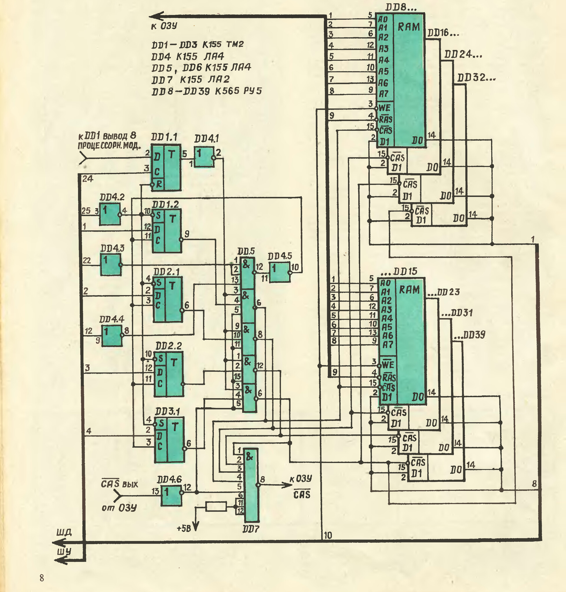

# 32. Электронный квазидиск

*Источник: «ЮТ для умелых рук» 1990-02, с. 8 (рис. 2 — схема), с. 12 (текст).*

## Диск CP/M и его заменитель

Прежде чем рассматривать операции CP/M с файлами, познакомимся с конкретной организацией
гибкого диска и его электронного заменителя — квазидиска.

**Стандартный гибкий диск CP/M** (8-дюймовый, формат IBM 3740):

| Параметр            | Значение         |
|---------------------|------------------|
| дорожек             | 77 (номера 0…76) |
| секторов на дорожке | 26               |
| байт в секторе      | 128              |
| ёмкость             | 256 Кбайт        |

Это пространство используется так: **нулевая и первая дорожки** содержат операционную систему
CP/M. В частности, БДОС размещается в 26 секторах нулевой дорожки и в 19 секторах первой
дорожки — там та же информация, что и в ОЗУ от C400H до D9FFH. С 20-го по 26-й сектор первой
дорожки размещается БСВВ (DA00H–DBFFH). В 26 секторах **второй дорожки** содержатся оглавление
и справочные данные о файлах, находящихся на диске.

*Прим.: так в журнале; для 8-дюймового диска это описание стандартной CP/M, а не квазидиска
ЮТ-88 (у квазидиска другая геометрия, см. ниже).*

## Что такое квазидиск

**Электронный квазидиск** — это модуль ОЗУ, подобный модулю динамического ОЗУ, рассмотренному
ранее, ёмкостью **от 64 до 256 Кбайт**, имеющий дополнительные возможности по вводу/выводу
информации в соответствии с командами БСВВ.

Существуют разные способы организации обмена с квазидиском: дополнительные порты приёма и
выдачи данных, порт управления и порты адресации. Однако проще всего осуществить обмен с
квазидиском, **инициализируя его как адресное пространство стека**.

## Схема (рис. 2)

Кроме микросхем ОЗУ, в квазидиск входят ещё семь микросхем:

| Позиция  | Тип                            |
|----------|--------------------------------|
| DD1–DD3  | К155ТМ2                        |
| DD4      | К155ЛН1 (на схеме «К155 ЛА4»?) |
| DD5, DD6 | К155ЛА4                        |
| DD7      | К155ЛА2                        |
| DD8–DD39 | К565РУ5                        |

*Прим.: в перечне на схеме для DD4 напечатано «К155 ЛА4», но на схеме DD4.1…DD4.6 — шесть
инверторов (элементы «1» с одним входом), то есть по смыслу это К155ЛН1.*

Микросхемы ОЗУ включаются параллельно тем, что используются в модуле ОЗУ (адресные входы A0–A7,
WE, RAS, данные — общие). Всего может быть **от одного до четырёх блоков по восемь микросхем
К565РУ5** в каждом. Отдельно у этих блоков включаются только выводы **CAS**:

| Сигнал | Ёмкость квазидиска | Микросхемы ОЗУ |
|--------|--------------------|----------------|
| CAS 1  | 64 К               | DD8–DD15       |
| CAS 2  | 128 К              | DD16–DD23      |
| CAS 3  | 192 К              | DD24–DD31      |
| CAS 4  | 256 К              | DD32–DD39      |

Такое простое взаимодействие с квазидиском достигнуто благодаря дополнительному управляющему
сигналу, который формируется на микросхеме **DD1.1 из слова состояния (2-й разряд)** и который
активен, когда идёт **обращение к стеку**. Таким образом, при обращении к стеку, когда в порт
**40H** записано 00, электронный квазидиск «открывается». Если инициализация порта 40H не
произведена, то стек формируется как обычно, в адресном пространстве основного ОЗУ.

### Как работает схема (по рисунку)

- **DD1.1** (D-триггер) защёлкивает бит D2 шины данных в такте выдачи слова состояния
  процессора (вход D — «к DD1 вывод 8 процессорного модуля», т. е. к выходу регистра слова
  состояния; бит D2 слова состояния КР580ВМ80А — **STACK**). Его выход через DD4.1 даёт сигнал
  «идёт обращение к стеку».
- **DD1.2, DD2.1, DD2.2, DD3.1** (D-триггеры) — регистр порта 40H: на их входы D заведены линии
  1–4 шины данных (D0–D3), а запись идёт по сигналу записи в порт (вход C), формируемому
  DD4.2, DD4.3, DD4.4 из сигналов шины управления (выводы 25, 22, 12 разъёма). Каждый бит
  разрешает один 64-килобайтный блок.
- **DD5** (И-НЕ) объединяет «стековый» сигнал с выходами регистра и формирует четыре сигнала
  CAS для блоков DD8…DD39; **DD7** (8И-НЕ) — сигнал CAS для основного ОЗУ: при обращении к
  квазидиску CAS основного ОЗУ запрещается (CAS вых. от ОЗУ → DD4.6 → DD7 → «к ОЗУ CAS»).

*Прим.: схема сложна для однозначного прочтения по скану; описание дано по рисунку и тексту
и для эмулятора не обязательно — поведение важно на уровне «порт 40H выбирает блок, стековые
обращения идут в квазидиск».*

## Геометрия квазидиска

Каждый из блоков дополнительной памяти имитирует **отдельный диск** со следующими
параметрами:

| Параметр              | Значение |
|-----------------------|----------|
| общая ёмкость         | 64 Кбайт |
| число «дорожек»       | 64       |
| секторов на дорожке   | 8        |
| байт в секторе (CP/M) | 128      |

64 дорожки × 8 секторов × 128 байт = 65 536 байт (одна «дорожка» = 1 Кбайт).

*Прим. (по коду БСВВ): в распечатанной БСВВ блоки — не отдельные диски, а продолжение одного
диска A: дорожки 0–63 лежат в блоке 1, 64–127 — в блоке 2 и т. д. (см. «Модель для
эмулятора»).*

Приведённая распечатка загрузчика CP/M соответствует квазидиску **256 Кбайт**. При меньшем
объёме в ячейку ОЗУ загрузчика CP/M **4A50H** следует ввести поправку:

| Ёмкость квазидиска | Значение в 4A50H |
|--------------------|------------------|
| 64 Кбайт           | 39H              |
| 128 Кбайт          | 79H              |
| 192 Кбайт          | B9H              |

*Прим.: строка для 192 Кбайт напечатана в начале с. 13 («для диска объемом 192 кбайта —
B9H»). Сама распечатка противоречит тексту: в ячейке 4A50H в ней стоит **39H** (значение для
64 Кбайт), хотя заставка в той же распечатке — «CPM V - 2.2 DISK RAM - 256K.». Ячейка 4A50H —
младший байт поля DSM таблицы DPB (адрес DA50H после загрузки); ряд 39H, 79H, B9H
продолжается значением **F9H** для 256 Кбайт (вывод, в журнале не указан; см. ниже).*

## Модель для эмулятора

Ниже **факты журнала** помечены «Ж», **факты из кода** распечатки CP/M-64
([`../roms/cpm64.bin`](../roms/cpm64.bin), разбор — в [35-dampy.md](35-dampy.md)) — «К»,
**выводы** — «В».

### Аппаратная часть

| Что                      | Модель                                                                                                                                                                                                                             | Источник |
|--------------------------|------------------------------------------------------------------------------------------------------------------------------------------------------------------------------------------------------------------------------------|----------|
| объём                    | 1–4 блока по 64 Кбайт (64/128/192/256 Кбайт), блок n — микросхемы с CAS n                                                                                                                                                          | Ж        |
| порт                     | **40H**, только запись (`OUT 40H`); чтения порта нет                                                                                                                                                                               | Ж, К     |
| биты порта               | D0 → блок 1 (0–63 дорожки), D1 → блок 2, D2 → блок 3, D3 → блок 4; **активный уровень 0**; D4–D7 не используются                                                                                                                   | К, В     |
| значения в коде          | FEH, FDH, FBH, F7H — открыть блок 1, 2, 3, 4; **FFH — квазидиск закрыт**                                                                                                                                                           | К        |
| «порт 40H = 00»          | по тексту журнала квазидиск «открывается» записью 00; по схеме это открыло бы все установленные блоки сразу (код так не делает)                                                                                                    | Ж, В     |
| какие обращения          | все обращения к памяти в машинных циклах, где в слове состояния КР580ВМ80А бит D2 (STACK) = 1                                                                                                                                      | Ж        |
| это команды              | `PUSH`, `POP`, `CALL`/`Cxx`, `RET`/`Rxx`, `RST`, `XTHL` (обращения по SP), а также запись адреса возврата при приёме прерывания (`RST` от контроллера)                                                                             | В        |
| не затрагиваются         | выборка команд, `MOV M`, `LDAX`/`STAX`, `LDA`/`STA`, `LHLD`/`SHLD`, `SPHL` (последняя только меняет SP)                                                                                                                            | В        |
| адресация                | 16-битный адрес шины (значение SP) — адрес внутри выбранного блока 64 Кбайт; основное ОЗУ в этих циклах не выбирается (CAS основного ОЗУ запрещается)                                                                              | Ж, В     |
| адреса ПЗУ и экрана      | в коде CP/M SP при открытом квазидиске указывает только на 0000H–FFFFH блока как на данные; что делает схема при SP в области ПЗУ/экрана, журнал не говорит — для эмулятора принять, что любое стековое обращение идёт в квазидиск | В        |
| начальное состояние      | после включения регистр порта 40H не определён в журнале; для эмулятора принять **FFH (закрыт)** — текст: «если инициализация порта 40 не произведена, то стек формируется, как обычно»                                            | Ж, В     |
| содержимое при включении | не определено (динамическое ОЗУ); загрузчик CP/M сам записывает системные дорожки и каталог                                                                                                                                        | В        |
| регенерация/питание      | как у модуля динамического ОЗУ; при выключении питания содержимое теряется (журнал советует аккумулятор)                                                                                                                           | Ж        |

Схема (рис. 2): DD1.1 запоминает бит D2 слова состояния (сигнал «обращение к стеку»),
D-триггеры DD1.2, DD2.1, DD2.2, DD3.1 — регистр порта 40H на линиях D0–D3; DD5 формирует
CAS 1…CAS 4, DD7 запрещает CAS основного ОЗУ. Точное прочтение дешифратора адреса порта по
скану ненадёжно; код обращается только к порту 40H (В).

Особенности, которые нужно учесть в эмуляторе (В):

- пока порт 40H ≠ FFH, **прерывание** записало бы адрес возврата в квазидиск — БСВВ
  выполняет `DI` (в GOCPM, DAE7H) и больше прерывания не разрешает; CP/M-64 работает с
  запрещёнными прерываниями;
- в подпрограммах READ/WRITE между `OUT 40H` и закрытием (`MVI A,FFH` / `OUT 40H`) нет ни
  одного `CALL` — только `POP`/`PUSH`, поэтому достаточно модели «стековые циклы → квазидиск».

### Формат диска CP/M-64 (К)

Квазидиск — единственный диск A: (SELDSK принимает только C=0). Таблицы БСВВ после загрузки:

| Поле DPH (DA33H) | Значение | Смысл                                      |
|------------------|----------|--------------------------------------------|
| XLT              | DA43H    | таблица трансляции: 1, 2, 3, 4, 5, 6, 7, 8 |
| рабочие          | 0, 0, 0  |                                            |
| DIRBUF           | DBF6H    | буфер каталога                             |
| DPB              | DA4BH    | см. ниже                                   |
| CSV              | DC95H    | контроль смены диска                       |
| ALV              | DC76H    | карта занятости                            |

| Поле DPB (DA4BH) | Значение в распечатке      | Смысл                                                                      |
|------------------|----------------------------|----------------------------------------------------------------------------|
| SPT              | 0008H                      | 8 секторов по 128 байт на дорожку (дорожка = 1 Кбайт)                      |
| BSH, BLM         | 03H, 07H                   | блок 1 Кбайт                                                               |
| EXM              | 00H                        |                                                                            |
| DSM              | 0039H (ячейка 4A50H/DA50H) | 58 блоков; для 128/192/256 Кбайт — 79H/B9H/F9H (Ж для 79H, B9H; В для F9H) |
| DRM              | 001FH                      | 32 записи каталога                                                         |
| AL0, AL1         | 80H, 00H                   | каталог — блок 0                                                           |
| CKS              | 0008H                      |                                                                            |
| OFF              | 0006H                      | 6 системных дорожек                                                        |

Расположение на диске (К): номер дорожки T (0–255) → блок 64 Кбайт = T div 64 (значение порта
FEH/FDH/FBH/F7H), адрес внутри блока = (T mod 64) × 400H + (S − 1) × 80H, где S — сектор
1…8. Байт i сектора лежит по адресу «адрес + i» (READ читает `POP`-ами снизу вверх, WRITE
пишет `PUSH`-ами сверху вниз — порядок байтов прямой).

| Дорожки | Адреса в блоке 1 | Содержимое                                                                         |
|---------|------------------|------------------------------------------------------------------------------------|
| 0–5     | 0000H–17FFH      | система: CCP+БДОС (C400H–D9FFH) и БСВВ (DA00H–DBFFH), образ 3400H–4BFFH загрузчика |
| 6       | 1800H–1BFFH      | каталог (блок 0), исходно все байты E5H                                            |
| 7–63    | 1C00H–FFFFH      | блоки данных 1–57                                                                  |
| 64–255  | блоки 2–4        | данные (используются, только если DSM рассчитан на 128–256 Кбайт)                  |

WBOOT (DA9EH) читает 44 (2CH) сектора начиная с дорожки 0, сектора 1 в C400H–D9FFH — то есть
перезагружается только CCP+БДОС, БСВВ остаётся в ОЗУ.

*Прим. (В): при DSM = 39H CP/M видит 58 Кбайт данных на первом блоке, остальные блоки не
используются, хотя SETTRK умеет до 256 дорожек. Пример STAT в журнале («SPACE: 152K») не
соответствует ни одному из значений DSM — вероятно, снят на другой конфигурации.*

### Загрузка CP/M-64 (К)

1. Распечатка 3100H–4CFFH (+ E5H в 4BF0H–4FFFH) находится в ОЗУ. По рис. 1 МОНИТОР-«F» в
   ПЗУ F800H–FFFFH и экран E000H–EFFFH остаются, всё остальное — ОЗУ; CP/M пользуется
   точками входа F803H…F812H и ячейкой курсора МОНИТОРА F75AH (рабочие ячейки F400H–F7FFH).
   Базовая страница 0000H–00FFH и TPA должны быть ОЗУ, то есть ПЗУ монитора «0» (0000H–0FFFH)
   отключено, а 0000H–DFFFH занято динамическим ОЗУ (В: в журнале для CP/M это прямо не
   сказано, но следует из рис. 1 и из того, что БСВВ пишет в 0000H–0007H).
2. `G3100`. Загрузчик:
   - копирует 3400H–4BFFH → **C400H–DBFFH** (CCP+БДОС+БСВВ);
   - `LXI SP,1C00H`, `OUT 40H` ← FEH (блок 1) и командами `PUSH` переносит 3400H–4FFFH в
     квазидиск по адресам **0000H–1BFFH** (дорожки 0–6: система и пустой каталог);
   - `OUT 40H` ← FFH, копирует 31E0H–32FFH → **F500H–F61FH** (драйвер CONOUT);
   - `JMP DA00H` (BOOT).
3. BOOT: SP=0100H, вывод заставки «CPM V - 2.2 DISK RAM - 256K.», ячейки 0003H (IOBYTE) и
   0004H (текущий диск) = 0, переход на GOCPM (DAE7H): `DI`, в 0000H — `JMP DA03H`, в 0005H —
   `JMP CC06H`, DMA = 0080H, C = диск, `JMP C400H` (CCP). Появляется приглашение `A>`.

Для эмулятора достаточно положить [`../roms/cpm64.bin`](../roms/cpm64.bin) по адресу 3100H
(при включённом ПЗУ МОНИТОРА-«F» и ОЗУ во всём остальном пространстве, кроме экрана
E000H–EFFFH) и запустить с 3100H. Повторный «горячий» запуск без перезагрузки квазидиска —
`G DA00` (так велит журнал после загрузки CH.COM) или `JMP 0000H` (WBOOT).

## Питание

Все транзитные команды при работе с электронным квазидиском хранятся на кассетах. Впрочем,
если приспособить для питания квазидиска автомобильный аккумулятор, отпадёт необходимость в
перезагрузке квазидиска рабочими программами при перерывах в работе с отключением питания.
