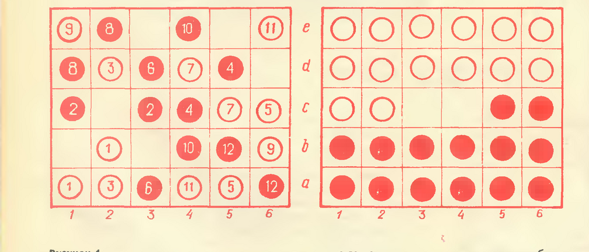
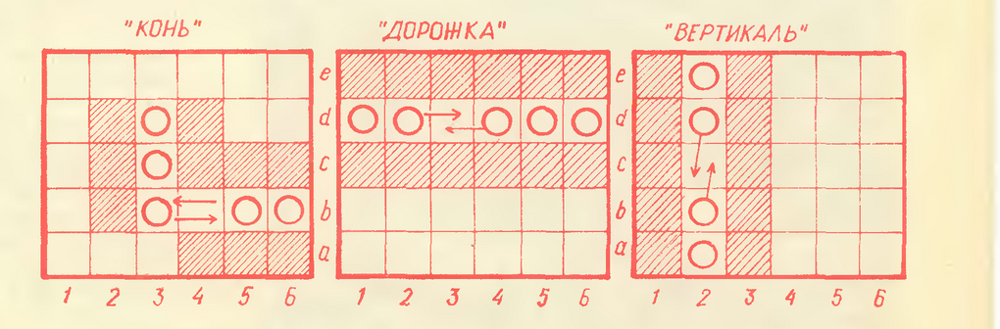

# 40. «Болотуду» и кое-что ещё

*Источник: «ЮТ для умелых рук» 1989-06, с. 9, рубрика «Игры программиста». Программы к
этим играм в журнале не приводятся — статья предлагает читателям составить их самим.*

Во втором номере приложения мы познакомили вас с несколькими популярными игровыми
программами для персональных компьютеров. На этот раз хотим, чтобы вы сами на основе
описания правил двух малоизвестных игр попробовали составить для них программы.
Благодаря своей простоте и чёткости они легко поддаются алгоритмизации.

## «Сенегальские шашки»

Первая игра называется «Сенегальские шашки». Вы догадались по названию — родилась она в
Африке. Играют в неё двое. Каждый получает по 14 шашек — белых и чёрных. Расстановка их
показана на рисунке 1 справа. Как видите, в середине остаётся всего два незанятых поля.
С них белые и начинают игру.

Ходить можно только на свободное поле вперёд, вправо и влево, продвигаясь в порядке
очереди на одну соседнюю клетку. По диагонали двигаться нельзя. Когда представляется
возможность перепрыгнуть через шашку партнёра, вы обязаны это сделать. Шашка противника
при этом считается съеденной и снимается с поля. Достигнув последней горизонтали, шашка
не становится «дамкой», как обычно, а выбывает из игры, поскольку ходить назад
запрещено. Цель игры — съесть как можно больше шашек противника. Поэтому имеет смысл не
спешить на последнюю горизонталь, а для свободы манёвра как можно дольше оставаться в
середине поля.

Игра заканчивается, когда все шашки кого-либо из партнёров продвинулись на последнюю
горизонталь и, следовательно, не могут никого ни «съесть», ни быть «съеденными» сами.
Остаётся подсчитать количество выставленных шашек и определить победителя.

*Рисунок 1. Поле 6×5 (вертикали 1–6, горизонтали a–e). Слева — расстановка «Болотуду»
после двенадцатого хода тренировочной партии (цифры — порядок, в котором ставились
шашки; светлые кружки — белые, закрашенные — чёрные). Справа — начальная расстановка
«Сенегальских шашек»: белые занимают горизонтали e, d и поля c1, c2; чёрные — a, b и
поля c5, c6; свободны c3 и c4.*

## «Болотуду»

Вторая игра тоже африканская и называется «Болотуду». Она напоминает
«крестики-нолики» и кажется очень простой. Но это только на первый взгляд. Возможности
этой игры гораздо большие, и во время партии вам или компьютеру придётся не раз
поломать голову.

У каждого из партнёров по 12 шашек. Игровое поле такое же, как и в предыдущей игре.
Партнёры начинают игру по очереди, выставляя шашки на поле. За один ход их можно
поставить только две. Занимать разрешается любую свободную клетку, но с условием: три
шашки одного цвета не должны находиться в ряду одна за другой ни по вертикали, ни по
горизонтали. Этап расстановки очень важен. От него зависит дальнейший ход игры. Поэтому
с самого начала надо всё хорошо обдумывать. Конечно, при неумелой игре партнёра на
втором этапе можно исправить ошибки, допущенные при расстановке. Но рассчитывать на это
не стоит, особенно при игре с компьютером.

«Соль» игры на втором этапе в том, чтобы поставить свои шашки по три в ряд. Тот, кому
это удалось, получает право снять с поля любую из примыкающих к тройке шашек
противника. Игроки ходят по очереди, передвигая за один ход шашку на одну клетку по
вертикали или горизонтали.

Играют до тех пор, пока у одного из партнёров не останутся лишь две шашки. Он
неизбежно проигрывает, поскольку их уже не хватит для того, чтобы образовать «тройку».
Если партнёры, боясь пойти на обострение, начинают делать одни и те же ходы, как в
шахматах, то после третьего хода партия заканчивается ничьей.

### Тренировочная партия

Теперь, чтобы лучше усвоить правила, давайте попробуем разыграть одну тренировочную
партию. Записана она в традиционной для шахмат форме.

**Первый этап.** Расстановка шашек. Начинают белые. 1. a1, b2. 2. c1, c3. 3. a2, d2.
4. d5, c4. 5. a5, c6. 6. d3, a3. 7. d4, c5. 8. d1, e2. 9. e1, b6. 10. e4, b4.
11. e6, a4. 12. b5, e6.

*Прим.: в 12-м ходе чёрных поле e6 повторяется (его уже занял 11-й ход белых); по
рисунку 1 двенадцатая чёрная шашка стоит на a6.*

Порядок расстановки шашек на игровом поле после двенадцатого хода (его сделали чёрные)
показан на рисунке 1 слева. Цифрами помечен порядок, в котором производилась
расстановка.

**Второй этап.** Начинают белые. 1. d2—c2:c3 (белые выстроили в ряд три шашки c2, b2,
a2 и могут снять любую из трёх чёрных шашек, примыкающих справа и слева к белой
тройке — c1, c3, или a3. Белые выбрали c3). Чёрные отвечают e2—d2:c2. 2. e6—d6:d5;
a3—b3:c5 (этим ходом чёрные мешают белым построить тройку на горизонтали d).
3. a2—a3:b3; c1—b1. 4. a3—a2... (белым хотелось бы взять шашку b1, но ходом 4. b1—a1 в
ряд выстраиваются пять белых шашек, и поэтому тройка a1, a2, a3 становится
«небьющей»). 4...d1—c1. 5. a4—a3:b1; b4—a4. 6. d6—d5; b5—b4:a5. 7. d5—d4; c1—d1:e1.
8. c6—c5; b4—b5. 9. a3—b3; b5—b4:a5. 10. b6—b5; d3—c3. 11. a1—b1:c3; e4—e4.
12. d4—d5:b4; c4—c3. 13. b2—c2; d2—d3:c2 (лучший ход в этой позиции: 13...c3—d3:c2).
14. a2—b2:c3; e3—e2. 15. c5—c4, и чёрным почти некуда ходить. Шашек у них на одну
меньше, чем у белых, стоят они разобщённо и особого вреда белым причинить уже не могут.
15...a4—b4. 16. b5—c5; d3—e3. 17. b3—c3:b4; e3—d3. 18. c3—b3; a6—a5. 19. b3—c3:d3, и
чёрные сдались.

*Прим.: запись партии приведена так, как напечатана; в ней есть явные опечатки
(например, «11. … e4—e4»).*

### Тактические приёмы

Обратим ваше внимание на несколько тактических приёмов. Во время игры, в зависимости от
сложившейся ситуации, выгодно построить одну из трёх фигур: «коня», «дорожку» или
«вертикаль» (см. рис. 2). В «коне» шашка b3 ходит челноком, образуя тройку то по
вертикали, то по горизонтали. В «дорожке» контролируются 6 или 12 клеток по
горизонтали. «Вертикаль» преграждает путь шашкам противника и в трудной ситуации поможет
вам свести партию к ничьей.

*Рисунок 2. Фигуры «конь», «дорожка» и «вертикаль»; штриховкой отмечены клетки, которые
контролирует фигура, стрелками — челночные ходы.*

Надеемся, что обе игры помогут вам освоить основные приёмы составления алгоритмов
игровых программ и их оптимизации.
