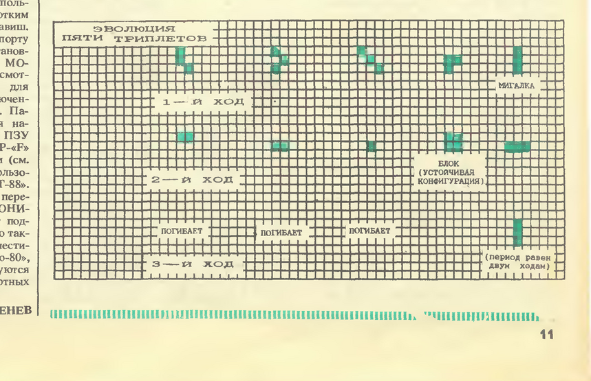
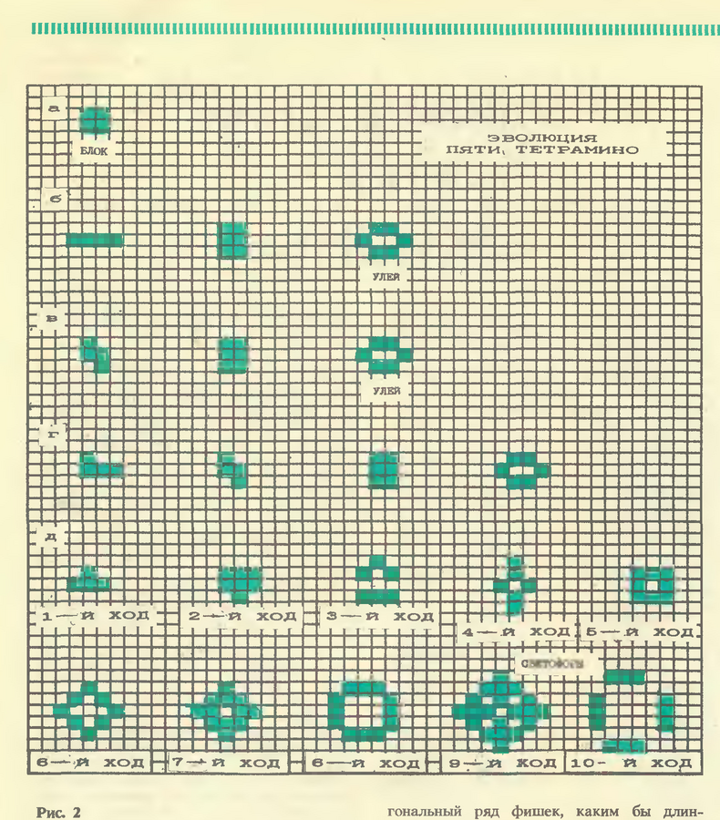
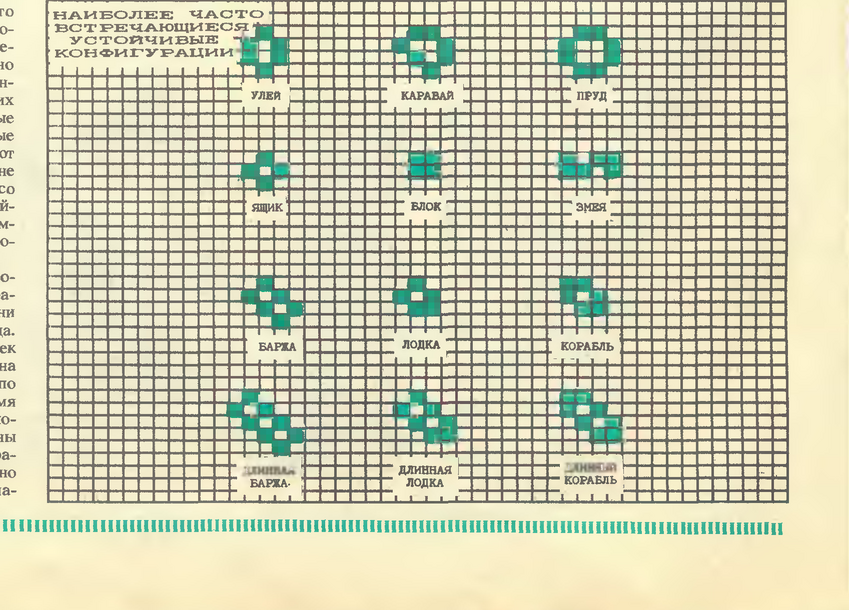
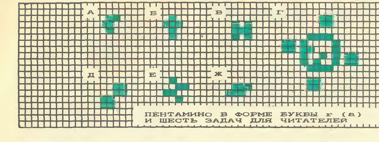
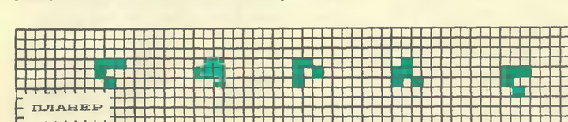
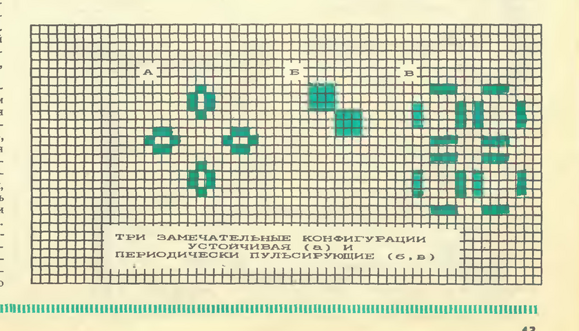
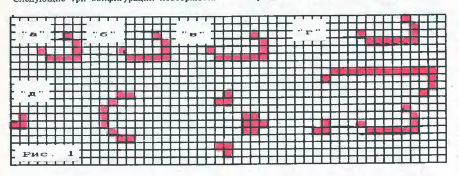
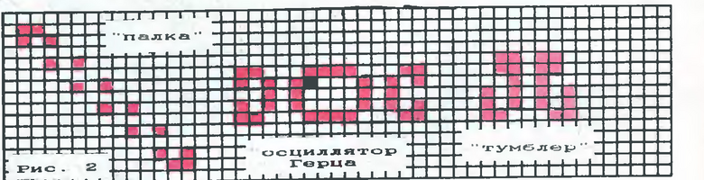
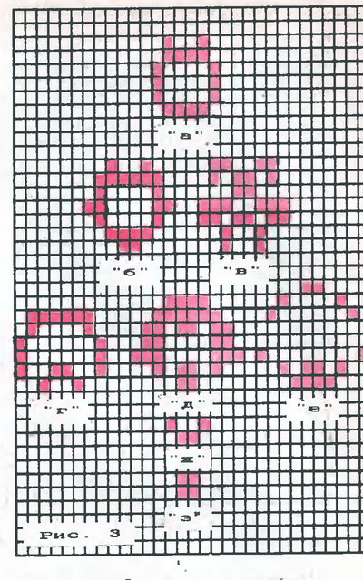
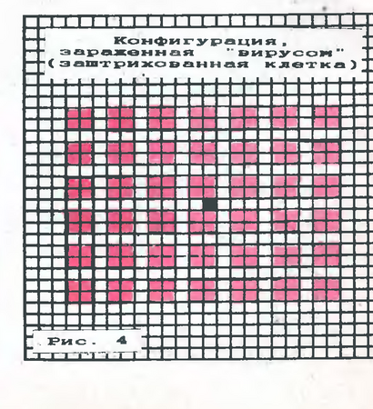

# 41. Удивительная игра «Жизнь»

*Источник: «ЮТ для умелых рук» 1989-08, с. 11–13 (начало) и 1989-10, с. 14
(продолжение), рубрика «Игры программиста». Автор — М. Колтовой. Программы для «ЮТ-88»
в статье нет: в конце предлагается составить её самим.*

## Правила

Это, пожалуй, одна из самых интересных математических игр. Придумал её двадцать лет назад
американский математик Конуэй. Своё название — «жизнь» — игра получила не случайно.
Законы и правила, которым она подчиняется, очень похожи на реальные процессы,
происходящие при зарождении, развитии и гибели колоний простейших микроорганизмов.

Для игры вам понадобится большая клетчатая доска или расчерченный на клетки лист бумаги и
плоские двухцветные фишки. Идея игры в том, что, начав с какого-нибудь простого
расположения фишек, надо проследить за эволюцией исходной позиции, изменяющейся под
действием «генетических законов». Они управляют рождением, гибелью и выживанием фишек.
Законы эти очень просты:

1. **Выживание.** Каждая фишка, имеющая две или три соседние фишки, выживает и переходит
   в следующее поколение.
2. **Гибель.** Каждая фишка, у которой больше трёх соседей, погибает (снимается с доски)
   из-за перенаселённости. Каждая фишка, вокруг которой свободны все соседние клетки или
   занята всего одна клетка, погибает от одиночества.
3. **Рождение.** Если число фишек, с которыми граничит какая-нибудь пустая клетка, в
   точности равно трём (не больше и не меньше), то на этой клетке происходит рождение
   нового «организма» — следующим ходом на неё ставится ещё одна фишка.

Заметим, что каждую клетку доски (она считается бесконечной) окружают восемь соседних
клеток: четыре имеют с ней общие стороны, а четыре другие — общие вершины.

Гибель и рождение организмов происходят одновременно. Вместе взятые, они образуют одно
поколение, или, иначе говоря, один ход в эволюции начальной конфигурации. Сама начальная
конфигурация считается первым ходом.

Ходы лучше всего делать следующим образом:

1. начните с конфигурации, целиком состоящей из чёрных фишек;
2. определите, какие фишки должны погибнуть, и положите на каждую из них по одной чёрной
   фишке;
3. найдите все свободные клетки, на которых должна родиться новая фишка, и положите на
   них фишки белого цвета.

Проделав все эти операции, проверьте, не сделали ли вы ошибок, и только после этого
снимите с доски все погибшие фишки (столбики из двух фишек), а все родившиеся замените
чёрными.

Проделав все операции, вы получите первое поколение в эволюции первоначальной
конфигурации. Аналогичным образом получаются и все последующие поколения. Теперь вам,
наверное, стало понятно, почему нужны фишки двух цветов: поскольку рождение и гибель
«организмов» происходят одновременно, новорождённые фишки никак не влияют на гибель и
рождение остальных фишек. Поэтому, проверяя новую конфигурацию, необходимо отличить их
друг от друга. Допустить ошибку здесь очень легко.

## Простые конфигурации

Вы получили первое поколение в эволюции первоначальной конфигурации. Таким же способом
получаются и все последующие поколения.

Начав игру, вы сразу заметите, что популяция всё время претерпевает необычные, нередко
очень красивые изменения. Иногда колония организмов медленно вымирает, и фишки исчезают
постепенно. Происходит это после смены многих поколений. В большинстве случаев исходные
конфигурации либо переходят в устойчивые и перестают изменяться, либо обретают
колебательный режим. Конфигурации, не обладавшие в начале игры симметрией, со временем
приобретают её. И в дальнейшем это свойство не утрачивается, симметрия конфигурации может
лишь обогащаться.

Теперь давайте рассмотрим, что происходит с некоторыми простыми конфигурациями. Одна или
две фишки, где бы они ни стояли, погибают после первого же хода. Исходная конфигурация из
трёх фишек (триплет) тоже, как правило, погибает. Она выживает только в том случае, если,
по крайней мере, одна фишка граничит с двумя занятыми клетками. Пять триплетов, не
погибающих на первом же ходу, показаны на рисунке 1. Первые три конфигурации (а, б, в)
гибнут на втором. Относительно конфигурации «в» заметим, что любой диагональный ряд
фишек, каким бы длинным он ни был, с каждым ходом теряет стоящие на его концах фишки и в
конце концов исчезает. Конфигурация «г» на втором ходу переходит в устойчивую — «блок»
размером 2×2. Конфигурация «д» служит простейшим примером так называемых
«флип-флопов» — кувыркающихся конфигураций, возвращающихся в исходное состояние через
каждые два хода. Она попеременно превращается то в вертикальный, то в горизонтальный ряд
из трёх фишек.

*Рис. 1. Эволюция пяти триплетов: три погибают, «г» становится блоком (устойчивая
конфигурация), «д» — мигалка (период равен двум ходам).*

На рисунке 2 показано пять четырёхклеточных конфигураций (тетрамино), связанных между
собой ходом ладьи. Как видите, блок «а» представляет собой устойчивую конфигурацию.
Конфигурации «б» и «в» переходят в устойчивые на третьем ходу. Называется она «ульем» и
встречается очень часто. Тетрамино «г» тоже превращается в улей, но на четвёртом ходу.
Особенно интересно тетрамино «д», которое только после девятого хода распадается на
четыре отдельные «мигалки» (потому и называется конфигурация «навигационные огни»). Они
относятся к разряду «флип-флопов» и возникают довольно часто. Для того чтобы лучше
усвоить правила игры, попробуйте разыграть на своей доске эволюцию всех пяти тетрамино,
не заглядывая в наш рисунок. Если вы не допустили ни одной ошибки, то можно идти дальше.

*Рис. 2. Эволюция пяти тетрамино (ходы 1–10): блок, ульи, «светофор» (навигационные
огни).*

*Рис. 3. Наиболее часто встречающиеся устойчивые конфигурации: улей, каравай, пруд,
ящик, блок, змея, баржа, лодка, корабль, длинная баржа, длинная лодка, длинный корабль.*

## Пентамино

Теперь предлагаем вам поэкспериментировать с двенадцатью фигурами, состоящими из пяти
клеток (пентамино), связанных между собой так, что их можно обойти ходом ладьи, и
посмотреть, во что они превращаются. Оказывается, пять из них на шестом ходу погибают,
две превращаются в устойчивые конфигурации из семи клеток, а четыре после небольшого
числа ходов — в «навигационные огни». Исключение — элемент пентамино в форме буквы «г»
(рис. 4 «а»), эволюция которого идёт довольно долго. Лишь после четыреста шестьдесят
первого хода эта конфигурация распадается на множество «планеров». После сорока девяти
ходов г-образное пентамино превращается в фигуру, левая часть которой состоит из семи
фишек, а правая — из фишек, заполняющих две симметричные области. Если бы левой части не
было, эти области превратились бы в «пасеку» с четырьмя «ульями» и «навигационные огни».
Но её наличие приводит к тому, что «пасека» как бы вгрызается в «навигационные огни», и
они гаснут один за другим, оставляя после себя беспорядочные конфигурации. А через
четыреста с лишним ходов, как уже было сказано, превращаются в множество «планеров»
(тоже очень любопытная конфигурация, но о ней немного позже). Если у вас хватит терпения,
попробуйте проследить эволюцию этого пентамино хотя бы до шестидесятого хода, и вы
увидите множество интереснейших комбинаций.

Ну а для упражнений попроще предлагаем проследить до конца эволюцию шести пентамино на
рисунке 4 — «латинского креста» (б), «буквы Н» (в), «вертушки» (г), «бакена» (д),
«часов» (е) и «жабы» (ж). Здесь вас тоже ждут сюрпризы. Например, подняв у «буквы Н»
перекладину и превратив её в П, можно наблюдать следующие неожиданные изменения. В
отличие от «буквы Н», эволюция которой заканчивается быстро, «буква П» лишь после 174
ходов распадается на 5 «мигалок», 6 «блоков» и 2 «пруда».

*Рис. 4. Пентамино в форме буквы «г» (а) и шесть задач для читателей (б–ж).*

## «Планер» и скорость света

Одна из самых удивительных конфигураций — «планер» (см. рис. 5). На третьем ходу он
сдвигается вниз и отражается относительно диагонали. После двух следующих ходов «планер»
«выходит из пике», ложится на прежний курс и сдвигается на одну клетку вниз и вправо
относительно начальной позиции. Исследования показали, что большая скорость
передвижения, чем та, с которой шахматный король перемещается по доске за один ход, ни
для одной конфигурации недостижима. Поэтому она получила в игре «Жизнь» название
скорости света. Пользуясь этим термином, можно, например, сказать, что диагональный ряд
фишек, показанный на рисунке 1 «в», распадается с концов со скоростью света, а поскольку
«планер» переходит сам в себя после четырёх ходов и при этом опускается на одну клетку
по диагонали, выходит, что он скользит по полю со скоростью, равной одной четвёртой
скорости света.

*Рис. 5. «Планер».*

Конуэю удалось доказать, что скорость любой конечной фигуры, перемещающейся по вертикали
и горизонтали, не может превышать половину скорости света. Попробуйте сами отыскать
такую фигуру, которая двигалась бы с такой скоростью. Напомним, что скорость движения
равна дроби, в числителе которой стоит число сделанных вами ходов для воспроизведения
фигуры, а в знаменателе — число клеток, на которое она при этом смещается. Если
какая-нибудь фигура каждые четыре хода передвигается на две клетки по горизонтали или
вертикали, повторяя при этом свою форму и ориентацию (как «планер»), скорость такой
фигуры будет равна половине скорости света. Надо сказать, что поиск подобных фигур —
дело нелёгкое. До недавнего времени их было известно всего четыре. В том числе и
«планер». Попробуйте найти остальные три. Намекнём, эти конфигурации состоят из большего
числа фишек, а по форме слегка напоминают «планер». Делать это лучше всего на большом
листе бумаги с игровым полем 150×150 клеток. Может быть, вам удастся отыскать ещё
какие-нибудь конфигурации, которые, периодически повторяясь, перемещаются по доске в
любых направлениях и с любой скоростью, даже очень маленькой. Ну а тем, у кого не
получилось, придётся подождать до выхода октябрьского номера приложения.

*Прим.: определение скорости в журнале дано «наоборот» (ходы в числителе, клетки в
знаменателе); по смыслу — клетки за ход.*

## Ещё три фигуры

Вот ещё три изящные фигуры (рис. 6). «Пасека» (а) является устойчивой конфигурацией,
которая после 14 ходов переходит в горизонтальный ряд из 7 фишек. Квадрат размером 5×5
после первого хода переходит в конфигурацию, которая может возникнуть лишь на четвёртом
этапе эволюции семиклеточного ряда. Поэтому квадрат 5×5 становится «пасекой» после 11
ходов. «Восьмёрка» (б) — периодически восстанавливающаяся конфигурация. Она не только по
форме напоминает восьмёрку, но и имеет период, равный восьми. Конфигурация «в»
называется «пульсар CP 48-56-72». Она также периодически восстанавливает себя через
каждые три хода. Состояние пульсара, показанное на нашем рисунке, образовано 48 фишками,
на следующем ходу их будет уже 56, 72, затем «пульсар» вновь вернётся в исходное
состояние, и число фишек сократится до 48. Интересно, что такой пульсар образуется из
семи фишек, расставленных в виде растянутой буквы П: горизонтального ряда из пяти фишек,
у которого под первой и последней фишками расположено ещё по одной. Образуется пульсар
из такой фигуры после 32 ходов.

*Рис. 6. Три замечательные конфигурации: устойчивая (а) и периодически пульсирующие
(б, в).*

Правила игры, как вы уже заметили, несложны и легко поддаются переводу на языки
программирования. Поэтому, если у вас есть такая возможность, составьте программу.
Играть на компьютере будет очень просто и удобно.

## Продолжение (1989-10)

Начнём с задач, опубликованных в позапрошлом номере приложения (см. с. 13, рис. 4). Вот
ответы. Конфигурация «латинский крест» погибает на пятом ходу, а буква «Н» — на шестом.
Следующие три конфигурации повторяются каждые два хода. Самым сложным можно считать
пентамино в форме буквы «г» — оно превращается в устойчивое образование только после
тысяча сто третьего хода. Интересно, смог ли кто-нибудь из вас решить последнюю задачу,
не прибегая к помощи компьютера?

Ещё мы предлагали найти три фигуры, передвигающиеся по тем же законам, что и «планер»
(с. 13, рис. 5). На рисунке 1 даны ответы. Это «космические корабли» — «лёгкого» («а»),
«среднего» («б») и «тяжёлого» («в») типов. Все они передвигаются горизонтально слева
направо со скоростью, равной половине «скорости света», принятой в игре «Жизнь». Во
время полёта из «космических кораблей» вылетают «искры», которые «гаснут» после
нескольких ходов. Одиночные «космические корабли» без эскорта не могут быть более шести
клеток, так как во время полёта на поле начинают появляться разные мелкие конфигурации,
мешающие движению. Конуэй установил, что более длинным «космическим кораблям» во время
полёта необходим эскорт из двух и более кораблей меньшего размера, который «расчищает»
дорогу своему флагману. И чем тот длиннее, тем более многочисленный эскорт ему
требуется. Например, флагману в сто клеток необходим эскорт из тридцати трёх
«кораблей»!

На рис. 1 «г» показан сверхтяжёлый «космический корабль», для которого достаточно эскорта
из двух «кораблей». Любопытна конфигурация, показанная на этом же рисунке («д»). Она
превращается со временем в своего рода «ружьё», выстреливающее через сорок ходов
«планер» и затем через каждые тридцать ходов следующий. И так до бесконечности. С
появлением каждого «планера» число фишек на поле увеличивается на пять, и в результате
популяция растёт.

*Рис. 1 (1989-10). «Космические корабли»: лёгкий (а), средний (б), тяжёлый (в),
сверхтяжёлый с эскортом (г) и «ружьё» (д).*

Приведём ещё несколько любопытных периодически воспроизводящихся конфигураций (см.
рис. 2). Первая называется «палка». Относится она к кувыркающимся образованиям
(«флип-флопам») и имеет период, равный двум ходам. Интересно, что её можно растягивать до
бесконечности. Вторая конфигурация — «осциллятор Герца» — занимательна тем, что после
каждых четырёх ходов тёмная клетка в центре перемещается внутри рамки, напоминающей
экран, к противоположной стороне. Период этой конфигурации равен восьми ходам. Третья
конфигурация получила название «тумблер» — каждые семь ходов у неё меняются местами верх
и низ, она как бы переключается.

*Рис. 2 (1989-10). «Палка», «осциллятор Герца», «тумблер».*

А вот ещё одна конфигурация — «Чеширский кот» (рис. 3). После ходов «а», «б», «в» и «д»
от мордочки кота, как в сказке Льюиса Кэрролла «Алиса в Стране Чудес», остаётся лишь
улыбка («е»). После следующего хода она исчезает, оставляя после себя отпечаток кошачьей
лапы («з»), напоминающий, что на этом месте некогда был сам Чеширский кот.

*Рис. 3 (1989-10). «Чеширский кот».*

На рис. 4 изображена конфигурация, заражённая «вирусом» (тёмная клетка в центре). Если
клетка касается одновременно вершин любых четырёх блоков, то конфигурация уничтожает
«вирус» и через два хода принимает прежний вид. Но когда «вирус» расположен так, как
показано на рисунке, конфигурация быстро распадается. Попробуйте определить, при каких
условиях одиночная фишка-«вирус» становится «смертельной».

*Рис. 4 (1989-10). Конфигурация, заражённая «вирусом» (заштрихованная клетка).*
