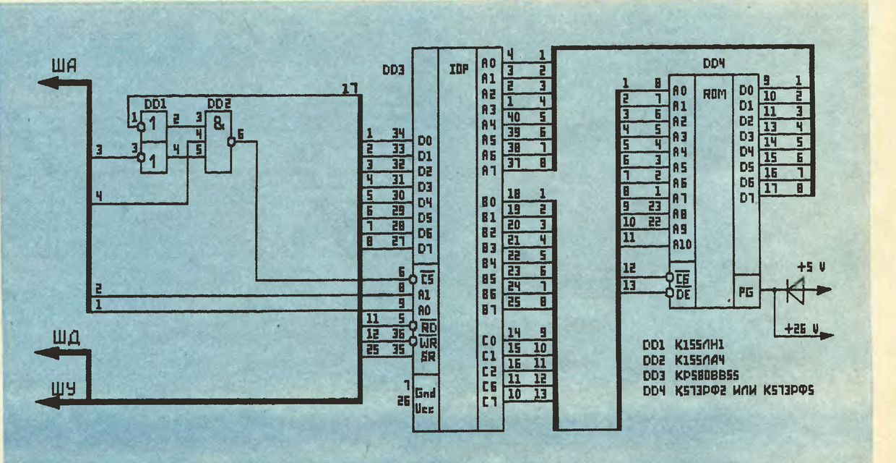

# 42. Программатор ПЗУ «ЮТ-88»

*Источник: «ЮТ для умелых рук» 1990-05, с. 12–13, рубрика «Твой персональный компьютер».
Автор — В. Г. Бартенев. Дамп программы — с. 13; готовые файлы —
[programs/programmator.hex](../programs/programmator.hex) и `programmator.bin`.*

По просьбе читателей предлагаем описание приставки к компьютеру «ЮТ-88» для
программирования микросхем ПЗУ. Она позволит вам, не прибегая к посторонней помощи,
записать в микросхемы ПЗУ любые программы.

В радиолюбительской практике используются микросхемы репрограммируемых ПЗУ с
ультрафиолетовым стиранием К573РФ2 и К573РФ5. Именно для них и предназначен
программатор. Приставка очень проста в изготовлении и через разъём легко подключается к
шинам данных, адреса и управления компьютера «ЮТ-88».

Схема программатора приведена на рисунке. В основу её работы положено использование
аппаратно-программных средств микросхемы параллельного интерфейса КР580ВВ55. Как вы
помните, при рассмотрении директив МОНИТОРА дисплейного модуля мы говорили о том, что в
нём имеется специальная директива «R», предназначенная для чтения данных из
вспомогательного интерфейса. Таким вспомогательным интерфейсом в нашем компьютере и
является микросхема DD3. А микросхемы DD1 и DD2 используются для формирования сигнала
выборки её кристалла.



*Схема программатора: DD1 — К155ЛН1, DD2 — К155ЛА4, DD3 — КР580ВВ55, DD4 — К573РФ2 или
К573РФ5. Через КР580ВВ55 к ПЗУ подключены данные D0–D7, адрес A0–A10 и сигналы
управления; на вывод 21 ПЗУ подаётся +26 В.*

## Проверка и ввод программы

После сборки и монтажа приставки первым делом следует проверить, как выполняется
директива «R». Для этого в панель приставки вставьте незапрограммированную микросхему и
на клавиатуре компьютера наберите: `R,7FF,1000` ВК, то есть перепишите всё содержимое
ПЗУ в ОЗУ. При правильной работе приставки всё адресное пространство ОЗУ от 1000H до
17FFH заполнится кодом FFH, в чём можно будет убедиться с помощью директивы
`D1000,17FF` ВК. Есть и другой способ — измерьте контрольную сумму с помощью директивы
`K1000,17FF` ВК. Она должна равняться F800H.

Затем с помощью директивы «M» набейте коды программы по приведённой таблице. Контрольная
сумма программы равна **62B9H**. Программу запишите на магнитофон. Копируется она в
адреса 2000H–27FFH с помощью директивы `T,7FF,2000` ВК для её последующей записи в ПЗУ.
Запуск программы производится директивой `G100`, в результате на экране дисплея появится
заголовок и меню:

```
ПРОГРАММАТОР ПЗУ 573РФ2-РФ5

ПЕРЕЧЕНЬ КОМАНД :
 R - ЧТЕНИЕ
 W - ЗАПИСЬ
 E - ВЫХОД В МОНИТОР

КОМАНДА >
```

*Прим.: в журнале меню показано сокращённо («ПРОГРАММАТОР ПЗУ «ЮТ-88»», «R — ЧТЕНИЕ,
W — ЗАПИСЬ, E — ВЫХОД В МОНИТОР»); выше — тексты, как они записаны в самой программе
(адреса 03D6H–0461H, в коде КОИ-7: строчные латинские буквы выводятся русскими).*

*Прим.: сумма 62B9H — это контрольная сумма директивы «K» МОНИТОРА-«F» (алгоритм
«Радио-86РК»: старший байт суммируется без последнего байта и с переносами). Простая
16-битная сумма байт 0100H–054FH (директива «8» МОНИТОРА-«0») равна A9B9H — младшие
байты совпадают. Расчёт по переписанному дампу дал ровно 62B9H.*

## Работа с программой

Дальнейшая работа идёт в диалоговом режиме. Если задать команду R, то появится
сообщение: РЕЖИМ ЧТЕНИЯ ЗАДАЙТЕ НАЧАЛЬНЫЙ АДРЕС ОЗУ.

Если задать адрес, например, 1000, на экране появится контрольная сумма
незапрограммированной ПЗУ F800.

Если задать команду W, перейдём в режим программирования:

```
РЕЖИМ ЗАПИСИ
ЗАДАЙТЕ НАЧАЛЬНЫЙ АДРЕС ОЗУ
```

Допустим, мы хотим запрограммировать первую микросхему ПЗУ, записав в неё программу
программатора. Для этого укажите адрес 2000, куда она была скопирована. На экране
появится текст:

```
ВКЛЮЧИТЕ НАПРЯЖЕНИЕ +26 ВОЛЬТ
```

При программировании микросхем ПЗУ подаётся напряжение +24…26 В на вывод 21. Между
выводом 21 микросхемы и источником напряжения обязательно надо включить
токоограничивающий резистор сопротивлением 200–300 Ом, в противном случае микросхема ПЗУ
может быть испорчена. Подключив источник, нажмите кнопку ВК. Начинается процесс
программирования, который завершится появлением сообщения:

```
ВЫКЛЮЧИТЕ НАПРЯЖЕНИЕ +26 ВОЛЬТ
```

Выполнив команду и нажав клавишу ВК, вы опять вызываете меню. Для проверки правильности
программирования микросхемы ПЗУ считайте её содержимое с помощью директивы «R» и
убедитесь в правильности контрольной суммы. Учитывая, что программа занимает меньше двух
килобайт, контрольная сумма совпадёт, если во всех остальных ячейках записаны нули.
Однако для дальнейшего использования оставшегося пространства в микросхеме ПЗУ советуем
заполнить его кодом FFH.

Во время программирования происходит проверка каждой ячейки памяти ПЗУ. Если данные в
ПЗУ и ОЗУ не совпадают, на экране появляется символ `#`, сигнализирующий, что необходимо
прервать процесс программирования и отключить напряжение.

Информация для записи в ПЗУ может размещаться в любом месте адресного пространства
компьютера, кроме области 0000H–04FFH.

## Замечания по программе

- Программа занимает 0100H–0545H (в дампе — до 054FH, хвост заполнен нулями) и
  использует ячейки 0568H–0569H (указатель) и буфер ввода с 056AH. Поэтому для неё нужно
  ОЗУ с адреса 0000H — модуль дополнительного ОЗУ 64 Кбайт (1989-11) — и дисплейный
  модуль: ввод и вывод идут через подпрограммы МОНИТОРА-«F» F803H (ввод символа) и F809H
  (вывод символа).
- Порты КР580ВВ55 программатора: F8H — порт A (данные), F9H — порт B (младший байт
  адреса), FAH — порт C (старшие разряды адреса и управление), FBH — регистр управления.
- Программируется всегда 2 Кбайт (0800H байт) с указанного адреса ОЗУ.
- Команды «C» и «P» в программе распознаются, но ведут на адрес 0000H (заготовка); по
  «E» выполняется переход в МОНИТОР-«F» (F800H).
