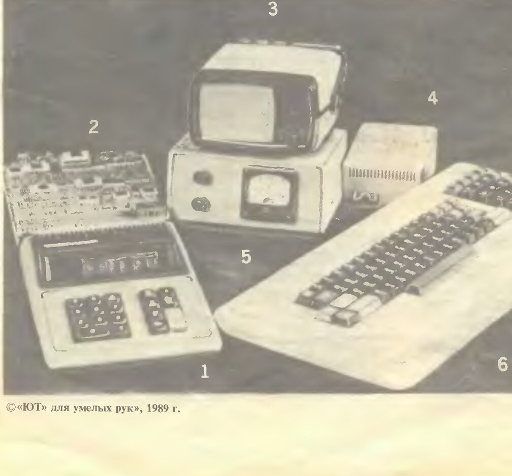

# Персональный компьютер «ЮТ-88». Модуль 1: микроЭВМ минимальной конфигурации

Текстовая версия публикации из журнала **«ЮТ» для умелых рук», № 2, 1989**
(приложение к журналу «Юный техник»). Исходный скан лежит рядом:
[`ЮТ для умелых рук 1989-02.djvu`](ЮТ%20для%20умелых%20рук%201989-02.djvu).

Компьютер разработан в кружке радиоэлектроники Раменского Дома пионеров под
руководством кандидата технических наук **В. Бартенева** по заказу редакции
«Юного техника».

*1 — процессорный модуль; 2 — дисплейный модуль; 3 — дисплей;
4, 5 — блоки питания процессорного и дисплейного модулей; 6 — клавиатура.*

## Содержание

| Файл | О чём |
|------|-------|
| [01-vvedenie.md](01-vvedenie.md) | Вступление редакции, «Детали о деталях», идея модульного компьютера |
| [02-arhitektura.md](02-arhitektura.md) | Структура микроЭВМ, шины, сигналы управления, шестнадцатеричная система, карта памяти и портов |
| [03-istochnik-pitaniya.md](03-istochnik-pitaniya.md) | Блок питания +5 В, +12 В, −5 В |
| [04-elektricheskaya-shema.md](04-elektricheskaya-shema.md) | Принципиальная схема: процессор, ПЗУ/ОЗУ, индикация, клавиатура, магнитофон |
| [05-programmirovanie.md](05-programmirovanie.md) | Программное обеспечение, правила использования команд КР580, способы адресации, первый пример |
| [06-monitor.md](06-monitor.md) | Программа МОНИТОР: директивы, вспомогательные программы, часы, подпрограммы, дамп ПЗУ |
| [07-programmy.md](07-programmy.md) | Примеры и игры: заполнение памяти константой, «Реакция», «Гамма», «Крестики-нолики», «Лабиринт» |
| [08-sborka-i-nalazhivanie.md](08-sborka-i-nalazhivanie.md) | Сборка платы и пошаговая отладка |
| [09-kr580vm80a.md](09-kr580vm80a.md) | Справочный листок: микропроцессор КР580ВМ80А |
| [10-sistema-komand.md](10-sistema-komand.md) | Полная таблица команд КР580ВМ80А (вкладка журнала) |

## Краткие характеристики модуля 1

| Параметр | Значение |
|----------|----------|
| Процессор | КР580ВМ80А (аналог Intel 8080), тактовый генератор КР580ГФ24, кварц 16 МГц (такт 2 МГц) |
| ПЗУ | 1 Кбайт, 0000H–03FFH, 2 × КР556РТ5: программа МОНИТОР |
| ОЗУ | 1 Кбайт, C000H–C3FFH, 2 × КР541РУ2 |
| Дисплей | 6 семисегментных индикаторов: ячейки памяти 9000H, 9001H, 9002H |
| Клавиатура | 17 кнопок: 0–F и «ШАГ НАЗАД», плюс кнопка «УСТ» (сброс); порт A0H |
| Магнитофон | 1 бит, порт A1H, двухфазное кодирование, 1500 бит/с, формат совместим с «Микро-80» и «Радио-86РК» |
| Часы | прерывание RST 7 раз в секунду от К176ИЕ5 (кварц 32768 Гц) |
| Питание | +5 В / 1 А, +12 В / 50 мА, −5 В / 5 мА |

## Принципиальная схема

Принципиальная схема модуля напечатана на вкладке (две страницы скана). Перерисовать её
текстом без потерь нельзя, поэтому она приложена изображениями:

- [img/schematic-part1.jpg](img/schematic-part1.jpg): левая половина (процессор, буферы, ПЗУ, тактовый генератор, часы);
- [img/schematic-part2.jpg](img/schematic-part2.jpg): правая половина (ОЗУ, индикация, клавиатура, магнитофон).

Подробное словесное описание схемы см. в [04-elektricheskaya-shema.md](04-elektricheskaya-shema.md).

## Связанные файлы репозитория

- [`../monitor/`](../monitor/): дизассемблированный МОНИТОР (`monitor.asm`, `monitor.lst`),
  бинарные образы ПЗУ (`monitor.bin` — как в журнале, `monitor-fixed.bin` — с исправлением)
  и фотографии дампа.

## Примечания к текстовой версии

- Текст получен из текстового слоя DjVu и вычитан по изображениям страниц. Опечатки
  оригинала, которые явно мешают пониманию, исправлены и отмечены в тексте как
  «*Прим.*».
- Листинги программ переписаны по изображениям страниц, а не по распознанному тексту.
- Справочный листок и таблица команд в журнале частично дублируют друг друга; здесь они
  сведены в файлы 09 и 10.
- Выходные данные номера: главный редактор В. В. Сухомлинов, редактор приложения
  В. А. Заворотов. Сдано в набор 26.12.88, подписано в печать 17.01.89. Тираж 1 200 000 экз.
  Цена 20 коп., индекс 71123.
